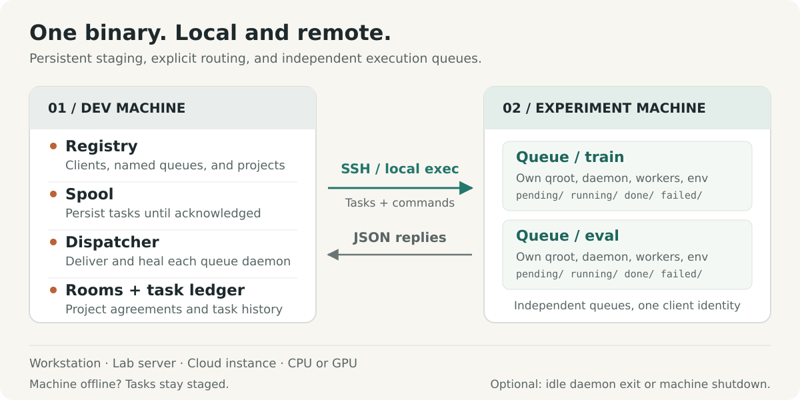
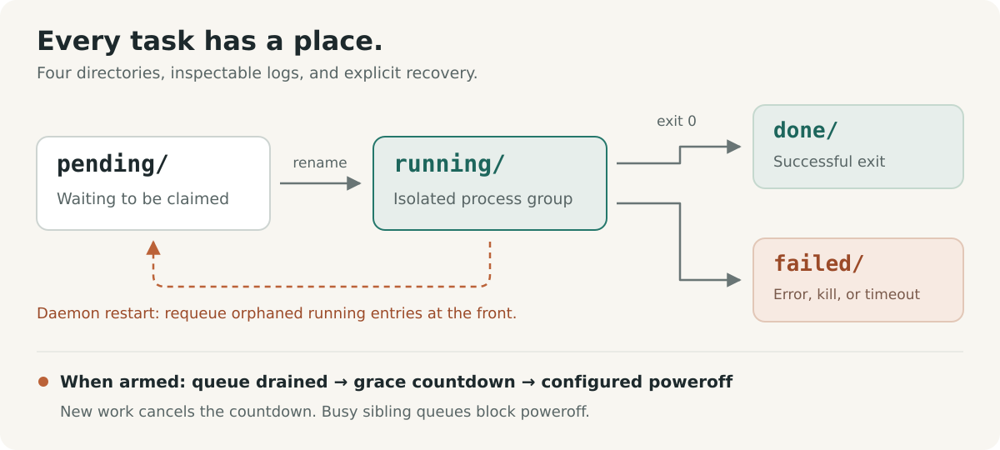

# shunt

**English** · [Français](docs/readme/fr/README.fr.md) · [Deutsch](docs/readme/de/README.de.md) · [Italiano](docs/readme/it/README.it.md) · [日本語](docs/readme/ja/README.ja.md) · [Español](docs/readme/es/README.es.md) · [한국어](docs/readme/ko/README.ko.md) · [简体中文](docs/readme/zh-CN/README.zh-CN.md) · [繁體中文](docs/readme/zh-TW/README.zh-TW.md) · [Русский](docs/readme/ru/README.ru.md) · [Bahasa Indonesia](docs/readme/id/README.id.md) · [Português (BR)](docs/readme/pt-BR/README.pt-BR.md)

[Translation status](docs/readme/README.md): all listed editions are complete translations with localized diagrams.


<p align="center">
  <strong>Run experiments. Coordinate compute.</strong><br>
  An experiment operations layer for humans and AI agents, from local workstations to remote servers.
</p>

<p align="center">
  <a href="Cargo.toml"></a>
  
  <a href="docs/design.md#5-wire-protocol"></a>
  <a href="LICENSE"></a>
</p>

<p align="center">
  <a href="#quick-start">Quick start</a> ·
  <a href="#how-it-works">Architecture</a> ·
  <a href="#coordinate-shared-compute">Coordination</a> ·
  <a href="#built-for-agents">Agent guide</a> ·
  <a href="docs/design.md">Design spec</a> ·
  <a href="#contributing">Contributing</a>
</p>

Experiments span projects, machines, environments, and long-running sessions. shunt brings that work into one CLI: register machines, bind projects to queues, stage and run tasks, inspect their results and resource use, and coordinate the people and agents sharing compute.

Use the same workflow on a local workstation, a lab server, or a cloud CPU or GPU instance. One Rust binary runs on both sides, with SSH for remote machines and direct process execution locally. Tasks, logs, and queue state live on disk. Billing metadata and idle shutdown are optional tools for machines that need them.

## Why shunt

| When you need to…                        | shunt gives you…                                                                                                                                   |
| ---------------------------------------- | -------------------------------------------------------------------------------------------------------------------------------------------------- |
| **Work across machines and projects**    | A TOML registry, many-to-many project bindings, per-binding working directories and environments, and SSH or local transport.                      |
| **Separate workflows on one machine**    | Named queues with independent directories, daemons, worker pools, shells, and environment setup under one client identity.                         |
| **Submit before a machine is reachable** | A persistent dev-side spool. The dispatcher delivers when the machine returns and revives a stopped queue daemon before pushing.                   |
| **Keep experiments moving**              | Concurrent workers, FIFO claim order, manual priority, live pool resizing, task timeouts, and opt-in bounded rescheduling for resource contention. |
| **Learn what a run actually used**       | Machine and GPU availability, per-task RAM and VRAM peaks, CPU time, and declared resource estimates alongside measured usage.                     |
| **Coordinate shared compute**            | Project coordination rooms with unread tracking, recorded agreements, conversation digests, and archiving.                                         |
| **Recover and inspect**                  | At-least-once execution, orphan recovery, artifact guards, delivery deduplication, task logs, a submission ledger, and event streams.              |
| **Operate through an agent**             | The same CLI with JSON status, JSONL task listings, an included operating skill, and a persistent feedback channel.                                |

Machine controls include managed SSH execution, bootstrap and upgrade, an optional reverse SOCKS5 proxy, daemon exit on drain, and opt-in idle shutdown. Shared machines can explicitly refuse server-side poweroff arming.

## Quick start

### 1. Install

Use Linux with a stable Rust toolchain, a system linker, and Bash. Remote operation also needs OpenSSH tools (`ssh`, `scp`, and `ssh-keygen`) on the dev machine.

```bash
curl -fsSL https://raw.githubusercontent.com/ShinoharaHaruna/shunt/main/install.sh | sh
shunt --help
```

The script installs the latest release binary (static musl build, dashboard included) into `~/.local/bin`; pass `--gnu` for the dynamic-linked build, `--dir` for a different location, or `uninstall` to remove the binary. For a Rust toolchain source build instead:

```bash
git clone https://github.com/ShinoharaHaruna/shunt.git
cd shunt
cargo install --path . --locked
shunt --help
```

### 2. Try the queue locally

The built-in `localhost` client uses the same CLI protocol through local process execution. You can try the full spool → dispatcher → queue path without SSH or a GPU:

```bash
# The task creates a completion marker in the local queue directory.
shunt submit -c localhost --slug hello --guard hello.done -- touch hello.done
shunt dispatch --once
shunt status -c localhost --json
shunt logs -c localhost hello

# When finished experimenting, drain the local daemon and exit.
shunt stop --root ~/.config/shunt/queue
```

Execution is asynchronous: repeat `status` or `logs` after a moment to see the result. The default local queue is `~/.config/shunt/queue/`; this demo leaves `hello.done` there, so repeating it skips the completed task. `stop` drains the daemon's running tasks; idle shutdown is a separate, opt-in operation.

### 3. Connect an experiment machine

Run these commands on your dev machine for an already-reachable Linux server. Replace the example paths with directories you own on that machine. This setup reuses an authorized SSH key and treats the server as shared:

```bash
shunt client add lab --template generic \
    --key ~/.ssh/id_ed25519 --deploy-root /path/you/own \
    --qroot /path/you/own/shunt-queue \
    --shared --exit-on-idle --expire unlimited

# Fill in ssh.host, ssh.port, and ssh.user for your server.
${EDITOR:-vi} ~/.config/shunt/clients/lab.toml

shunt client bootstrap lab

shunt project add experiments
shunt project bind experiments --client lab \
    --workdir /path/to/experiments --env OMP_NUM_THREADS=4 --env MKL_NUM_THREADS=4
```

`--shared` blocks server-side idle-shutdown arming; `--exit-on-idle` lets the queue daemon exit after draining and be revived by the next dispatch. Omit those flags when you want a dedicated machine with a resident daemon. `expire = "unlimited"` describes an owned or lab machine; cloud machines can instead use `"metered"` or a subscription deadline, with optional billing rates.

Bootstrap installs the binary under the queue root, checks runtime compatibility, initializes the queue, starts the daemon, and probes machine facts. It can fetch a matching static release when the local build requires a newer glibc; other architectures or unreleased builds may need an explicit `--bin-path`. See [binary compatibility](docs/design.md#15-binary-compatibility-at-bootstrap).

For a dedicated cloud instance, vendor templates such as `--template autodl` seed deployment defaults. Without `--key`, shunt generates a dedicated keypair: install its public key yourself, or configure `ssh.password` and install `sshpass` for password-assisted deployment on a dedicated machine. Shared clients skip automatic key deployment.

The binding's `workdir` must already contain your code, data, and runtime environment. Bootstrap deploys shunt; project binding records where your experiments run.

### 4. Submit and inspect an experiment

Assuming your `train.py` writes `runs/exp1/metrics.json` on successful completion:

```bash
shunt submit -p experiments -c lab --slug exp1 \
    --guard runs/exp1/metrics.json --timeout 14400 -- \
    uv run python train.py --out runs/exp1

shunt dispatch --once               # deliver the current spool
shunt status -c lab --json           # inspect queue state and resource use
shunt logs -c lab exp1               # inspect the task log
```

Keep `shunt dispatch` running in a separate dev-machine terminal for continuous delivery, including tasks submitted while a machine is offline. After delivery, the machine's own queue daemon runs the task independently of the dispatcher or the submitting terminal.

`--timeout 14400` sets a four-hour wall-clock limit for this task. `--guard` checks a path relative to the binding's `workdir` and skips execution if it already exists. `uv` and `train.py` are example workload dependencies; use the command your project needs.

## How it works



The name comes from railway shunting. Your dev machine is the marshalling yard; each experiment machine is a destination siding. A **client** is a registered machine; a **queue** is one execution lane on it; a **project binding** supplies the working directory and environment for a `(client, queue)` pair.

| On your dev machine                                                                                  | On each experiment machine                                                                       |
| ---------------------------------------------------------------------------------------------------- | ------------------------------------------------------------------------------------------------ |
| **Registry** — editable TOML for clients, queues, projects, bindings, and optional billing.          | **Queues** — task directories under `pending/`, `running/`, `done/`, and `failed/`.              |
| **Spool and dispatcher** — stage tasks until acknowledged, deliver them, and revive stopped daemons. | **Daemons** — one per queue, with concurrent workers, logs, usage sampling, and orphan recovery. |
| **Task ledger and rooms** — track submissions and keep project coordination history.                 | **Task environments** — queue setup and shell, project binding settings, and per-task overrides. |

### Projects and named queues

Separate training, evaluation, or different projects on one machine without registering duplicate SSH identities:

```bash
shunt queue add eval -c lab --qroot /path/you/own/shunt-eval \
    --workers 2 --exit-on-idle
shunt queue bootstrap eval -c lab
shunt project bind experiments --client lab --queue eval \
    --workdir /path/to/experiments --env OMP_NUM_THREADS=2 --env MKL_NUM_THREADS=2
shunt submit -p experiments -c lab --queue eval --slug eval1 \
    --guard runs/eval1.json -- python evaluate.py --out runs/eval1.json
shunt status -c lab --queue eval --json
```

Each queue owns its qroot, sequence space, worker pool, daemon, binary, shell, and environment setup. Queue selection is `--queue` → configured `default_queue` → sole queue; an unresolved choice fails with an ambiguity error. Staged tasks pin their queue and qroot, so changing the default never redirects work already submitted.

Configure `env_setup` and `shell` on a queue for environment activation or shared exports, then push them with `shunt queue env <name> -c lab`; `shunt client env lab` updates every queue. Project and per-task environment overlays let one queue serve several workloads.

The wire is `ssh <machine> 'shunt <cmd> --json'`. No HTTP service or reverse connection to the dev machine is required. The same binary supports direct local transport for `localhost` and additional `client add --local` clients.

### A queue you can inspect



Each task is a directory named `NNNN_<slug>`. It contains `task.sh` and accumulates a `log`, a live `pid` record, measured `usage`, and a terminal `exit` code. Queue transitions use filesystem renames. The worker count is re-read on every poll, so resizing needs no restart; lowering it lets current tasks finish. Tasks run in separate process groups, with recorded identity checks before signaling.

**Execution is at least once.** Server-generated task IDs deduplicate redelivery across live queue tracks, but daemon recovery or a delivery outside that deduplication window can still cause a rerun. A guard is an existence check before execution, so publish the guarded artifact only when it represents completed work, and make reruns safe. It does not provide exactly-once execution or a lock against overlapping attempts. See the [guard contract](docs/design.md#313-task-file-format-and-the-guard-contract) and the [task template](task_template.sh).

## Resource-aware experiments

Declare estimates, set a wall-clock budget, and allow a bounded retry when resources are temporarily unavailable:

```bash
shunt submit -p experiments -c lab --slug exp2 \
    --guard runs/exp2/metrics.json --timeout 14400 \
    --retry 2 --retry-delay 60 --ram-mb 8192 --cpu-cores 4 --gpu-mem-mb 4096 \
    --env CUDA_VISIBLE_DEVICES=0 --env OMP_NUM_THREADS=4 --env MKL_NUM_THREADS=4 -- \
    uv run python train.py --out runs/exp2
shunt status -c lab --json
```

`--retry 2` permits two extra attempts for exit code 75 (`EX_TEMPFAIL`, a resource-busy signal) or a recognized out-of-memory log signature. Each waits at least `--retry-delay` seconds before becoming claimable. Other failures and timeouts remain failures; retries require an explicit budget.

Status pairs declared estimates with sampled per-task peak RAM, per-GPU peak VRAM, and cumulative CPU seconds. It also reports current GPU memory and utilization, host RAM, and load; machine probes supply cgroup-aware capacity facts. GPU telemetry uses `nvidia-smi` when available. Sampling can miss short-lived processes or brief peaks.

**Estimates are annotations, not resource reservations or admission checks.** You or your agent choose the target, worker count, and GPU assignment. CPU-only tasks use the same queue without GPU flags. See [resource telemetry](docs/design.md#316-resource-declarations-and-usage-telemetry).

## Coordinate shared compute

When projects share a machine, their agents need a place to agree on worker limits, memory budgets, or GPU placement. Coordination rooms keep that conversation and its current agreement alongside the registry:

```bash
# Assume experiments and analysis are registered projects.
shunt room ls --as experiments          # rooms, unread counts, suggested groups
shunt room create shared-compute --members experiments,analysis --clients lab
shunt room say shared-compute --as experiments \
    --body "Training needs GPU 0 until 18:00; can evaluation use GPU 1?"
shunt room read shared-compute --as analysis
shunt room decide shared-compute --as analysis \
    --note "Training uses GPU 0; evaluation uses GPU 1 with two workers."
shunt status --all --json --as experiments
```

Rooms have project membership, per-identity unread positions, and a current decision. `room ls` suggests groups of projects bound to the same machine. Long conversations can be compacted into in-stream digests while retaining archived messages for range reads; whole rooms can be archived and restored.

Rooms live on one dev machine and can span its registered clients. Agents sharing that registry can poll them before changing shared compute. Agreements take effect when participants apply them with commands such as `workers` or `submit --env`; rooms do not enforce scheduling or resource allocation. See [coordination rooms](docs/design.md#17-coordination-rooms-server-side).

## Everyday controls

Run these commands on the dev machine. Client-specific examples use the registered client `lab`; add `--queue eval` to target the named queue.

| Intent                                 | Command                                               |
| -------------------------------------- | ----------------------------------------------------- |
| See all machines, queues, and rooms    | `shunt status --all --json`                           |
| See submissions awaiting delivery      | `shunt spool ls`                                      |
| Inspect a submitted task by its ID     | `shunt task show <id> --json`                         |
| Read the server's task event stream    | `shunt task events`                                   |
| Resize the worker pool                 | `shunt workers 4 -c lab`                              |
| Move a pending task to the front       | `shunt prio exp1 0 -c lab`                            |
| Cancel a pending task                  | `shunt cancel exp1 -c lab`                            |
| Stop a running task's process group    | `shunt kill exp1 -c lab`                              |
| Drain and stop one queue daemon        | `shunt queue stop eval -c lab`                        |
| Refresh machine facts                  | `shunt client probe lab`                              |
| List queues on a machine               | `shunt queue ls -c lab`                               |
| Run an ad-hoc command over managed SSH | `shunt client exec lab -- nvidia-smi`                 |
| Update a moved SSH endpoint            | `shunt client update lab --host <host> --port <port>` |
| Clear a stale host key and connection  | `shunt client hostkey lab`                            |
| Open the optional reverse SOCKS5 proxy | `shunt tunnel up -c lab`                              |
| Generate shell completions             | `shunt completions zsh`                               |
| Inspect local version and build        | `shunt version --json`                                |
| Check for a new release                | `shunt upgrade --check --json`                        |
| Upgrade the local binary               | `shunt upgrade`                                       |
| Upgrade one remote queue's binary      | `shunt upgrade -c lab --queue eval`                   |

Task-control patterns such as `exp1` must identify one task; use the full task entry name when a pattern is ambiguous. The task ledger maps a submission ID to that entry name. `task show` queries the machine lazily to resolve an outcome; an entry outside the recent-status window can appear as `unknown`.

Upgrades verify release checksums and binary version before installation. A running remote daemon keeps its loaded version until you drain and restart it with `queue stop` / `queue start`; replacing its binary leaves current work running. Prebuilt release upgrades currently target Linux x86_64.

Use `shunt <command> --help` for flags and the [CLI reference](docs/design.md#10-cli-surface) for the full surface. Queue commands such as `status` and `logs` also work directly on a machine with `--root <qroot>`.

### Optional idle shutdown

For a dedicated machine you want powered off after a batch, explicitly opt in with `shunt shutdown -c <client> on`; use `off` to disarm and `status` to inspect the resolved command. The queue counts down only after draining, and new work cancels the countdown. The server preflights registered sibling queues when arming; the machine's runtime gate checks live daemons under the same Unix account. A `shared` client refuses server-side arming.

For a workstation or shared server that should stay on, use `exit_on_idle` to end only the daemon, or keep it resident for the next batch. The local demo and shared-server quick start need no power-management setup.

## Built for agents

The CLI is also the agent interface. Queue status and task-ledger queries expose structured JSON or JSONL; task and daemon logs provide the detail behind those states. Machine facts, live resources, declared-versus-measured usage, and room unread counts give agents context for choosing a target, sizing a batch, and negotiating shared compute. Configured billing rates and expiry metadata add context when a machine has a cost or deadline.

The included [shunt skill](skills/shunt/SKILL.md) teaches setup, guarded submissions, queue interpretation, coordination, failure handling, and optional cost-aware operation. Point your agent at it before managing experiment machines.

Install the skill by linking `skills/shunt/` into wherever your agent loads skills:

```bash
ln -s "$PWD/skills/shunt" ~/.agents/skills/shunt   # shared agentskills directory
# or: cp -r skills/shunt ~/.claude/skills/shunt   # Claude Code user skills
# or: cp -r skills/shunt .claude/skills/          # project-local
```

```bash
shunt task ls --json
shunt status --all --json --as experiments
shunt task show <id> --json
```

shunt exposes facts and executes explicit commands. Choosing a machine, applying resource agreements, deciding whether a run fits the budget, and provisioning or powering machines on remain with the human or the surrounding agent workflow.

When an agent hits a shunt defect or a rough edge, `shunt feedback "title" --body "…"` files it as a GitHub issue. The feedback channel scrubs known registry credentials and registered client, project, and queue names, saves a local report before delivery, deduplicates repeats, and applies an hourly cap. Preview with `--dry-run`; inspect pending reports with `feedback ls --json` and redeliver with `feedback retry`. Reports are public by default, and the scrubber cannot recognize every arbitrary secret. See [feedback](docs/design.md#14-feedback-channel).

## Operating boundaries

- **Independent tasks and explicit placement.** There is no dependency graph, automatic machine selection, or multi-machine load balancing; each submission targets a client and queue. Resource declarations and room decisions do not reserve hardware or isolate tenants.
- **Bounded recovery.** Resource-busy or recognized out-of-memory failures can reschedule only with a declared retry budget. Failures outside those criteria, timeouts, and exhausted retries land in `failed/`; inspect logs and resubmit when appropriate. Orphan recovery after a daemon restart is separate.
- **Local coordination.** Rooms serve agents sharing one dev-side registry. They provide a polled coordination record, with no cross-registry messaging, push notifications, or enforced access control between participants.
- **Opt-in poweroff.** Idle shutdown uses a configurable command and a grace period, 60 seconds by default. Empty managed queues do not establish that other users or unmanaged workloads are idle. Verify the shutdown command for your machine; shunt does not control vendor billing rules. An enqueue racing the final poweroff check can still lose to shutdown.
- **Explicit deployment.** Project binding records paths and environment; it does not synchronize source code, provision dependencies, or create the remote workdir.

The Rust implementation covers the registry, named queues, spool, dispatcher, SSH and local transports, task telemetry, coordination rooms, tunnel, upgrade, feedback, and client queue daemon. It is actively developed; [docs/design.md](docs/design.md) defines the behavioral contract and its edge cases.

## Contributing

Start with the [design spec](docs/design.md) and [repository guide](AGENTS.md). For a queue-behavior change, update the contract and cover the relevant transition or failure case.

```bash
just setup       # enable the versioned Git hooks
just fmt         # format Rust, Markdown, TOML, and JSON
just check       # format check + clippy (-D warnings) + tests
```

Install `just` and `dprint` for these recipes; Rust formatting and Clippy come from the configured toolchain. Hooks check formatting before commit and run Clippy before push. They never rewrite files; the full test suite runs through `just check` or `just test`.

### Releases

Push a SemVer tag such as `v0.1.0` (or `0.1.0`) on the commit to release. The version, excluding the optional `v` prefix, must match `package.version` in `Cargo.toml`; update `Cargo.lock` with the version change too. The tagged commit must include [the release workflow](.github/workflows/release.yml).

```bash
git tag -a v0.1.0 -m "Release v0.1.0"
git push origin v0.1.0
```

The workflow checks formatting, runs Clippy and tests for both targets, then publishes a GitHub Release with generated notes, Linux x86_64 musl (static) and GNU binary archives, and per-target `SHA256SUMS-<target>` files. Tags with a prerelease suffix, such as `v0.2.0-rc.1`, create prereleases. It uses the built-in `GITHUB_TOKEN`; no additional secret is required. Published releases are not overwritten on reruns.

| Start here                           | For…                                                                |
| ------------------------------------ | ------------------------------------------------------------------- |
| [Design spec](docs/design.md)        | Queue semantics, wire protocol, telemetry, rooms, and test strategy |
| [Agent skill](skills/shunt/SKILL.md) | Operating playbook for an AI agent                                  |
| [Vendor templates](etc/vendors/)     | AutoDL and generic client defaults                                  |
| [Task template](task_template.sh)    | Writing a guarded task script                                       |
| [Integration tests](tests/)          | Queue, process, shutdown, and dispatch behavior                     |

## License

[MIT](LICENSE).
