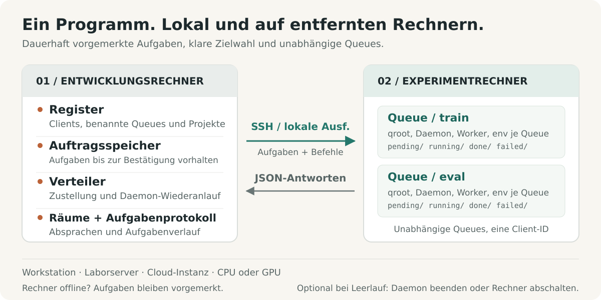

# shunt

[English](../../../README.md) · [Français](../fr/README.fr.md) · **Deutsch** · [Italiano](../it/README.it.md) · [日本語](../ja/README.ja.md) · [Español](../es/README.es.md) · [한국어](../ko/README.ko.md) · [简体中文](../zh-CN/README.zh-CN.md) · [繁體中文](../zh-TW/README.zh-TW.md) · [Русский](../ru/README.ru.md) · [Bahasa Indonesia](../id/README.id.md) · [Português (BR)](../pt-BR/README.pt-BR.md)


<p align="center">
  <strong>Experimente ausführen. Rechenkapazität koordinieren.</strong><br>
  Eine Betriebsschicht für Experimente von Menschen und KI-Agents, von lokalen Workstations bis zu Remote-Servern.
</p>

<p align="center">
  <a href="../../../Cargo.toml"></a>
  
  <a href="../../design.md#5-wire-protocol"></a>
  <a href="../../../LICENSE"></a>
</p>

<p align="center">
  <a href="#schnellstart">Schnellstart</a> ·
  <a href="#funktionsweise">Architektur</a> ·
  <a href="#gemeinsame-rechenkapazität-koordinieren">Koordination</a> ·
  <a href="#für-agents-gebaut">Agent-Anleitung</a> ·
  <a href="../../design.md">Design-Spezifikation</a> ·
  <a href="#mitwirken">Mitwirken</a>
</p>

Experimente erstrecken sich über Projekte, Maschinen, Umgebungen und lang laufende Sitzungen. shunt bündelt diese Arbeit in einem CLI: Maschinen registrieren, Projekte an Queues binden, Tasks bereitstellen und ausführen, ihre Ergebnisse und ihren Ressourcenverbrauch prüfen sowie die Menschen und Agents koordinieren, die sich Rechenkapazität teilen.

Derselbe Workflow funktioniert auf einer lokalen Workstation, einem Labor-Server oder einer Cloud-CPU- bzw. GPU-Instanz. Ein einziges Rust-Binary läuft auf beiden Seiten – per SSH für entfernte Maschinen und per direkter Prozessausführung lokal. Tasks, Logs und Queue-Zustände liegen auf der Festplatte. Abrechnungsmetadaten und Leerlauf-Abschaltung sind optionale Werkzeuge für Maschinen, die sie brauchen.

## Warum shunt

| Wenn du …                                                  | liefert shunt …                                                                                                                                                                        |
| ---------------------------------------------------------- | -------------------------------------------------------------------------------------------------------------------------------------------------------------------------------------- |
| **über Maschinen und Projekte hinweg arbeiten** willst     | Eine TOML-Registry, Many-to-Many-Projekt-Bindings, eigene Arbeitsverzeichnisse und Umgebungen pro Binding sowie SSH- oder lokalen Transport.                                           |
| **Workflows auf einer Maschine trennen** willst            | Benannte Queues mit eigenen Verzeichnissen, Daemons, Worker-Pools, Shells und Umgebungs-Setup unter einer Client-Identität.                                                            |
| **einreichen willst, bevor eine Maschine erreichbar ist**  | Einen persistenten Spool auf der Dev-Seite. Der Dispatcher liefert nach, sobald die Maschine zurück ist, und belebt einen gestoppten Queue-Daemon vor dem Push wieder.                 |
| **Experimente voranbringen** willst                        | Gleichzeitige Worker, FIFO-Übernahmereihenfolge, manuelle Priorität, Pool-Größenänderung im laufenden Betrieb, Task-Timeouts und opt-in begrenzte Neuplanung bei Ressourcenkonkurrenz. |
| **wissen willst, was ein Lauf tatsächlich verbraucht hat** | Maschinen- und GPU-Verfügbarkeit, RAM- und VRAM-Spitzen pro Task, CPU-Zeit sowie deklarierte Ressourcenschätzungen neben gemessenem Verbrauch.                                         |
| **geteilte Rechenkapazität koordinieren** willst           | Projekt-Koordinationsräume mit Ungelesen-Verfolgung, festgehaltenen Vereinbarungen, Gesprächs-Digests und Archivierung.                                                                |
| **wiederherstellen und inspizieren** willst                | At-least-once-Ausführung, Wiederherstellung verwaister Tasks, Artefakt-Guards, Zustell-Deduplizierung, Task-Logs, ein Submission-Ledger und Event-Streams.                             |
| **über einen Agent arbeiten** willst                       | Dasselbe CLI mit JSON-Status, JSONL-Task-Listen, einem mitgelieferten Betriebs-Skill und einem persistenten Feedback-Kanal.                                                            |

Die Maschinensteuerung umfasst verwaltete SSH-Ausführung, Bootstrap und Upgrade, einen optionalen SOCKS5-Reverse-Proxy, Daemon-Beendigung nach dem Leeren und opt-in Leerlauf-Abschaltung. Geteilte Maschinen können das serverseitige Scharfschalten des Poweroff ausdrücklich verweigern.

## Schnellstart

### 1. Installation

Benötigt werden Linux mit einer stabilen Rust-Toolchain, einem System-Linker und Bash. Für den Remote-Betrieb braucht die Dev-Maschine außerdem OpenSSH-Werkzeuge (`ssh`, `scp` und `ssh-keygen`).

```bash
curl -fsSL https://raw.githubusercontent.com/ShinoharaHaruna/shunt/main/install.sh | sh
shunt --help
```

Das Skript installiert das neueste Release-Binary (statischer musl-Build, Dashboard enthalten) nach `~/.local/bin`; übergib `--gnu` für den dynamisch gelinkten Build, `--dir` für ein anderes Verzeichnis oder `uninstall`, um das Binary zu entfernen. Baue stattdessen aus dem Quellcode mit der Rust-Toolchain:

```bash
git clone https://github.com/ShinoharaHaruna/shunt.git
cd shunt
cargo install --path . --locked
shunt --help
```

### 2. Die Queue lokal ausprobieren

Der eingebaute `localhost`-Client nutzt dasselbe CLI-Protokoll über lokale Prozessausführung. Du kannst den vollständigen Pfad Spool → Dispatcher → Queue ohne SSH oder GPU ausprobieren:

```bash
# Der Task erzeugt eine Abschluss-Markierung im lokalen Queue-Verzeichnis.
shunt submit -c localhost --slug hello --guard hello.done -- touch hello.done
shunt dispatch --once
shunt status -c localhost --json
shunt logs -c localhost hello

# Nach dem Ausprobieren den lokalen Daemon leeren und beenden.
shunt stop --root ~/.config/shunt/queue
```

Die Ausführung ist asynchron: wiederhole `status` oder `logs` nach kurzer Zeit, um das Ergebnis zu sehen. Die lokale Standard-Queue ist `~/.config/shunt/queue/`; diese Demo hinterlässt dort `hello.done`, sodass eine Wiederholung den bereits erledigten Task überspringt. `stop` wartet, bis die laufenden Tasks des Daemons fertig sind; die Leerlauf-Abschaltung ist ein separater, opt-in Vorgang.

### 3. Eine Experimentmaschine anbinden

Führe diese Befehle auf deiner Dev-Maschine für einen bereits erreichbaren Linux-Server aus. Ersetze die Beispielpfade durch Verzeichnisse, die dir auf dieser Maschine gehören. Dieses Setup verwendet einen autorisierten SSH-Schlüssel wieder und behandelt den Server als geteilt:

```bash
shunt client add lab --template generic \
    --key ~/.ssh/id_ed25519 --deploy-root /path/you/own \
    --qroot /path/you/own/shunt-queue \
    --shared --exit-on-idle --expire unlimited

# ssh.host, ssh.port und ssh.user für deinen Server eintragen.
${EDITOR:-vi} ~/.config/shunt/clients/lab.toml

shunt client bootstrap lab

shunt project add experiments
shunt project bind experiments --client lab \
    --workdir /path/to/experiments --env OMP_NUM_THREADS=4 --env MKL_NUM_THREADS=4
```

`--shared` verhindert das serverseitige Scharfschalten der Leerlauf-Abschaltung; `--exit-on-idle` lässt den Queue-Daemon nach dem Leeren beenden und vom nächsten Dispatch wiederbeleben. Lass diese Flags weg, wenn du eine dedizierte Maschine mit residentem Daemon möchtest. `expire = "unlimited"` beschreibt eine eigene oder Labor-Maschine; Cloud-Maschinen können stattdessen `"metered"` oder eine Abo-Frist verwenden, optional mit Abrechnungstarifen.

Bootstrap installiert das Binary unter dem Queue-Root, prüft die Laufzeitkompatibilität, initialisiert die Queue, startet den Daemon und ermittelt Maschinendaten. Es kann ein passendes statisches Release holen, wenn der lokale Build eine neuere glibc erfordert; andere Architekturen oder unveröffentlichte Builds brauchen eventuell ein explizites `--bin-path`. Siehe [Binärkompatibilität](../../design.md#15-binary-compatibility-at-bootstrap).

Für eine dedizierte Cloud-Instanz füllen Vendor-Templates wie `--template autodl` Deployment-Defaults vor. Ohne `--key` erzeugt shunt ein dediziertes Schlüsselpaar: installiere den öffentlichen Schlüssel selbst, oder konfiguriere `ssh.password` und installiere `sshpass` für passwortgestütztes Deployment auf einer dedizierten Maschine. Geteilte Clients überspringen die automatische Schlüsselverteilung.

Das `workdir` des Bindings muss deinen Code, deine Daten und deine Laufzeitumgebung bereits enthalten. Bootstrap installiert shunt; das Projekt-Binding zeichnet auf, wo deine Experimente laufen.

### 4. Ein Experiment einreichen und prüfen

Angenommen, dein `train.py` schreibt bei erfolgreichem Abschluss `runs/exp1/metrics.json`:

```bash
shunt submit -p experiments -c lab --slug exp1 \
    --guard runs/exp1/metrics.json --timeout 14400 -- \
    uv run python train.py --out runs/exp1

shunt dispatch --once               # aktuellen Spool zustellen
shunt status -c lab --json           # Queue-Zustand und Ressourcennutzung prüfen
shunt logs -c lab exp1               # Task-Log ansehen
```

Lass `shunt dispatch` in einem separaten Dev-Maschinen-Terminal für fortlaufende Zustellung laufen, einschließlich der Tasks, die bei offline Maschine eingereicht wurden. Nach der Zustellung führt der Queue-Daemon der Maschine den Task unabhängig vom Dispatcher oder dem einreichenden Terminal aus.

`--timeout 14400` setzt ein vierstündiges Wall-Clock-Limit für diesen Task. `--guard` prüft einen Pfad relativ zum `workdir` des Bindings und überspringt die Ausführung, wenn er bereits existiert. `uv` und `train.py` sind beispielhafte Abhängigkeiten der Workload; verwende den Befehl, den dein Projekt braucht.

## Funktionsweise



Der Name kommt vom Rangieren im Eisenbahnbetrieb. Deine Dev-Maschine ist der Rangierbahnhof; jede Experimentmaschine ist ein Zielgleis. Ein **Client** ist eine registrierte Maschine; eine **Queue** ist eine Ausführungsspur darauf; ein **Projekt-Binding** liefert Arbeitsverzeichnis und Umgebung für ein `(Client, Queue)`-Paar.

| Auf deiner Dev-Maschine                                                                                            | Auf jeder Experimentmaschine                                                                                                |
| ------------------------------------------------------------------------------------------------------------------ | --------------------------------------------------------------------------------------------------------------------------- |
| **Registry** — bearbeitbares TOML für Clients, Queues, Projekte, Bindings und optionale Abrechnung.                | **Queues** — Task-Verzeichnisse unter `pending/`, `running/`, `done/` und `failed/`.                                        |
| **Spool und Dispatcher** — Tasks bis zur Bestätigung bereitstellen, zustellen und gestoppte Daemons wiederbeleben. | **Daemons** — einer pro Queue, mit gleichzeitigen Workern, Logs, Verbrauchssampling und Wiederherstellung verwaister Tasks. |
| **Task-Ledger und Rooms** — Einreichungen verfolgen und die Projekt-Koordinationshistorie aufbewahren.             | **Task-Umgebungen** — Queue-Setup und Shell, Projekt-Binding-Einstellungen und taskbezogene Overrides.                      |

### Projekte und benannte Queues

Trenne Training, Auswertung oder verschiedene Projekte auf einer Maschine, ohne doppelte SSH-Identitäten zu registrieren:

```bash
shunt queue add eval -c lab --qroot /path/you/own/shunt-eval \
    --workers 2 --exit-on-idle
shunt queue bootstrap eval -c lab
shunt project bind experiments --client lab --queue eval \
    --workdir /path/to/experiments --env OMP_NUM_THREADS=2 --env MKL_NUM_THREADS=2
shunt submit -p experiments -c lab --queue eval --slug eval1 \
    --guard runs/eval1.json -- python evaluate.py --out runs/eval1.json
shunt status -c lab --queue eval --json
```

Jede Queue besitzt ihren eigenen qroot, Nummernraum, Worker-Pool, Daemon, Binary, Shell und Umgebungs-Setup. Die Queue-Auswahl folgt `--queue` → konfigurierter `default_queue` → einzige Queue; bleibt die Wahl unklar, schlägt sie mit einem Mehrdeutigkeitsfehler fehl. Bereitgestellte Tasks binden ihre Queue und ihren qroot, sodass eine Änderung des Defaults bereits eingereichte Arbeit niemals umleitet.

Konfiguriere `env_setup` und `shell` auf einer Queue für Umgebungsaktivierung oder gemeinsame Exports und pushe sie mit `shunt queue env <name> -c lab`; `shunt client env lab` aktualisiert alle Queues. Projekt- und taskbezogene Umgebungs-Overlays lassen eine Queue mehrere Workloads bedienen.

Die Verbindung ist `ssh <machine> 'shunt <cmd> --json'`. Es ist weder ein HTTP-Dienst noch eine Rückverbindung zur Dev-Maschine nötig. Dasselbe Binary unterstützt direkten lokalen Transport für `localhost` und weitere `client add --local`-Clients.

### Eine einsehbare Queue


Jeder Task ist ein Verzeichnis namens `NNNN_<slug>`. Es enthält `task.sh` und sammelt ein `log`, einen fortlaufend aktualisierten `pid`-Eintrag, gemessene `usage` und einen finalen `exit`-Code. Queue-Übergänge nutzen Dateisystem-Renames. Die Worker-Anzahl wird bei jedem Poll neu gelesen, daher braucht eine Größenänderung keinen Neustart; eine Verringerung lässt laufende Tasks zu Ende gehen. Tasks laufen in eigenen Prozessgruppen, mit aufgezeichneten Identitätsprüfungen vor dem Signalisieren.

**Die Ausführung erfolgt mindestens einmal.** Server-generierte Task-IDs deduplizieren Nachzustellungen über die aktiven Queue-Spuren hinweg, aber eine Daemon-Wiederherstellung oder eine Zustellung außerhalb dieses Deduplizierungsfensters kann trotzdem einen erneuten Lauf auslösen. Ein Guard ist eine Existenzprüfung vor der Ausführung; veröffentliche das bewachte Artefakt also erst, wenn es abgeschlossene Arbeit repräsentiert, und mache Wiederholungen sicher. Er bietet weder Exactly-once-Ausführung noch eine Sperre gegen überlappende Versuche. Siehe den [Guard-Vertrag](../../design.md#313-task-file-format-and-the-guard-contract) und das [Task-Template](../../../task_template.sh).

## Ressourcenbewusste Experimente

Deklariere Schätzwerte, setze ein Wall-Clock-Budget und erlaube einen begrenzten Wiederholungsversuch, wenn Ressourcen vorübergehend nicht verfügbar sind:

```bash
shunt submit -p experiments -c lab --slug exp2 \
    --guard runs/exp2/metrics.json --timeout 14400 \
    --retry 2 --retry-delay 60 --ram-mb 8192 --cpu-cores 4 --gpu-mem-mb 4096 \
    --env CUDA_VISIBLE_DEVICES=0 --env OMP_NUM_THREADS=4 --env MKL_NUM_THREADS=4 -- \
    uv run python train.py --out runs/exp2
shunt status -c lab --json
```

`--retry 2` erlaubt zwei zusätzliche Versuche bei Exit-Code 75 (`EX_TEMPFAIL`, ein Ressourcen-besetzt-Signal) oder einer erkannten Out-of-Memory-Signatur im Log. Jeder wartet mindestens `--retry-delay` Sekunden, bevor er wieder übernommen werden kann. Andere Fehler und Timeouts bleiben Fehler; Wiederholungen brauchen ein explizites Budget.

Status zeigt deklarierte Schätzwerte neben den gesampelten RAM-Spitzen pro Task, den VRAM-Spitzen pro GPU und kumulativen CPU-Sekunden. Er meldet außerdem aktuellen GPU-Speicher und Auslastung, Host-RAM und Load; Maschinen-Probes liefern cgroup-bewusste Kapazitätsdaten. GPU-Telemetrie nutzt `nvidia-smi`, wenn verfügbar. Sampling kann kurzlebige Prozesse oder kurze Spitzen verpassen.

**Schätzwerte sind Annotationen, keine Ressourcenreservierungen oder Zulassungsprüfungen.** Du oder dein Agent wählt Ziel, Worker-Anzahl und GPU-Zuordnung. CPU-only-Tasks nutzen dieselbe Queue ohne GPU-Flags. Siehe [Ressourcentelemetrie](../../design.md#316-resource-declarations-and-usage-telemetry).

## Gemeinsame Rechenkapazität koordinieren

Wenn sich Projekte eine Maschine teilen, brauchen ihre Agents einen Ort, um Worker-Grenzen, Speicherbudgets oder GPU-Platzierung zu vereinbaren. Koordinationsräume halten diese Unterhaltung und ihre aktuelle Vereinbarung neben der Registry fest:

```bash
# Angenommen, experiments und analysis sind registrierte Projekte.
shunt room ls --as experiments          # Rooms, Ungelesen-Zähler, Gruppenvorschläge
shunt room create shared-compute --members experiments,analysis --clients lab
shunt room say shared-compute --as experiments \
    --body "Training needs GPU 0 until 18:00; can evaluation use GPU 1?"
shunt room read shared-compute --as analysis
shunt room decide shared-compute --as analysis \
    --note "Training uses GPU 0; evaluation uses GPU 1 with two workers."
shunt status --all --json --as experiments
```

Rooms haben Projekt-Mitgliedschaft, Ungelesen-Positionen pro Identität und eine aktuelle Entscheidung. `room ls` schlägt Gruppen von Projekten vor, die an dieselbe Maschine gebunden sind. Lange Unterhaltungen können zu In-Stream-Digests verdichtet werden, während archivierte Nachrichten für Bereichslesezugriffe erhalten bleiben; ganze Rooms können archiviert und wiederhergestellt werden.

Rooms liegen auf einer Dev-Maschine und können deren registrierte Clients überspannen. Agents, die sich diese Registry teilen, können sie pollen, bevor sie geteilte Rechenkapazität ändern. Vereinbarungen greifen, wenn Teilnehmer sie mit Befehlen wie `workers` oder `submit --env` anwenden; Rooms erzwingen weder Scheduling noch Ressourcenzuteilung. Siehe [Koordinationsräume](../../design.md#17-coordination-rooms-server-side).

## Alltägliche Befehle

Führe diese Befehle auf der Dev-Maschine aus. Client-spezifische Beispiele nutzen den registrierten Client `lab`; füge `--queue eval` hinzu, um die benannte Queue anzusprechen.

| Absicht                                                | Befehl                                                |
| ------------------------------------------------------ | ----------------------------------------------------- |
| Alle Maschinen, Queues und Rooms ansehen               | `shunt status --all --json`                           |
| Auf Zustellung wartende Einreichungen ansehen          | `shunt spool ls`                                      |
| Einen eingereichten Task anhand seiner ID prüfen       | `shunt task show <id> --json`                         |
| Den Task-Event-Stream des Servers lesen                | `shunt task events`                                   |
| Den Worker-Pool in der Größe ändern                    | `shunt workers 4 -c lab`                              |
| Einen ausstehenden Task an die Spitze verschieben      | `shunt prio exp1 0 -c lab`                            |
| Einen ausstehenden Task abbrechen                      | `shunt cancel exp1 -c lab`                            |
| Einen ausstehenden Task bis zur Freigabe parken        | `shunt hold exp1 -c lab "waiting on lease"`           |
| Einen geparkten ausstehenden Task freigeben            | `shunt release exp1 -c lab`                           |
| Die Prozessgruppe eines laufenden Tasks stoppen        | `shunt kill exp1 -c lab`                              |
| Einen Queue-Daemon leeren und stoppen                  | `shunt queue stop eval -c lab`                        |
| Maschinendaten aktualisieren                           | `shunt client probe lab`                              |
| Queues auf einer Maschine auflisten                    | `shunt queue ls -c lab`                               |
| Einen Ad-hoc-Befehl über verwaltetes SSH ausführen     | `shunt client exec lab -- nvidia-smi`                 |
| Einen verschobenen SSH-Endpunkt aktualisieren          | `shunt client update lab --host <host> --port <port>` |
| Einen veralteten Host-Schlüssel und Verbindung löschen | `shunt client hostkey lab`                            |
| Den optionalen SOCKS5-Reverse-Proxy öffnen             | `shunt tunnel up -c lab`                              |
| Shell-Vervollständigungen erzeugen                     | `shunt completions zsh`                               |
| Lokale Version und Build prüfen                        | `shunt version --json`                                |
| Nach einem neuen Release suchen                        | `shunt upgrade --check --json`                        |
| Das lokale Binary aktualisieren                        | `shunt upgrade`                                       |
| Das Binary einer Remote-Queue aktualisieren            | `shunt upgrade -c lab --queue eval`                   |

Task-Steuerungsmuster wie `exp1` müssen genau einen Task identifizieren; verwende bei Mehrdeutigkeit den vollständigen Task-Eintragsnamen. Das Task-Ledger bildet eine Submission-ID auf diesen Eintragsnamen ab. `task show` fragt die Maschine bei Bedarf, um ein Ergebnis aufzulösen; ein Eintrag außerhalb des Recent-Status-Fensters kann als `unknown` erscheinen. Arbeit lässt sich auch parken, bevor sie abholbar ist: `--hold` hält eine Einreichung im dev-seitigen Spool bis `spool release`, und `--hold-on-box` stellt sie zu und lässt den Eintrag auf der Box bis `shunt release` nicht abholbar.

Upgrades prüfen Release-Checksums und die Binary-Version vor der Installation. Ein laufender Daemon — einer lokalen Queue, einer Remote-Box oder des `serve`-Dashboards — wird per Handoff auf das installierte Binary neu gestartet: er re-exect an Ort und Stelle, behält dieselbe PID, und laufende Arbeit läuft weiter; ein gestoppter Daemon wird einfach gestartet. Stammt das laufende Image aus der Zeit vor dem Handoff-Handler, benennt das Upgrade es, statt es zu signalisieren, und Stoppen plus Starten dieses Daemons (`serve down` + `serve up` für das Dashboard) bringt es auf das neue Binary. Ein Dispatcher hat keine PID-Datei, daher nennt ein lokales Upgrade nur die PIDs laufender Dispatcher — schicke jedem `SIGUSR2` oder starte ihn neu. Vorgefertigte Release-Upgrades zielen derzeit auf Linux x86_64.

Nutze `shunt <command> --help` für Flags und die [CLI-Referenz](../../design.md#10-cli-surface) für die vollständige Oberfläche. Queue-Befehle wie `status` und `logs` funktionieren mit `--root <qroot>` auch direkt auf einer Maschine.

### Optionale Leerlauf-Abschaltung

Für eine dedizierte Maschine, die nach einem Batch ausgeschaltet werden soll, aktiviere dies explizit mit `shunt shutdown -c <client> on`; mit `off` entschärfst du das Kommando und mit `status` prüfst du den aufgelösten Befehl. Die Queue zählt erst nach dem Leeren herunter, und neue Arbeit bricht den Countdown ab. Der Server macht beim Scharfschalten einen Preflight der registrierten Geschwister-Queues; das Laufzeit-Gate der Maschine prüft laufende Daemons unter demselben Unix-Account. Ein `shared`-Client verweigert das serverseitige Scharfschalten.

Für eine Workstation oder einen geteilten Server, der eingeschaltet bleiben soll, nutze `exit_on_idle`, um nur den Daemon zu beenden, oder halte ihn für den nächsten Batch resident. Die lokale Demo und der Geteilte-Server-Schnellstart brauchen kein Power-Management-Setup.

## Für Agents gebaut

Das CLI ist zugleich die Agent-Schnittstelle. Queue-Status- und Task-Ledger-Abfragen liefern strukturiertes JSON oder JSONL; Task- und Daemon-Logs liefern die Details hinter diesen Zuständen. Maschinendaten, aktuelle Ressourcen, deklarierte gegenüber gemessener Nutzung und Ungelesen-Zähler der Rooms geben Agents Kontext für die Zielwahl, die Dimensionierung eines Batches und die Aushandlung geteilter Rechenkapazität. Konfigurierte Abrechnungstarife und Ablauf-Metadaten liefern Kontext, wenn eine Maschine Kosten oder eine Frist hat.

Der mitgelieferte [shunt-Skill](../../../skills/shunt/SKILL.md) vermittelt Setup, Guard-Einreichungen, Queue-Interpretation, Koordination, Fehlerbehandlung und optionalen kostenbewussten Betrieb. Verweise deinen Agent darauf, bevor er Experimentmaschinen verwaltet.

Installiere den Skill, indem du `skills/shunt/` dorthin verlinkst, wo dein Agent Skills lädt:

```bash
ln -s "$PWD/skills/shunt" ~/.agents/skills/shunt   # gemeinsames agentskills-Verzeichnis
# oder: cp -r skills/shunt ~/.claude/skills/shunt   # Claude-Code-Benutzer-Skills
# oder: cp -r skills/shunt .claude/skills/          # projektlokal
```

```bash
shunt task ls --json
shunt status --all --json --as experiments
shunt task show <id> --json
```

shunt liefert Fakten und führt explizite Befehle aus. Die Wahl einer Maschine, das Anwenden von Ressourcenvereinbarungen, die Entscheidung, ob ein Lauf ins Budget passt, und das Bereitstellen oder Einschalten von Maschinen bleiben beim Menschen oder dem umgebenden Agent-Workflow.

Wenn ein Agent auf einen shunt-Defekt oder eine raue Kante stößt, reicht `shunt feedback "title" --body "…"` diese als GitHub-Issue ein. Der Feedback-Kanal entfernt bekannte Registry-Zugangsdaten sowie registrierte Client-, Projekt- und Queue-Namen, speichert einen lokalen Bericht vor der Zustellung, dedupliziert Wiederholungen und wendet ein Stundenlimit an. Mit `--dry-run` in der Vorschau ansehen; ausstehende Berichte mit `feedback ls --json` prüfen und mit `feedback retry` erneut zustellen. Berichte sind standardmäßig öffentlich, und der Scrubber kann nicht jedes beliebige Geheimnis erkennen. Siehe [Feedback-Kanal](../../design.md#14-feedback-channel).

## Betriebsgrenzen

- **Unabhängige Tasks und explizite Platzierung.** Es gibt keinen Abhängigkeitsgraphen, keine automatische Maschinenauswahl und kein Multi-Maschinen-Load-Balancing; jede Einreichung zielt auf einen Client und eine Queue. Ressourcendeklarationen und Room-Entscheidungen reservieren weder Hardware noch isolieren sie Mandanten.
- **Begrenzte Wiederherstellung.** Ressourcen-besetzt- oder erkannte Out-of-Memory-Fehler können nur mit einem deklarierten Wiederholungsbudget neu eingeplant werden. Fehler außerhalb dieser Kriterien, Timeouts und erschöpfte Wiederholungen landen in `failed/`; prüfe die Logs und reiche gegebenenfalls neu ein. Die Wiederherstellung verwaister Tasks nach einem Daemon-Neustart ist separat.
- **Lokale Koordination.** Rooms dienen Agents, die sich eine Dev-seitige Registry teilen. Sie bieten einen gepollten Koordinationsdatensatz, ohne Registry-übergreifende Nachrichten, Push-Benachrichtigungen oder erzwungene Zugriffskontrolle zwischen Teilnehmern.
- **Opt-in Poweroff.** Die Leerlauf-Abschaltung nutzt einen konfigurierbaren Befehl und eine Schonfrist, standardmäßig 60 Sekunden. Leere verwaltete Queues belegen nicht, dass andere Nutzer oder nicht verwaltete Workloads untätig sind. Prüfe den Shutdown-Befehl für deine Maschine; shunt kontrolliert keine Vendor-Abrechnungsregeln. Eine Einreihung, die mit der letzten Poweroff-Prüfung konkurriert, kann den Shutdown trotzdem verlieren.
- **Explizites Deployment.** Das Projekt-Binding zeichnet Pfade und Umgebung auf; es synchronisiert weder Quellcode, noch installiert es Abhängigkeiten oder erzeugt das entfernte workdir.

Die Rust-Implementierung deckt Registry, benannte Queues, Spool, Dispatcher, SSH- und lokale Transports, Task-Telemetrie, Koordinationsräume, Tunnel, Upgrade, Feedback und den Client-Queue-Daemon ab. Sie wird aktiv entwickelt; [docs/design.md](../../design.md) definiert den Verhaltensvertrag und seine Grenzfälle.

## Mitwirken

Beginne mit der [Design-Spezifikation](../../design.md) und dem [Repository-Leitfaden](../../../AGENTS.md). Bei einer Änderung des Queue-Verhaltens aktualisiere den Vertrag und decke den relevanten Übergang oder Fehlerfall ab.

```bash
just setup       # aktiviert die versionierten Git-Hooks
just fmt         # formatiert Rust, Markdown, TOML und JSON
just check       # Formatcheck + Clippy (-D warnings) + Tests
```

Installiere `just` und `dprint` für diese Recipes; Rust-Formatierung und Clippy kommen aus der konfigurierten Toolchain. Hooks prüfen die Formatierung vor dem Commit und führen Clippy vor dem Push aus. Sie schreiben nie Dateien um; die vollständige Testsuite läuft über `just check` oder `just test`.

### Releases

Pushe einen SemVer-Tag wie `v0.1.0` (oder `0.1.0`) auf den zu veröffentlichenden Commit. Die Version, ohne das optionale `v`-Präfix, muss mit `package.version` in `Cargo.toml` übereinstimmen; aktualisiere `Cargo.lock` ebenfalls mit der Versionsänderung. Der getaggte Commit muss den [Release-Workflow](../../../.github/workflows/release.yml) enthalten.

```bash
git tag -a v0.1.0 -m "Release v0.1.0"
git push origin v0.1.0
```

Der Workflow prüft die Formatierung, führt Clippy und Tests für beide Targets aus und veröffentlicht dann ein GitHub-Release mit generierten Notes, Linux-x86_64-musl- (statisch) und GNU-Binary-Archiven sowie `SHA256SUMS-<target>`-Dateien pro Target. Tags mit Prerelease-Suffix, etwa `v0.2.0-rc.1`, erzeugen Prereleases. Er nutzt das eingebaute `GITHUB_TOKEN`; kein zusätzliches Secret nötig. Veröffentlichte Releases werden bei erneuten Läufen nicht überschrieben.

| Hier beginnen                                 | Für …                                                               |
| --------------------------------------------- | ------------------------------------------------------------------- |
| [Design-Spezifikation](../../design.md)       | Queue-Semantik, Wire-Protokoll, Telemetrie, Rooms und Teststrategie |
| [Agent-Skill](../../../skills/shunt/SKILL.md) | Betriebshandbuch für einen KI-Agent                                 |
| [Vendor-Templates](../../../etc/vendors/)     | AutoDL- und generische Client-Defaults                              |
| [Task-Template](../../../task_template.sh)    | Einen Task-Skript mit Guard schreiben                               |
| [Integrationstests](../../../tests/)          | Queue-, Prozess-, Shutdown- und Dispatch-Verhalten                  |

## Lizenz

[MIT](../../../LICENSE).
