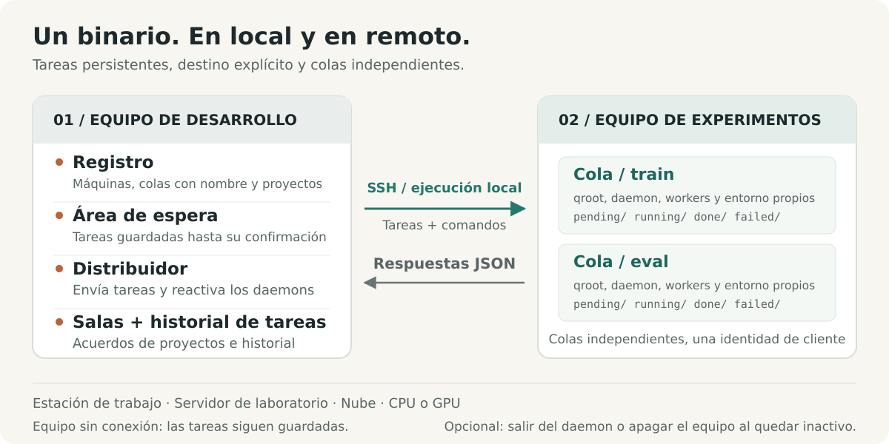

# shunt

[English](../../../README.md) · [Français](../fr/README.fr.md) · [Deutsch](../de/README.de.md) · [Italiano](../it/README.it.md) · [日本語](../ja/README.ja.md) · **Español** · [한국어](../ko/README.ko.md) · [简体中文](../zh-CN/README.zh-CN.md) · [繁體中文](../zh-TW/README.zh-TW.md) · [Русский](../ru/README.ru.md) · [Bahasa Indonesia](../id/README.id.md) · [Português (BR)](../pt-BR/README.pt-BR.md)


<p align="center">
  <strong>Ejecuta experimentos. Coordina el cómputo.</strong><br>
  Una capa de operaciones de experimentos para personas y agents de IA, desde estaciones de trabajo locales hasta servidores remotos.
</p>

<p align="center">
  <a href="../../../Cargo.toml"></a>
  
  <a href="../../design.md#5-wire-protocol"></a>
  <a href="../../../LICENSE"></a>
</p>

<p align="center">
  <a href="#inicio-rápido">Inicio rápido</a> ·
  <a href="#cómo-funciona">Arquitectura</a> ·
  <a href="#coordinar-el-cómputo-compartido">Coordinación</a> ·
  <a href="#diseñado-para-agents">Guía para agents</a> ·
  <a href="../../design.md">Especificación de diseño</a> ·
  <a href="#contribuir">Contribuir</a>
</p>

Los experimentos abarcan proyectos, máquinas, entornos y sesiones de larga duración. shunt reúne ese trabajo en un solo CLI: registra máquinas, vincula proyectos a colas, prepara y ejecuta tareas, inspecciona sus resultados y su uso de recursos, y coordina a las personas y agents que comparten cómputo.

Usa el mismo flujo de trabajo en una estación de trabajo local, un servidor de laboratorio o una instancia de CPU o GPU en la nube. Un único binario de Rust corre en ambos lados, con SSH para las máquinas remotas y ejecución directa de procesos en local. Las tareas, los logs y el estado de las colas viven en disco. Los metadatos de facturación y el apagado por inactividad son herramientas opcionales para las máquinas que los necesiten.

## Por qué shunt

| Cuando necesitas…                                 | shunt te da…                                                                                                                                                                        |
| ------------------------------------------------- | ----------------------------------------------------------------------------------------------------------------------------------------------------------------------------------- |
| **Trabajar entre máquinas y proyectos**           | Un registry en TOML, vinculaciones de proyecto muchos-a-muchos, directorios de trabajo y entornos por vinculación, y transporte SSH o local.                                        |
| **Separar flujos de trabajo en una máquina**      | Colas con nombre con directorios, demonios, pools de workers, shells y configuración de entorno independientes bajo una misma identidad de client.                                  |
| **Enviar antes de que una máquina sea accesible** | Un spool persistente en la máquina de desarrollo. El dispatcher entrega cuando la máquina vuelve y reanima un demonio de cola detenido antes de enviar.                             |
| **Mantener los experimentos en marcha**           | Workers concurrentes, orden de reclamo FIFO, prioridad manual, redimensión del pool en caliente, timeouts de tarea y replanificación acotada y opcional por contención de recursos. |
| **Saber qué usó realmente una ejecución**         | Disponibilidad de máquina y GPU, picos de RAM y VRAM por tarea, tiempo de CPU y estimaciones de recursos declaradas junto al uso medido.                                            |
| **Coordinar cómputo compartido**                  | Salas de coordinación de proyecto con seguimiento de no leídos, acuerdos registrados, resúmenes de conversación y archivado.                                                        |
| **Recuperar e inspeccionar**                      | Ejecución al menos una vez, recuperación de huérfanos, guards de artefactos, deduplicación de entregas, logs de tareas, un libro mayor de envíos y flujos de eventos.               |
| **Operar a través de un agent**                   | El mismo CLI con status en JSON, listados de tareas en JSONL, un skill de operación incluido y un canal de feedback persistente.                                                    |

Los controles de máquina incluyen ejecución SSH gestionada, bootstrap y actualización, un proxy SOCKS5 inverso opcional, salida del demonio al vaciarse y apagado por inactividad opcional. Las máquinas compartidas pueden rechazar explícitamente el armado de apagado del lado del server.

## Inicio rápido

### 1. Instalar desde el código fuente

Necesitas Linux con una toolchain stable de Rust, un enlazador del sistema y Bash. La operación remota también requiere herramientas OpenSSH (`ssh`, `scp` y `ssh-keygen`) en la máquina de desarrollo.

```bash
git clone https://github.com/ShinoharaHaruna/shunt.git
cd shunt
cargo install --path . --locked
shunt --help
```

### 2. Probar la cola en local

El client `localhost` incorporado usa el mismo protocolo CLI mediante ejecución de procesos locales. Puedes recorrer todo el camino spool → dispatcher → cola sin SSH ni GPU:

```bash
# La tarea crea un marcador de finalización en el directorio de la cola local.
shunt submit -c localhost --slug hello --guard hello.done -- touch hello.done
shunt dispatch --once
shunt status -c localhost --json
shunt logs -c localhost hello

# Cuando termines de experimentar, vacía el demonio local y sal.
shunt stop --root ~/.config/shunt/queue
```

La ejecución es asíncrona: repite `status` o `logs` al cabo de un momento para ver el resultado. La cola local por defecto es `~/.config/shunt/queue/`; esta demo deja `hello.done` ahí, así que repetirla omite la tarea ya completada. `stop` vacía las tareas en ejecución del demonio; el apagado por inactividad es una operación aparte y opcional.

### 3. Conectar una máquina de experimentos

Ejecuta estos comandos en tu máquina de desarrollo para un servidor Linux ya accesible. Sustituye las rutas de ejemplo por directorios que controles en esa máquina. Esta configuración reutiliza una clave SSH autorizada y trata el servidor como compartido:

```bash
shunt client add lab --template generic \
    --key ~/.ssh/id_ed25519 --deploy-root /path/you/own \
    --qroot /path/you/own/shunt-queue \
    --shared --exit-on-idle --expire unlimited

# Rellena ssh.host, ssh.port y ssh.user de tu servidor.
${EDITOR:-vi} ~/.config/shunt/clients/lab.toml

shunt client bootstrap lab

shunt project add experiments
shunt project bind experiments --client lab \
    --workdir /path/to/experiments --env OMP_NUM_THREADS=4 --env MKL_NUM_THREADS=4
```

`--shared` bloquea el armado de apagado por inactividad del lado del server; `--exit-on-idle` permite que el demonio de la cola salga tras vaciarse y sea reanimado por el siguiente dispatch. Omite esos flags si quieres una máquina dedicada con un demonio residente. `expire = "unlimited"` describe una máquina propia o de laboratorio; las máquinas en la nube pueden usar `"metered"` o una fecha de fin de suscripción, con tarifas de facturación opcionales.

El bootstrap instala el binario bajo la raíz de la cola, comprueba la compatibilidad del runtime, inicializa la cola, arranca el demonio y sondea los datos de la máquina. Puede descargar un release estático compatible cuando la build local requiere una glibc más reciente; otras arquitecturas o builds sin publicar pueden necesitar un `--bin-path` explícito. Consulta la [compatibilidad binaria](../../design.md#15-binary-compatibility-at-bootstrap).

Para una instancia de nube dedicada, las plantillas de vendor como `--template autodl` precargan valores de despliegue. Sin `--key`, shunt genera un par de claves dedicado: instala tú mismo su clave pública, o configura `ssh.password` e instala `sshpass` para un despliegue asistido por contraseña en una máquina dedicada. Los clients compartidos omiten el despliegue automático de claves.

El `workdir` de la vinculación debe contener ya tu código, datos y entorno de ejecución. El bootstrap despliega shunt; la vinculación de proyecto registra dónde corren tus experimentos.

### 4. Enviar e inspeccionar un experimento

Suponiendo que tu `train.py` escribe `runs/exp1/metrics.json` al completar con éxito:

```bash
shunt submit -p experiments -c lab --slug exp1 \
    --guard runs/exp1/metrics.json --timeout 14400 -- \
    uv run python train.py --out runs/exp1

shunt dispatch --once               # entrega el spool actual
shunt status -c lab --json           # inspecciona el estado de la cola y el uso de recursos
shunt logs -c lab exp1               # inspecciona el log de la tarea
```

Mantén `shunt dispatch` corriendo en otra terminal de la máquina de desarrollo para una entrega continua, incluidas las tareas enviadas mientras una máquina está desconectada. Tras la entrega, el demonio de cola de la propia máquina ejecuta la tarea con independencia del dispatcher y de la terminal que la envió.

`--timeout 14400` fija un límite de cuatro horas de tiempo real para esta tarea. `--guard` comprueba una ruta relativa al `workdir` de la vinculación y omite la ejecución si ya existe. `uv` y `train.py` son dependencias de ejemplo de la carga de trabajo; usa el comando que tu proyecto necesite.

## Cómo funciona



El nombre viene de las maniobras ferroviarias (shunting). Tu máquina de desarrollo es el patio de clasificación; cada máquina de experimentos es una vía muerta de destino. Un **client** es una máquina registrada; una **cola** es un carril de ejecución en ella; una **vinculación de proyecto** aporta el directorio de trabajo y el entorno para un par `(client, queue)`.

| En tu máquina de desarrollo                                                                                     | En cada máquina de experimentos                                                                                        |
| --------------------------------------------------------------------------------------------------------------- | ---------------------------------------------------------------------------------------------------------------------- |
| **Registry** — TOML editable para clients, colas, proyectos, vinculaciones y facturación opcional.              | **Colas** — directorios de tareas bajo `pending/`, `running/`, `done/` y `failed/`.                                    |
| **Spool y dispatcher** — preparan tareas hasta su confirmación, las entregan y reaniman demonios detenidos.     | **Demonios** — uno por cola, con workers concurrentes, logs, muestreo de uso y recuperación de huérfanos.              |
| **Libro mayor de tareas y salas** — registran los envíos y conservan el historial de coordinación del proyecto. | **Entornos de tarea** — configuración y shell de la cola, ajustes de la vinculación de proyecto y overrides por tarea. |

### Proyectos y colas con nombre

Separa entrenamiento, evaluación o distintos proyectos en una máquina sin registrar identidades SSH duplicadas:

```bash
shunt queue add eval -c lab --qroot /path/you/own/shunt-eval \
    --workers 2 --exit-on-idle
shunt queue bootstrap eval -c lab
shunt project bind experiments --client lab --queue eval \
    --workdir /path/to/experiments --env OMP_NUM_THREADS=2 --env MKL_NUM_THREADS=2
shunt submit -p experiments -c lab --queue eval --slug eval1 \
    --guard runs/eval1.json -- python evaluate.py --out runs/eval1.json
shunt status -c lab --queue eval --json
```

Cada cola posee su qroot, su espacio de secuencia, su pool de workers, su demonio, su binario, su shell y su configuración de entorno. La selección de cola es `--queue` → `default_queue` configurado → cola única; una elección no resuelta falla con un error de ambigüedad. Las tareas preparadas fijan su cola y su qroot, así que cambiar el valor por defecto nunca redirige trabajo ya enviado.

Configura `env_setup` y `shell` en una cola para la activación del entorno o exportaciones compartidas, y luego empújalos con `shunt queue env <name> -c lab`; `shunt client env lab` actualiza todas las colas. Los overlays de entorno de proyecto y por tarea permiten que una cola sirva a varias cargas de trabajo.

El enlace es `ssh <machine> 'shunt <cmd> --json'`. No hace falta ningún servicio HTTP ni conexión inversa hacia la máquina de desarrollo. El mismo binario admite transporte local directo para `localhost` y para clients adicionales creados con `client add --local`.

### Una cola que puedes inspeccionar


Cada tarea es un directorio llamado `NNNN_<slug>`. Contiene `task.sh` y acumula un `log`, un registro `pid` en vivo, el `usage` medido y un código `exit` terminal. Las transiciones de la cola usan renombrados del sistema de archivos. El número de workers se relee en cada sondeo, así que redimensionar no requiere reinicio; al bajarlo, las tareas en curso terminan. Las tareas corren en grupos de proceso separados, con comprobaciones de identidad registradas antes de señalar.

**La ejecución es al menos una vez.** Los IDs de tarea generados por el server deduplican la reentrega entre las pistas activas de la cola, pero una recuperación del demonio o una entrega fuera de esa ventana de deduplicación aún pueden provocar una reejecución. Un guard es una comprobación de existencia antes de ejecutar, así que publica el artefacto vigilado solo cuando represente trabajo completado, y haz que las reejecuciones sean seguras. No proporciona ejecución exactamente-una-vez ni un bloqueo contra intentos solapados. Consulta el [contrato del guard](../../design.md#313-task-file-format-and-the-guard-contract) y la [plantilla de tarea](../../../task_template.sh).

## Experimentos con estimación de recursos

Declara estimaciones, fija un presupuesto de tiempo real y permite un reintento acotado cuando los recursos no estén disponibles temporalmente:

```bash
shunt submit -p experiments -c lab --slug exp2 \
    --guard runs/exp2/metrics.json --timeout 14400 \
    --retry 2 --retry-delay 60 --ram-mb 8192 --cpu-cores 4 --gpu-mem-mb 4096 \
    --env CUDA_VISIBLE_DEVICES=0 --env OMP_NUM_THREADS=4 --env MKL_NUM_THREADS=4 -- \
    uv run python train.py --out runs/exp2
shunt status -c lab --json
```

`--retry 2` permite dos intentos extra para el código de salida 75 (`EX_TEMPFAIL`, una señal de recurso ocupado) o una firma reconocida de falta de memoria en el log. Cada intento espera al menos `--retry-delay` segundos antes de volver a ser reclamable. Los demás fallos y los timeouts siguen siendo fallos; los reintentos requieren un presupuesto explícito.

El status empareja las estimaciones declaradas con los picos muestreados de RAM por tarea, los picos de VRAM por GPU y los segundos de CPU acumulados. También informa de la memoria y utilización actuales de GPU, la RAM del host y la carga; los sondeos de máquina aportan datos de capacidad conscientes de cgroup. La telemetría de GPU usa `nvidia-smi` cuando está disponible. El muestreo puede perderse procesos efímeros o picos breves.

**Las estimaciones son anotaciones, no reservas de recursos ni comprobaciones de admisión.** Tú o tu agent elegís el destino, el número de workers y la asignación de GPU. Las tareas de solo CPU usan la misma cola sin flags de GPU. Consulta la [telemetría de recursos](../../design.md#316-resource-declarations-and-usage-telemetry).

## Coordinar el cómputo compartido

Cuando los proyectos comparten una máquina, sus agents necesitan un lugar donde acordar límites de workers, presupuestos de memoria o colocación de GPU. Las salas de coordinación guardan esa conversación y su acuerdo vigente junto al registry:

```bash
# Supón que experiments y analysis son proyectos registrados.
shunt room ls --as experiments          # salas, conteos de no leídos, grupos sugeridos
shunt room create shared-compute --members experiments,analysis --clients lab
shunt room say shared-compute --as experiments \
    --body "Training needs GPU 0 until 18:00; can evaluation use GPU 1?"
shunt room read shared-compute --as analysis
shunt room decide shared-compute --as analysis \
    --note "Training uses GPU 0; evaluation uses GPU 1 with two workers."
shunt status --all --json --as experiments
```

Las salas tienen membresía de proyecto, posiciones de no leídos por identidad y una decisión vigente. `room ls` sugiere grupos de proyectos vinculados a la misma máquina. Las conversaciones largas pueden compactarse en resúmenes dentro del flujo conservando los mensajes archivados para lecturas por rango; las salas enteras pueden archivarse y restaurarse.

Las salas viven en una máquina de desarrollo y pueden abarcar sus clients registrados. Los agents que comparten ese registry pueden sondearlas antes de cambiar el cómputo compartido. Los acuerdos surten efecto cuando los participantes los aplican con comandos como `workers` o `submit --env`; las salas no imponen planificación ni asignación de recursos. Consulta las [salas de coordinación](../../design.md#17-coordination-rooms-server-side).

## Controles cotidianos

Ejecuta estos comandos en la máquina de desarrollo. Los ejemplos por client usan el client registrado `lab`; añade `--queue eval` para apuntar a la cola con nombre.

| Intención                                         | Comando                                               |
| ------------------------------------------------- | ----------------------------------------------------- |
| Ver todas las máquinas, colas y salas             | `shunt status --all --json`                           |
| Ver envíos pendientes de entrega                  | `shunt spool ls`                                      |
| Inspeccionar una tarea enviada por su ID          | `shunt task show <id> --json`                         |
| Leer el flujo de eventos de tareas del server     | `shunt task events`                                   |
| Redimensionar el pool de workers                  | `shunt workers 4 -c lab`                              |
| Mover una tarea pending al frente                 | `shunt prio exp1 0 -c lab`                            |
| Cancelar una tarea pending                        | `shunt cancel exp1 -c lab`                            |
| Detener el grupo de proceso de una tarea en curso | `shunt kill exp1 -c lab`                              |
| Vaciar y detener el demonio de una cola           | `shunt queue stop eval -c lab`                        |
| Refrescar los datos de la máquina                 | `shunt client probe lab`                              |
| Listar las colas de una máquina                   | `shunt queue ls -c lab`                               |
| Ejecutar un comando ad-hoc por SSH gestionado     | `shunt client exec lab -- nvidia-smi`                 |
| Actualizar un endpoint SSH que se ha movido       | `shunt client update lab --host <host> --port <port>` |
| Limpiar una host key y conexión obsoletas         | `shunt client hostkey lab`                            |
| Abrir el proxy SOCKS5 inverso opcional            | `shunt tunnel up -c lab`                              |
| Generar autocompletados de shell                  | `shunt completions zsh`                               |
| Inspeccionar la versión y la build local          | `shunt version --json`                                |
| Comprobar si hay un nuevo release                 | `shunt upgrade --check --json`                        |
| Actualizar el binario local                       | `shunt upgrade`                                       |
| Actualizar el binario de una cola remota          | `shunt upgrade -c lab --queue eval`                   |

Los patrones de control de tareas como `exp1` deben identificar una sola tarea; usa el nombre completo de la entrada de la tarea cuando un patrón sea ambiguo. El libro mayor de tareas mapea un ID de envío a ese nombre de entrada. `task show` consulta la máquina de forma perezosa para resolver un resultado; una entrada fuera de la ventana de estado reciente puede aparecer como `unknown`.

Las actualizaciones verifican las sumas de comprobación del release y la versión del binario antes de instalar. Un demonio remoto en ejecución mantiene su versión cargada hasta que lo vacíes y reinicies con `queue stop` / `queue start`; reemplazar su binario deja el trabajo actual corriendo. Las actualizaciones a releases precompilados apuntan actualmente a Linux x86_64.

Usa `shunt <command> --help` para los flags y la [referencia del CLI](../../design.md#10-cli-surface) para la superficie completa. Los comandos de cola como `status` y `logs` también funcionan directamente en una máquina con `--root <qroot>`.

### Apagado por inactividad opcional

Para una máquina dedicada que quieras apagar tras un lote, actívalo explícitamente con `shunt shutdown -c <client> on`; usa `off` para desarmar y `status` para inspeccionar el comando resuelto. La cola solo inicia la cuenta atrás tras vaciarse, y el trabajo nuevo cancela la cuenta atrás. Al armar, el server hace comprobaciones previas de las colas hermanas registradas; la puerta de runtime de la máquina comprueba los demonios vivos bajo la misma cuenta de Unix. Un client `shared` rechaza el armado del lado del server.

Para una estación de trabajo o un servidor compartido que deba permanecer encendido, usa `exit_on_idle` para terminar solo el demonio, o mantenlo residente para el siguiente lote. La demo local y el inicio rápido con servidor compartido no necesitan configuración de gestión de energía.

## Diseñado para agents

El CLI es también la interfaz del agent. El estado de las colas y las consultas al libro mayor de tareas exponen JSON o JSONL estructurado; los logs de tareas y demonios dan el detalle detrás de esos estados. Los datos de la máquina, los recursos en vivo, el uso declarado frente al medido y los conteos de no leídos de las salas dan a los agents contexto para elegir un destino, dimensionar un lote y negociar el cómputo compartido. Las tarifas de facturación configuradas y los metadatos de expiración añaden contexto cuando una máquina tiene coste o fecha límite.

El [skill de shunt](../../../skills/shunt/SKILL.md) incluido enseña la configuración, los envíos con guard, la interpretación de colas, la coordinación, el manejo de fallos y la operación opcional consciente del coste. Apunta tu agent a él antes de gestionar máquinas de experimentos.

Instala el skill enlazando `skills/shunt/` en el lugar donde tu agent cargue skills:

```bash
ln -s "$PWD/skills/shunt" ~/.agents/skills/shunt   # directorio compartido de agentskills
# o: cp -r skills/shunt ~/.claude/skills/shunt   # skills de usuario de Claude Code
# o: cp -r skills/shunt .claude/skills/          # local al proyecto
```

```bash
shunt task ls --json
shunt status --all --json --as experiments
shunt task show <id> --json
```

shunt expone hechos y ejecuta comandos explícitos. Elegir una máquina, aplicar los acuerdos de recursos, decidir si una ejecución encaja en el presupuesto y aprovisionar o encender máquinas queda en manos del humano o del flujo de trabajo del agent que lo rodea.

Cuando un agent topa con un defecto de shunt o una aspereza, `shunt feedback "title" --body "…"` lo archiva como issue de GitHub. El canal de feedback limpia las credenciales conocidas del registry y los nombres registrados de clients, proyectos y colas, guarda un informe local antes de la entrega, deduplica repeticiones y aplica un tope por hora. Previsualiza con `--dry-run`; inspecciona los informes pendientes con `feedback ls --json` y reenvía con `feedback retry`. Los informes son públicos por defecto, y el limpiador no puede reconocer cualquier secreto arbitrario. Consulta [feedback](../../design.md#14-feedback-channel).

## Límites de operación

- **Tareas independientes y colocación explícita.** No hay grafo de dependencias, selección automática de máquina ni balanceo de carga multimáquina; cada envío apunta a un client y una cola. Las declaraciones de recursos y las decisiones de las salas no reservan hardware ni aíslan inquilinos.
- **Recuperación acotada.** Los fallos por recurso ocupado o falta de memoria reconocida solo pueden replanificarse con un presupuesto de reintentos declarado. Los fallos fuera de esos criterios, los timeouts y los reintentos agotados acaban en `failed/`; inspecciona los logs y reenvía cuando proceda. La recuperación de huérfanos tras un reinicio del demonio es aparte.
- **Coordinación local.** Las salas sirven a agents que comparten un registry en la máquina de desarrollo. Proporcionan un registro de coordinación sondeable, sin mensajería entre registries, notificaciones push ni control de acceso impuesto entre participantes.
- **Apagado opcional.** El apagado por inactividad usa un comando configurable y un período de gracia, 60 segundos por defecto. Que las colas gestionadas estén vacías no demuestra que otros usuarios o cargas no gestionadas estén inactivos. Verifica el comando de apagado de tu máquina; shunt no controla las reglas de facturación del vendor. Una encolación que compita con la comprobación final de apagado aún puede perder contra el apagado.
- **Despliegue explícito.** La vinculación de proyecto registra rutas y entorno; no sincroniza código fuente, no aprovisiona dependencias ni crea el workdir remoto.

La implementación en Rust cubre el registry, las colas con nombre, el spool, el dispatcher, los transportes SSH y local, la telemetría de tareas, las salas de coordinación, el tunnel, la actualización, el feedback y el demonio de cola del client. Está en desarrollo activo; [docs/design.md](../../design.md) define el contrato de comportamiento y sus casos límite.

## Contribuir

Empieza por la [especificación de diseño](../../design.md) y la [guía del repositorio](../../../AGENTS.md). Para un cambio en el comportamiento de la cola, actualiza el contrato y cubre la transición o el caso de fallo relevante.

```bash
just setup       # activa los hooks de Git versionados
just fmt         # formatea Rust, Markdown, TOML y JSON
just check       # comprobación de formato + clippy (-D warnings) + tests
```

Instala `just` y `dprint` para estas recetas; el formateo de Rust y Clippy vienen de la toolchain configurada. Los hooks comprueban el formato antes del commit y ejecutan Clippy antes del push. Nunca reescriben archivos; la suite de tests completa corre con `just check` o `just test`.

### Publicación de versiones

Empuja un tag SemVer como `v0.1.0` (o `0.1.0`) sobre el commit a publicar. La versión, sin el prefijo `v` opcional, debe coincidir con `package.version` en `Cargo.toml`; actualiza también `Cargo.lock` con el cambio de versión. El commit etiquetado debe incluir [el workflow de release](../../../.github/workflows/release.yml).

```bash
git tag -a v0.1.0 -m "Release v0.1.0"
git push origin v0.1.0
```

El workflow comprueba el formato, ejecuta Clippy y los tests para ambos targets, y luego publica un GitHub Release con notas generadas, archivos de binarios Linux x86_64 musl (estático) y GNU, y archivos `SHA256SUMS-<target>` por target. Los tags con sufijo de prerelease, como `v0.2.0-rc.1`, crean prereleases. Usa el `GITHUB_TOKEN` incorporado; no hace falta ningún secret adicional. Los releases publicados no se sobrescriben en reejecuciones.

| Empieza aquí                                        | Para…                                                                       |
| --------------------------------------------------- | --------------------------------------------------------------------------- |
| [Especificación de diseño](../../design.md)         | Semántica de colas, protocolo wire, telemetría, salas y estrategia de tests |
| [Skill para agents](../../../skills/shunt/SKILL.md) | Manual de operación para un agent de IA                                     |
| [Plantillas de vendor](../../../etc/vendors/)       | Valores por defecto de clients AutoDL y generic                             |
| [Plantilla de tarea](../../../task_template.sh)     | Escribir un script de tarea con guard                                       |
| [Tests de integración](../../../tests/)             | Comportamiento de cola, procesos, apagado y dispatch                        |

## License

[MIT](../../../LICENSE).
