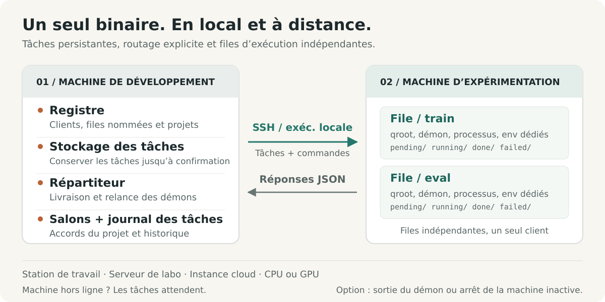
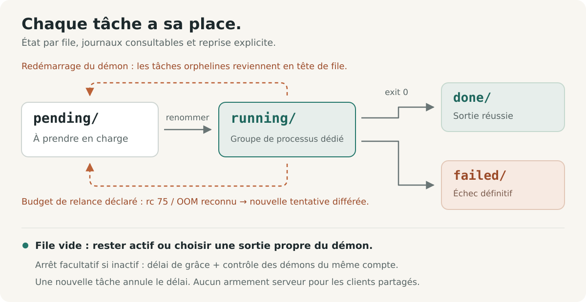

# shunt

[English](../../../README.md) · **Français** · [Deutsch](../de/README.de.md) · [Italiano](../it/README.it.md) · [日本語](../ja/README.ja.md) · [Español](../es/README.es.md) · [한국어](../ko/README.ko.md) · [简体中文](../zh-CN/README.zh-CN.md) · [繁體中文](../zh-TW/README.zh-TW.md) · [Русский](../ru/README.ru.md) · [Bahasa Indonesia](../id/README.id.md) · [Português (BR)](../pt-BR/README.pt-BR.md)


<p align="center">
  <strong>Exécutez des expériences. Coordonnez le calcul.</strong><br>
  Une couche d'opérations pour les expériences, destinée aux humains comme aux agents IA, des postes de travail locaux aux serveurs distants.
</p>

<p align="center">
  <a href="../../../Cargo.toml"></a>
  
  <a href="../../design.md#5-wire-protocol"></a>
  <a href="../../../LICENSE"></a>
</p>

<p align="center">
  <a href="#démarrage-rapide">Démarrage rapide</a> ·
  <a href="#fonctionnement">Architecture</a> ·
  <a href="#coordonner-le-calcul-partagé">Coordination</a> ·
  <a href="#conçu-pour-les-agents">Guide agent</a> ·
  <a href="../../design.md">Spécification de conception</a> ·
  <a href="#contribuer">Contribuer</a>
</p>

Les expériences s'étendent sur plusieurs projets, machines, environnements et sessions de longue durée. shunt rassemble ce travail dans un seul CLI : enregistrer des machines, lier des projets à des queues, préparer et exécuter des tâches, inspecter leurs résultats et leur consommation de ressources, et coordonner les personnes et les agents qui partagent le calcul.

Le même workflow s'applique à un poste de travail local, à un serveur de laboratoire ou à une instance cloud CPU ou GPU. Un même binaire Rust tourne des deux côtés : SSH pour les machines distantes, exécution directe de processus en local. Les tâches, les logs et l'état des queues vivent sur le disque. Les métadonnées de facturation et l'arrêt sur inactivité sont des outils optionnels pour les machines qui en ont besoin.

## Pourquoi shunt

| Quand vous devez…                                 | shunt vous offre…                                                                                                                                                                                                 |
| ------------------------------------------------- | ----------------------------------------------------------------------------------------------------------------------------------------------------------------------------------------------------------------- |
| **Travailler sur plusieurs machines et projets**  | Un registry TOML, des bindings de projets many-to-many, des répertoires de travail et environnements par binding, et un transport SSH ou local.                                                                   |
| **Séparer des workflows sur une même machine**    | Des queues nommées avec répertoires, daemons, pools de workers, shells et initialisations d'environnement indépendants sous une même identité client.                                                             |
| **Soumettre avant qu'une machine soit joignable** | Un spool persistant côté dev. Le dispatcher livre quand la machine redevient accessible et relance un daemon de queue arrêté avant de pousser.                                                                    |
| **Faire avancer les expériences**                 | Des workers concurrents, un ordre de claim FIFO, une priorité manuelle, un redimensionnement du pool à chaud, des timeouts de tâche et une replanification bornée optionnelle en cas de contention de ressources. |
| **Savoir ce qu'un run a réellement consommé**     | La disponibilité des machines et des GPU, les pics de RAM et de VRAM par tâche, le temps CPU, et les estimations de ressources déclarées en regard des usages mesurés.                                            |
| **Coordonner le calcul partagé**                  | Des rooms de coordination de projet avec suivi des non-lus, accords consignés, résumés de conversation et archivage.                                                                                              |
| **Reprendre et inspecter**                        | Une exécution au moins une fois, la récupération des orphelins, des guards d'artefacts, la déduplication des livraisons, des logs de tâches, un ledger des soumissions et des flux d'événements.                  |
| **Opérer via un agent**                           | Le même CLI avec status JSON, listings de tâches JSONL, un skill d'exploitation inclus et un canal de feedback persistant.                                                                                        |

Les contrôles machine incluent l'exécution SSH managée, le bootstrap et les mises à niveau, un proxy SOCKS5 inverse optionnel, la sortie du daemon après vidange, et un arrêt sur inactivité optionnel. Les machines partagées peuvent explicitement refuser l'armement du poweroff côté serveur.

## Démarrage rapide

### 1. Installation

Utilisez Linux avec une toolchain Rust stable, un linker système et Bash. L'exploitation à distance requiert aussi les outils OpenSSH (`ssh`, `scp` et `ssh-keygen`) sur la machine de dev.

```bash
curl -fsSL https://raw.githubusercontent.com/ShinoharaHaruna/shunt/main/install.sh | sh
shunt --help
```

Le script installe le binaire de la dernière release (build musl statique, dashboard inclus) dans `~/.local/bin` ; passez `--gnu` pour le build à liaison dynamique, `--dir` pour un autre emplacement, ou `uninstall` pour supprimer le binaire. Pour un build depuis les sources avec une toolchain Rust :

```bash
git clone https://github.com/ShinoharaHaruna/shunt.git
cd shunt
cargo install --path . --locked
shunt --help
```

### 2. Essayer la queue en local

Le client `localhost` intégré utilise le même protocole CLI via l'exécution de processus locaux. Vous pouvez tester la chaîne complète spool → dispatcher → queue sans SSH ni GPU :

```bash
# La tâche crée un marqueur de complétion dans le répertoire de la queue locale.
shunt submit -c localhost --slug hello --guard hello.done -- touch hello.done
shunt dispatch --once
shunt status -c localhost --json
shunt logs -c localhost hello

# Une fois les essais terminés, vider le daemon local et quitter.
shunt stop --root ~/.config/shunt/queue
```

L'exécution est asynchrone : répétez `status` ou `logs` après un instant pour voir le résultat. La queue locale par défaut est `~/.config/shunt/queue/` ; cette démo y laisse `hello.done`, donc la rejouer saute la tâche déjà terminée. `stop` laisse les tâches en cours du daemon se terminer ; l'arrêt sur inactivité est une opération séparée, explicitement activée.

### 3. Connecter une machine d'expérience

Exécutez ces commandes sur votre machine de dev pour un serveur Linux déjà joignable. Remplacez les chemins d'exemple par des répertoires qui vous appartiennent sur cette machine. Cette configuration réutilise une clé SSH autorisée et traite le serveur comme partagé :

```bash
shunt client add lab --template generic \
    --key ~/.ssh/id_ed25519 --deploy-root /path/you/own \
    --qroot /path/you/own/shunt-queue \
    --shared --exit-on-idle --expire unlimited

# Renseignez ssh.host, ssh.port et ssh.user pour votre serveur.
${EDITOR:-vi} ~/.config/shunt/clients/lab.toml

shunt client bootstrap lab

shunt project add experiments
shunt project bind experiments --client lab \
    --workdir /path/to/experiments --env OMP_NUM_THREADS=4 --env MKL_NUM_THREADS=4
```

`--shared` bloque l'armement de l'arrêt sur inactivité côté serveur ; `--exit-on-idle` permet au daemon de queue de quitter après vidange et d'être relancé par le prochain dispatch. Omettez ces drapeaux pour une machine dédiée avec un daemon résident. `expire = "unlimited"` décrit une machine possédée ou de laboratoire ; les machines cloud peuvent utiliser `"metered"` ou une échéance d'abonnement, avec des tarifs de facturation optionnels.

Le bootstrap installe le binaire sous la racine de la queue, vérifie la compatibilité d'exécution, initialise la queue, démarre le daemon et sonde les caractéristiques de la machine. Il peut récupérer une release statique correspondante quand le build local exige une glibc plus récente ; d'autres architectures ou des builds non publiés peuvent nécessiter un `--bin-path` explicite. Voir [compatibilité binaire](../../design.md#15-binary-compatibility-at-bootstrap).

Pour une instance cloud dédiée, les templates vendeur comme `--template autodl` amorcent les valeurs par défaut du déploiement. Sans `--key`, shunt génère une paire de clés dédiée : installez vous-même sa clé publique, ou configurez `ssh.password` et installez `sshpass` pour un déploiement assisté par mot de passe sur une machine dédiée. Les clients partagés sautent le déploiement automatique de clés.

Le `workdir` du binding doit déjà contenir votre code, vos données et votre environnement d'exécution. Le bootstrap déploie shunt ; le binding de projet enregistre l'endroit où vos expériences s'exécutent.

### 4. Soumettre et inspecter une expérience

En supposant que votre `train.py` écrit `runs/exp1/metrics.json` en cas de succès :

```bash
shunt submit -p experiments -c lab --slug exp1 \
    --guard runs/exp1/metrics.json --timeout 14400 -- \
    uv run python train.py --out runs/exp1

shunt dispatch --once               # livrer le spool courant
shunt status -c lab --json           # inspecter l'état de la queue et l'usage des ressources
shunt logs -c lab exp1               # inspecter le log de la tâche
```

Laissez `shunt dispatch` tourner dans un autre terminal de la machine de dev pour une livraison continue, y compris des tâches soumises pendant qu'une machine est hors ligne. Après livraison, le daemon de queue de la machine exécute la tâche indépendamment du dispatcher ou du terminal de soumission.

`--timeout 14400` fixe une limite de quatre heures en temps réel pour cette tâche. `--guard` vérifie un chemin relatif au `workdir` du binding et saute l'exécution s'il existe déjà. `uv` et `train.py` sont des dépendances d'exemple ; utilisez la commande dont votre projet a besoin.

## Fonctionnement



Le nom vient du triage ferroviaire (shunting). Votre machine de dev est la gare de triage ; chaque machine d'expérience est une voie de destination. Un **client** est une machine enregistrée ; une **queue** est une voie d'exécution sur celle-ci ; un **binding de projet** fournit le répertoire de travail et l'environnement d'un couple `(client, queue)`.

| Sur votre machine de dev                                                                                           | Sur chaque machine d'expérience                                                                                              |
| ------------------------------------------------------------------------------------------------------------------ | ---------------------------------------------------------------------------------------------------------------------------- |
| **Registry** — TOML éditable pour les clients, queues, projets, bindings et la facturation optionnelle.            | **Queues** — répertoires de tâches sous `pending/`, `running/`, `done/` et `failed/`.                                        |
| **Spool et dispatcher** — préparent les tâches jusqu'à acquittement, les livrent et relancent les daemons arrêtés. | **Daemons** — un par queue, avec workers concurrents, logs, échantillonnage d'usage et récupération des orphelins.           |
| **Ledger des tâches et rooms** — suivent les soumissions et conservent l'historique de coordination des projets.   | **Environnements de tâches** — initialisation de la queue et shell, paramètres du binding de projet et surcharges par tâche. |

### Projets et queues nommées

Séparez l'entraînement, l'évaluation ou des projets différents sur une même machine sans enregistrer d'identités SSH dupliquées :

```bash
shunt queue add eval -c lab --qroot /path/you/own/shunt-eval \
    --workers 2 --exit-on-idle
shunt queue bootstrap eval -c lab
shunt project bind experiments --client lab --queue eval \
    --workdir /path/to/experiments --env OMP_NUM_THREADS=2 --env MKL_NUM_THREADS=2
shunt submit -p experiments -c lab --queue eval --slug eval1 \
    --guard runs/eval1.json -- python evaluate.py --out runs/eval1.json
shunt status -c lab --queue eval --json
```

Chaque queue possède son qroot, son espace de séquence, son pool de workers, son daemon, son binaire, son shell et son initialisation d'environnement. La sélection de queue suit `--queue` → le `default_queue` configuré → l'unique queue ; un choix non résolu échoue avec une erreur d'ambiguïté. Les tâches préparées épinglent leur queue et leur qroot : changer le défaut après coup ne redirige jamais le travail déjà soumis.

Configurez `env_setup` et `shell` sur une queue pour l'activation d'environnement ou les exports partagés, puis poussez-les avec `shunt queue env <name> -c lab` ; `shunt client env lab` met à jour toutes les queues. Les surcharges d'environnement par projet et par tâche permettent à une queue de servir plusieurs charges de travail.

Le canal de communication est `ssh <machine> 'shunt <cmd> --json'`. Aucun service HTTP ni connexion inverse vers la machine de dev n'est requis. Le même binaire offre un transport local direct pour `localhost` et les clients supplémentaires créés par `client add --local`.

### Une queue inspectable



Chaque tâche est un répertoire nommé `NNNN_<slug>`. Il contient `task.sh` et accumule un `log`, un enregistrement `pid` vivant, un `usage` mesuré et un code `exit` final. Les transitions de queue utilisent des renommages du système de fichiers. Le nombre de workers est relu à chaque poll, donc le redimensionnement ne demande aucun redémarrage ; le réduire laisse les tâches en cours finir. Les tâches s'exécutent dans des groupes de processus séparés, avec des vérifications d'identité enregistrées avant tout signal.

**L'exécution est au moins une fois.** Les IDs de tâches générés par le serveur dédupliquent les relivraisons sur les pistes actives de la queue, mais une reprise de daemon ou une livraison hors de cette fenêtre de déduplication peut encore provoquer une réexécution. Un guard est un test d'existence avant exécution : ne publiez l'artefact gardé que lorsqu'il représente un travail terminé, et rendez les réexécutions sûres. Il ne fournit ni exécution exactement une fois ni verrou contre les tentatives qui se chevauchent. Voir le [contrat de guard](../../design.md#313-task-file-format-and-the-guard-contract) et le [template de tâche](../../../task_template.sh).

## Expériences tenant compte des ressources

Déclarez des estimations, fixez un budget de temps réel et autorisez une relance bornée quand les ressources sont temporairement indisponibles :

```bash
shunt submit -p experiments -c lab --slug exp2 \
    --guard runs/exp2/metrics.json --timeout 14400 \
    --retry 2 --retry-delay 60 --ram-mb 8192 --cpu-cores 4 --gpu-mem-mb 4096 \
    --env CUDA_VISIBLE_DEVICES=0 --env OMP_NUM_THREADS=4 --env MKL_NUM_THREADS=4 -- \
    uv run python train.py --out runs/exp2
shunt status -c lab --json
```

`--retry 2` autorise deux tentatives supplémentaires pour le code de sortie 75 (`EX_TEMPFAIL`, un signal de ressource occupée) ou une signature de manque de mémoire reconnue dans le log. Chacune attend au moins `--retry-delay` secondes avant de redevenir éligible. Les autres échecs et timeouts restent des échecs ; les relances exigent un budget explicite.

Le status met en regard les estimations déclarées avec les pics de RAM par tâche échantillonnés, les pics de VRAM par GPU et les secondes de CPU cumulées. Il rapporte aussi la mémoire et l'utilisation GPU courantes, la RAM hôte et la charge ; les sondes de machine fournissent des capacités tenant compte des cgroups. La télémétrie GPU utilise `nvidia-smi` quand il est disponible. L'échantillonnage peut manquer les processus éphémères ou les pics brefs.

**Les estimations sont des annotations, pas des réservations de ressources ni des contrôles d'admission.** Vous ou votre agent choisissez la cible, le nombre de workers et l'attribution des GPU. Les tâches CPU-only utilisent la même queue sans drapeaux GPU. Voir la [télémétrie des ressources](../../design.md#316-resource-declarations-and-usage-telemetry).

## Coordonner le calcul partagé

Quand des projets partagent une machine, leurs agents ont besoin d'un endroit pour convenir des limites de workers, des budgets mémoire ou du placement GPU. Les rooms de coordination conservent cette conversation et son accord courant aux côtés du registry :

```bash
# Supposons que experiments et analysis sont des projets enregistrés.
shunt room ls --as experiments          # rooms, compteurs de non-lus, groupes suggérés
shunt room create shared-compute --members experiments,analysis --clients lab
shunt room say shared-compute --as experiments \
    --body "Training needs GPU 0 until 18:00; can evaluation use GPU 1?"
shunt room read shared-compute --as analysis
shunt room decide shared-compute --as analysis \
    --note "Training uses GPU 0; evaluation uses GPU 1 with two workers."
shunt status --all --json --as experiments
```

Les rooms ont une appartenance par projet, des positions de non-lus par identité et une décision courante. `room ls` suggère des groupes de projets liés à la même machine. Les longues conversations peuvent être compactées en résumés dans le flux tout en conservant les messages archivés pour des lectures par plage ; des rooms entières peuvent être archivées et restaurées.

Les rooms vivent sur une machine de dev et peuvent couvrir ses clients enregistrés. Les agents partageant ce registry peuvent les interroger avant de modifier le calcul partagé. Les accords prennent effet quand les participants les appliquent avec des commandes comme `workers` ou `submit --env` ; les rooms n'imposent ni ordonnancement ni allocation de ressources. Voir les [rooms de coordination](../../design.md#17-coordination-rooms-server-side).

## Opérations courantes

Exécutez ces commandes sur la machine de dev. Les exemples spécifiques à un client utilisent le client enregistré `lab` ; ajoutez `--queue eval` pour cibler la queue nommée.

| Intention                                           | Commande                                              |
| --------------------------------------------------- | ----------------------------------------------------- |
| Voir toutes les machines, queues et rooms           | `shunt status --all --json`                           |
| Voir les soumissions en attente de livraison        | `shunt spool ls`                                      |
| Inspecter une tâche soumise par son ID              | `shunt task show <id> --json`                         |
| Lire le flux d'événements de tâches du serveur      | `shunt task events`                                   |
| Redimensionner le pool de workers                   | `shunt workers 4 -c lab`                              |
| Avancer une tâche pending en tête de file           | `shunt prio exp1 0 -c lab`                            |
| Annuler une tâche pending                           | `shunt cancel exp1 -c lab`                            |
| Parquer une tâche pending jusqu'à sa libération     | `shunt hold exp1 -c lab "waiting on lease"`           |
| Libérer une tâche pending parquée                   | `shunt release exp1 -c lab`                           |
| Arrêter le groupe de processus d'une tâche en cours | `shunt kill exp1 -c lab`                              |
| Vider et arrêter le daemon d'une queue              | `shunt queue stop eval -c lab`                        |
| Rafraîchir les informations de la machine           | `shunt client probe lab`                              |
| Lister les queues d'une machine                     | `shunt queue ls -c lab`                               |
| Exécuter une commande ad hoc via SSH managé         | `shunt client exec lab -- nvidia-smi`                 |
| Mettre à jour un endpoint SSH déplacé               | `shunt client update lab --host <host> --port <port>` |
| Effacer une clé d'hôte et une connexion périmées    | `shunt client hostkey lab`                            |
| Ouvrir le proxy SOCKS5 inverse optionnel            | `shunt tunnel up -c lab`                              |
| Générer les complétions du shell                    | `shunt completions zsh`                               |
| Inspecter la version et le build locaux             | `shunt version --json`                                |
| Vérifier l'existence d'une nouvelle release         | `shunt upgrade --check --json`                        |
| Mettre à niveau le binaire local                    | `shunt upgrade`                                       |
| Mettre à niveau le binaire d'une queue distante     | `shunt upgrade -c lab --queue eval`                   |

Les motifs de contrôle de tâches comme `exp1` doivent identifier une seule tâche ; utilisez le nom complet de l'entrée de tâche quand un motif est ambigu. Le ledger des tâches fait correspondre un ID de soumission à ce nom d'entrée. `task show` interroge la machine à la demande pour résoudre un résultat ; une entrée hors de la fenêtre de status récent peut apparaître comme `unknown`. Le travail peut aussi être parqué avant d'être réclamable : `--hold` retient une soumission dans le spool côté dev jusqu'à `spool release`, et `--hold-on-box` la livre en laissant l'entrée côté box non réclamable jusqu'à `shunt release`.

Les mises à niveau vérifient les sommes de contrôle de la release et la version du binaire avant installation. Un daemon vivant — celui d'une queue locale, d'une box distante ou du dashboard `serve` — est redémarré par handoff sur le binaire installé : il se ré-exécute sur place, garde le même pid, et le travail en cours continue de tourner ; un daemon arrêté est simplement démarré. Quand l'image en cours précède le gestionnaire de handoff, la mise à niveau la nomme au lieu de la signaler, et arrêter puis démarrer ce daemon (`serve down` + `serve up` pour le dashboard) le fait passer sur le nouveau binaire. Un dispatcher n'a pas de pidfile : une mise à niveau locale se contente de nommer les pid des dispatchers vivants — envoyez `SIGUSR2` à chacun, ou redémarrez-le. Les mises à niveau par release précompilée ciblent actuellement Linux x86_64.

Utilisez `shunt <command> --help` pour les drapeaux et la [référence CLI](../../design.md#10-cli-surface) pour la surface complète. Les commandes de queue comme `status` et `logs` fonctionnent aussi directement sur une machine avec `--root <qroot>`.

### Arrêt sur inactivité optionnel

Pour une machine dédiée que vous voulez éteindre après un lot, activez explicitement avec `shunt shutdown -c <client> on` ; utilisez `off` pour désarmer et `status` pour inspecter la commande résolue. La queue ne décompte qu'après vidange, et tout nouveau travail annule le décompte. Le serveur précontrôle les queues sœurs enregistrées à l'armement ; la barrière d'exécution de la machine vérifie les daemons vivants sous le même compte Unix. Un client `shared` refuse l'armement côté serveur.

Pour un poste de travail ou un serveur partagé qui doit rester allumé, utilisez `exit_on_idle` pour ne terminer que le daemon, ou gardez-le résident pour le lot suivant. La démo locale et le démarrage rapide sur serveur partagé ne demandent aucune configuration de gestion d'énergie.

## Conçu pour les agents

Le CLI est aussi l'interface agent. Le status des queues et les requêtes du ledger de tâches exposent du JSON ou JSONL structuré ; les logs de tâches et de daemons fournissent le détail derrière ces états. Les informations machine, les ressources en direct, l'usage déclaré versus mesuré et les compteurs de non-lus des rooms donnent aux agents le contexte pour choisir une cible, dimensionner un lot et négocier le calcul partagé. Les tarifs de facturation configurés et les métadonnées d'échéance ajoutent du contexte quand une machine a un coût ou une limite de temps.

Le [skill shunt](../../../skills/shunt/SKILL.md) inclus enseigne la configuration, les soumissions gardées, l'interprétation des queues, la coordination, la gestion des échecs et l'exploitation optionnelle sensible aux coûts. Pointez votre agent dessus avant de gérer des machines d'expérience.

Installez le skill en liant `skills/shunt/` dans le répertoire où votre agent charge ses skills :

```bash
ln -s "$PWD/skills/shunt" ~/.agents/skills/shunt   # répertoire agentskills partagé
# ou : cp -r skills/shunt ~/.claude/skills/shunt   # skills utilisateur de Claude Code
# ou : cp -r skills/shunt .claude/skills/          # propre au projet
```

```bash
shunt task ls --json
shunt status --all --json --as experiments
shunt task show <id> --json
```

shunt expose des faits et exécute des commandes explicites. Choisir une machine, appliquer les accords de ressources, décider si un run tient dans le budget, et provisionner ou allumer les machines restent à la charge de l'humain ou du workflow d'agent environnant.

Quand un agent rencontre un défaut ou une aspérité de shunt, `shunt feedback "title" --body "…"` le dépose en issue GitHub. Le canal de feedback expurge les identifiants connus du registry et les noms de clients, projets et queues enregistrés, sauvegarde un rapport local avant livraison, déduplique les répétitions et applique un plafond horaire. Prévisualisez avec `--dry-run` ; inspectez les rapports en attente avec `feedback ls --json` et relivrez avec `feedback retry`. Les rapports sont publics par défaut, et le filtre ne peut pas reconnaître tous les secrets possibles. Voir [feedback](../../design.md#14-feedback-channel).

## Limites de fonctionnement

- **Tâches indépendantes et placement explicite.** Pas de graphe de dépendances, de sélection automatique de machine ni d'équilibrage de charge multi-machines ; chaque soumission cible un client et une queue. Les déclarations de ressources et les décisions de room ne réservent pas de matériel et n'isolent pas les tenants.
- **Reprise bornée.** Les échecs de type ressource occupée ou manque de mémoire reconnu ne peuvent être replanifiés qu'avec un budget de relance déclaré. Les échecs hors de ces critères, les timeouts et les relances épuisées aboutissent dans `failed/` ; inspectez les logs et resoumettez si approprié. La récupération des orphelins après un redémarrage de daemon est un mécanisme séparé.
- **Coordination locale.** Les rooms servent les agents partageant un même registry côté dev. Elles fournissent un registre de coordination à interroger, sans messagerie entre registries, notifications push ni contrôle d'accès imposé entre participants.
- **Poweroff optionnel.** L'arrêt sur inactivité utilise une commande configurable et un délai de grâce, 60 secondes par défaut. Des queues managées vides n'établissent pas que d'autres utilisateurs ou des charges non managées sont inactifs. Vérifiez la commande d'arrêt pour votre machine ; shunt ne contrôle pas les règles de facturation du vendeur. Une mise en file concurrente du dernier contrôle avant poweroff peut toujours perdre face à l'arrêt.
- **Déploiement explicite.** Le binding de projet enregistre des chemins et l'environnement ; il ne synchronise pas le code source, ne provisionne pas les dépendances et ne crée pas le workdir distant.

L'implémentation Rust couvre le registry, les queues nommées, le spool, le dispatcher, les transports SSH et local, la télémétrie des tâches, les rooms de coordination, le tunnel, la mise à niveau, le feedback et le daemon de queue côté client. Elle est en développement actif ; [docs/design.md](../../design.md) définit le contrat comportemental et ses cas limites.

## Contribuer

Commencez par la [spécification de conception](../../design.md) et le [guide du dépôt](../../../AGENTS.md). Pour un changement de comportement de queue, mettez à jour le contrat et couvrez la transition ou le cas d'échec pertinent.

```bash
just setup       # activer les hooks Git versionnés
just fmt         # formater Rust, Markdown, TOML et JSON
just check       # vérification de format + clippy (-D warnings) + tests
```

Ces recettes requièrent `just` et `dprint` ; le formatage Rust et Clippy viennent de la toolchain configurée. Les hooks vérifient le formatage avant commit et lancent Clippy avant push. Ils ne réécrivent jamais les fichiers ; la suite de tests complète s'exécute via `just check` ou `just test`.

### Publication d'une version

Poussez un tag SemVer comme `v0.1.0` (ou `0.1.0`) sur le commit à publier. La version, hors préfixe `v` optionnel, doit correspondre à `package.version` dans `Cargo.toml` ; mettez aussi à jour `Cargo.lock` avec le changement de version. Le commit tagué doit inclure [le workflow de release](../../../.github/workflows/release.yml).

```bash
git tag -a v0.1.0 -m "Release v0.1.0"
git push origin v0.1.0
```

Le workflow vérifie le formatage, lance Clippy et les tests pour les deux cibles, puis publie une GitHub Release avec des notes générées, des archives binaires Linux x86_64 musl (statique) et GNU, et des fichiers `SHA256SUMS-<target>` par cible. Les tags avec un suffixe de pré-version, comme `v0.2.0-rc.1`, créent des prereleases. Il utilise le `GITHUB_TOKEN` intégré ; aucun secret supplémentaire n'est requis. Les releases publiées ne sont pas écrasées en cas de réexécution.

| Par où commencer                               | Pour…                                                                    |
| ---------------------------------------------- | ------------------------------------------------------------------------ |
| [Spécification de conception](../../design.md) | Sémantique des queues, protocole, télémétrie, rooms et stratégie de test |
| [Skill agent](../../../skills/shunt/SKILL.md)  | Manuel d'exploitation pour un agent IA                                   |
| [Templates vendeur](../../../etc/vendors/)     | Défauts de clients AutoDL et génériques                                  |
| [Template de tâche](../../../task_template.sh) | Écrire un script de tâche gardé                                          |
| [Tests d'intégration](../../../tests/)         | Comportement des queues, processus, arrêt et dispatch                    |

## Licence

[MIT](../../../LICENSE).
