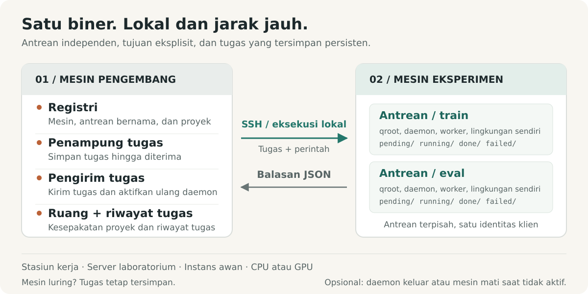
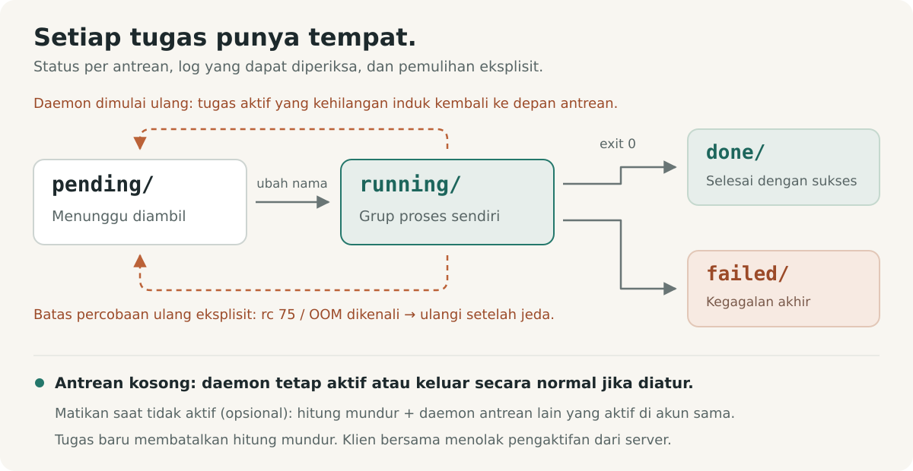

# shunt

[English](../../../README.md) · [Français](../fr/README.fr.md) · [Deutsch](../de/README.de.md) · [Italiano](../it/README.it.md) · [日本語](../ja/README.ja.md) · [Español](../es/README.es.md) · [한국어](../ko/README.ko.md) · [简体中文](../zh-CN/README.zh-CN.md) · [繁體中文](../zh-TW/README.zh-TW.md) · [Русский](../ru/README.ru.md) · **Bahasa Indonesia** · [Português (BR)](../pt-BR/README.pt-BR.md)


<p align="center">
  <strong>Jalankan eksperimen. Koordinasikan komputasi.</strong><br>
  Lapisan operasi eksperimen untuk manusia dan agen AI, dari workstation lokal hingga server remote.
</p>

<p align="center">
  <a href="../../../Cargo.toml"></a>
  
  <a href="../../design.md#5-wire-protocol"></a>
  <a href="../../../LICENSE"></a>
</p>

<p align="center">
  <a href="#mulai-cepat">Mulai cepat</a> ·
  <a href="#cara-kerja">Arsitektur</a> ·
  <a href="#koordinasi-komputasi-bersama">Koordinasi</a> ·
  <a href="#dibangun-untuk-agen">Panduan agen</a> ·
  <a href="../../design.md">Spesifikasi desain</a> ·
  <a href="#berkontribusi">Berkontribusi</a>
</p>

Eksperimen mencakup berbagai proyek, mesin, environment, dan sesi yang berjalan lama. shunt menyatukan pekerjaan itu dalam satu CLI: mendaftarkan mesin, mem-bind proyek ke queue, menyiapkan dan menjalankan tugas, memeriksa hasil serta penggunaan sumber dayanya, dan mengoordinasikan manusia serta agen yang berbagi komputasi.

Gunakan alur kerja yang sama di workstation lokal, server lab, atau instance CPU maupun GPU cloud. Satu biner Rust berjalan di kedua sisi, dengan SSH untuk mesin remote dan eksekusi proses langsung secara lokal. Tugas, log, dan status queue tersimpan di disk. Metadata penagihan dan pematian idle adalah alat opsional untuk mesin yang memerlukannya.

## Mengapa shunt

| Saat Anda perlu…                                    | shunt menyediakan…                                                                                                                                               |
| --------------------------------------------------- | ---------------------------------------------------------------------------------------------------------------------------------------------------------------- |
| **Bekerja lintas mesin dan proyek**                 | Registry TOML, binding proyek many-to-many, direktori kerja dan environment per binding, serta transport SSH atau lokal.                                         |
| **Memisahkan alur kerja di satu mesin**             | Queue bernama dengan direktori, daemon, pool worker, shell, dan env setup masing-masing, di bawah satu identitas client.                                         |
| **Submit sebelum mesin bisa dijangkau**             | Spool persisten di sisi dev. Dispatcher mengirimkan saat mesin kembali dan membangunkan daemon queue yang berhenti sebelum push.                                 |
| **Menjaga eksperimen tetap berjalan**               | Worker konkuren, urutan claim FIFO, prioritas manual, resize pool saat berjalan, timeout tugas, dan penjadwalan ulang terbatas opt-in untuk rebutan sumber daya. |
| **Mengetahui sumber daya yang benar-benar dipakai** | Ketersediaan mesin dan GPU, puncak RAM dan VRAM per tugas, waktu CPU, serta estimasi sumber daya yang dideklarasikan berdampingan dengan penggunaan terukur.     |
| **Mengoordinasikan komputasi bersama**              | Ruang koordinasi proyek dengan pelacakan belum dibaca, kesepakatan tercatat, ringkasan percakapan, dan pengarsipan.                                              |
| **Pemulihan dan inspeksi**                          | Eksekusi at-least-once, pemulihan orphan, guard artefak, deduplikasi pengiriman, log tugas, ledger pengiriman, dan event stream.                                 |
| **Operasi lewat agen**                              | CLI yang sama dengan status JSON, daftar tugas JSONL, skill operasi bawaan, dan saluran feedback persisten.                                                      |

Kendali mesin mencakup eksekusi SSH terkelola, bootstrap dan upgrade, proxy SOCKS5 reverse opsional, daemon yang keluar setelah drain, dan pematian idle opt-in. Mesin bersama dapat secara eksplisit menolak arming poweroff dari sisi server.

## Mulai cepat

### 1. Instalasi

Gunakan Linux dengan toolchain Rust stable, linker sistem, dan Bash. Operasi remote juga memerlukan OpenSSH (`ssh`, `scp`, dan `ssh-keygen`) di mesin dev.

```bash
curl -fsSL https://raw.githubusercontent.com/ShinoharaHaruna/shunt/main/install.sh | sh
shunt --help
```

Skrip ini menginstal biner rilis terbaru (build musl statik, dashboard termasuk) ke `~/.local/bin`; berikan `--gnu` untuk build dynamic-linked, `--dir` untuk lokasi lain, atau `uninstall` untuk menghapus biner. Untuk build dari sumber dengan toolchain Rust:

```bash
git clone https://github.com/ShinoharaHaruna/shunt.git
cd shunt
cargo install --path . --locked
shunt --help
```

### 2. Coba queue secara lokal

Client `localhost` bawaan menggunakan protokol CLI yang sama lewat eksekusi proses lokal. Anda bisa mencoba alur lengkap spool → dispatcher → queue tanpa SSH atau GPU:

```bash
# Tugas ini membuat penanda selesai di direktori queue lokal.
shunt submit -c localhost --slug hello --guard hello.done -- touch hello.done
shunt dispatch --once
shunt status -c localhost --json
shunt logs -c localhost hello

# Setelah selesai mencoba, drain daemon lokal lalu keluar.
shunt stop --root ~/.config/shunt/queue
```

Eksekusi bersifat asinkron: ulangi `status` atau `logs` setelah beberapa saat untuk melihat hasilnya. Queue lokal default adalah `~/.config/shunt/queue/`; demo ini menyisakan `hello.done` di sana, sehingga pengulangan akan melewati tugas yang sudah selesai. `stop` melakukan drain pada tugas yang sedang berjalan di daemon; pematian idle adalah operasi terpisah yang bersifat opt-in.

### 3. Hubungkan mesin eksperimen

Jalankan perintah berikut di mesin dev untuk server Linux yang sudah bisa dijangkau. Ganti path contoh dengan direktori milik Anda di mesin tersebut. Setup ini memakai ulang SSH key yang sudah diotorisasi dan memperlakukan server sebagai mesin bersama:

```bash
shunt client add lab --template generic \
    --key ~/.ssh/id_ed25519 --deploy-root /path/you/own \
    --qroot /path/you/own/shunt-queue \
    --shared --exit-on-idle --expire unlimited

# Isi ssh.host, ssh.port, dan ssh.user untuk server Anda.
${EDITOR:-vi} ~/.config/shunt/clients/lab.toml

shunt client bootstrap lab

shunt project add experiments
shunt project bind experiments --client lab \
    --workdir /path/to/experiments --env OMP_NUM_THREADS=4 --env MKL_NUM_THREADS=4
```

`--shared` menolak arming pematian idle dari sisi server; `--exit-on-idle` membuat daemon queue keluar setelah drain dan dibangunkan lagi oleh dispatch berikutnya. Hilangkan flag tersebut jika Anda ingin mesin khusus dengan daemon yang selalu berjalan. `expire = "unlimited"` menggambarkan mesin milik sendiri atau mesin lab; mesin cloud dapat menggunakan `"metered"` atau batas waktu langganan, dengan tarif penagihan opsional.

Bootstrap menginstal biner di bawah queue root, memeriksa kompatibilitas runtime, menginisialisasi queue, menjalankan daemon, dan mem-probe fakta mesin. Ia dapat mengambil rilis statik yang cocok saat build lokal memerlukan glibc yang lebih baru; arsitektur lain atau build yang belum dirilis mungkin memerlukan `--bin-path` eksplisit. Lihat [kompatibilitas biner](../../design.md#15-binary-compatibility-at-bootstrap).

Untuk instance cloud khusus, template vendor seperti `--template autodl` mengisi default deployment. Tanpa `--key`, shunt membuat keypair khusus: pasang public key-nya sendiri, atau konfigurasikan `ssh.password` dan instal `sshpass` untuk deployment berbantuan password di mesin khusus. Client bersama melewati deployment key otomatis.

`workdir` pada binding harus sudah berisi kode, data, dan environment runtime Anda. Bootstrap men-deploy shunt; binding proyek mencatat di mana eksperimen Anda berjalan.

### 4. Kirim dan periksa eksperimen

Dengan asumsi `train.py` Anda menulis `runs/exp1/metrics.json` setelah berhasil:

```bash
shunt submit -p experiments -c lab --slug exp1 \
    --guard runs/exp1/metrics.json --timeout 14400 -- \
    uv run python train.py --out runs/exp1

shunt dispatch --once               # kirimkan spool saat ini
shunt status -c lab --json           # periksa status queue dan penggunaan sumber daya
shunt logs -c lab exp1               # periksa log tugas
```

Jalankan `shunt dispatch` di terminal mesin dev lain untuk pengiriman berkelanjutan, termasuk tugas yang dikirim saat mesin sedang offline. Setelah terkirim, daemon queue milik mesin itu menjalankan tugas secara independen dari dispatcher maupun terminal pengirim.

`--timeout 14400` menetapkan batas wall-clock empat jam untuk tugas ini. `--guard` memeriksa path relatif terhadap `workdir` binding dan melewati eksekusi jika path itu sudah ada. `uv` dan `train.py` adalah contoh dependensi beban kerja; gunakan perintah yang dibutuhkan proyek Anda.

## Cara kerja



Nama ini berasal dari shunting kereta api. Mesin dev Anda adalah stasiun pemilah; setiap mesin eksperimen adalah jalur simpan tujuan. **Client** adalah mesin terdaftar; **queue** adalah satu lajur eksekusi di mesin itu; **project binding** menyediakan direktori kerja dan environment untuk pasangan `(client, queue)`.

| Di mesin dev Anda                                                                                            | Di setiap mesin eksperimen                                                                           |
| ------------------------------------------------------------------------------------------------------------ | ---------------------------------------------------------------------------------------------------- |
| **Registry** — TOML yang dapat diedit untuk client, queue, proyek, binding, dan penagihan opsional.          | **Queue** — direktori tugas di bawah `pending/`, `running/`, `done/`, dan `failed/`.                 |
| **Spool dan dispatcher** — menyiapkan tugas hingga diakui, mengirimkannya, dan membangunkan daemon berhenti. | **Daemon** — satu per queue, dengan worker konkuren, log, sampling penggunaan, dan pemulihan orphan. |
| **Ledger tugas dan ruang** — melacak pengiriman dan menyimpan riwayat koordinasi proyek.                     | **Environment tugas** — setup dan shell queue, pengaturan binding proyek, dan override per tugas.    |

### Proyek dan queue bernama

Pisahkan training, evaluasi, atau proyek berbeda di satu mesin tanpa mendaftarkan identitas SSH duplikat:

```bash
shunt queue add eval -c lab --qroot /path/you/own/shunt-eval \
    --workers 2 --exit-on-idle
shunt queue bootstrap eval -c lab
shunt project bind experiments --client lab --queue eval \
    --workdir /path/to/experiments --env OMP_NUM_THREADS=2 --env MKL_NUM_THREADS=2
shunt submit -p experiments -c lab --queue eval --slug eval1 \
    --guard runs/eval1.json -- python evaluate.py --out runs/eval1.json
shunt status -c lab --queue eval --json
```

Setiap queue memiliki qroot, ruang nomor urut, pool worker, daemon, biner, shell, dan env setup sendiri. Pemilihan queue mengikuti `--queue` → `default_queue` terkonfigurasi → satu-satunya queue; pilihan yang tidak terselesaikan gagal dengan error ambiguitas. Tugas yang sudah di-stage mengunci queue dan qroot-nya, sehingga mengubah default tidak pernah mengalihkan pekerjaan yang sudah dikirim.

Konfigurasikan `env_setup` dan `shell` pada queue untuk aktivasi environment atau export bersama, lalu push dengan `shunt queue env <name> -c lab`; `shunt client env lab` memperbarui semua queue. Overlay environment proyek dan per tugas memungkinkan satu queue melayani beberapa beban kerja.

Wire-nya adalah `ssh <machine> 'shunt <cmd> --json'`. Tidak perlu layanan HTTP atau koneksi balik ke mesin dev. Biner yang sama mendukung transport lokal langsung untuk `localhost` dan client tambahan dari `client add --local`.

### Queue yang dapat diperiksa



Setiap tugas adalah direktori bernama `NNNN_<slug>`. Ia berisi `task.sh` dan mengakumulasi `log`, catatan `pid` live, `usage` terukur, dan kode `exit` akhir. Transisi queue memakai rename filesystem. Jumlah worker dibaca ulang pada setiap poll, sehingga resize tidak butuh restart; menurunkannya membiarkan tugas berjalan selesai. Tugas berjalan di process group terpisah, dengan pemeriksaan identitas tercatat sebelum pengiriman sinyal.

**Eksekusi bersifat at-least-once.** ID tugas buatan server mendeduplikasi pengiriman ulang di seluruh track queue yang live, tetapi pemulihan daemon atau pengiriman di luar jendela deduplikasi itu tetap bisa memicu rerun. Guard adalah pemeriksaan keberadaan sebelum eksekusi, jadi publikasikan artefak yang di-guard hanya saat ia mewakili pekerjaan yang sudah selesai, dan buat rerun aman. Ia tidak menyediakan eksekusi exactly-once maupun lock terhadap percobaan yang tumpang tindih. Lihat [kontrak guard](../../design.md#313-task-file-format-and-the-guard-contract) dan [template tugas](../../../task_template.sh).

## Eksperimen sadar sumber daya

Deklarasikan estimasi, tetapkan anggaran wall-clock, dan izinkan retry terbatas saat sumber daya sementara tidak tersedia:

```bash
shunt submit -p experiments -c lab --slug exp2 \
    --guard runs/exp2/metrics.json --timeout 14400 \
    --retry 2 --retry-delay 60 --ram-mb 8192 --cpu-cores 4 --gpu-mem-mb 4096 \
    --env CUDA_VISIBLE_DEVICES=0 --env OMP_NUM_THREADS=4 --env MKL_NUM_THREADS=4 -- \
    uv run python train.py --out runs/exp2
shunt status -c lab --json
```

`--retry 2` mengizinkan dua percobaan tambahan untuk exit code 75 (`EX_TEMPFAIL`, sinyal sumber daya sibuk) atau tanda out-of-memory yang dikenali di log. Setiap percobaan menunggu setidaknya `--retry-delay` detik sebelum bisa di-claim. Kegagalan lain dan timeout tetap dianggap gagal; retry memerlukan anggaran eksplisit.

Status memasangkan estimasi yang dideklarasikan dengan puncak RAM per tugas yang disampling, puncak VRAM per GPU, dan detik CPU kumulatif. Ia juga melaporkan memori dan utilisasi GPU saat ini, RAM host, dan load; probe mesin menyediakan fakta kapasitas yang sadar cgroup. Telemetri GPU memakai `nvidia-smi` bila tersedia. Sampling bisa melewatkan proses berumur pendek atau puncak sekejap.

**Estimasi adalah anotasi, bukan reservasi sumber daya atau pemeriksaan admission.** Anda atau agen Anda yang memilih target, jumlah worker, dan penempatan GPU. Tugas khusus CPU memakai queue yang sama tanpa flag GPU. Lihat [telemetri sumber daya](../../design.md#316-resource-declarations-and-usage-telemetry).

## Koordinasi komputasi bersama

Saat beberapa proyek berbagi satu mesin, agen mereka butuh tempat untuk menyepakati batas worker, anggaran memori, atau penempatan GPU. Ruang koordinasi menyimpan percakapan dan kesepakatan terkininya di samping registry:

```bash
# Asumsikan experiments dan analysis sudah terdaftar sebagai proyek.
shunt room ls --as experiments          # ruang, jumlah belum dibaca, saran pengelompokan
shunt room create shared-compute --members experiments,analysis --clients lab
shunt room say shared-compute --as experiments \
    --body "Training needs GPU 0 until 18:00; can evaluation use GPU 1?"
shunt room read shared-compute --as analysis
shunt room decide shared-compute --as analysis \
    --note "Training uses GPU 0; evaluation uses GPU 1 with two workers."
shunt status --all --json --as experiments
```

Ruang memiliki keanggotaan proyek, posisi belum dibaca per identitas, dan satu keputusan terkini. `room ls` menyarankan pengelompokan proyek yang di-bind ke mesin yang sama. Percakapan panjang dapat dipadatkan menjadi digest dalam stream sambil tetap menyimpan pesan yang diarsipkan untuk pembacaan per rentang; seluruh ruang juga dapat diarsipkan dan dipulihkan.

Ruang berada di satu mesin dev dan dapat mencakup client terdaftarnya. Agen yang berbagi registry itu dapat melakukan poll sebelum mengubah komputasi bersama. Kesepakatan berlaku saat peserta menerapkannya dengan perintah seperti `workers` atau `submit --env`; ruang tidak menegakkan penjadwalan atau alokasi sumber daya. Lihat [ruang koordinasi](../../design.md#17-coordination-rooms-server-side).

## Kendali sehari-hari

Jalankan perintah berikut di mesin dev. Contoh khusus client memakai client terdaftar `lab`; tambahkan `--queue eval` untuk menargetkan queue bernama.

| Maksud                                       | Perintah                                              |
| -------------------------------------------- | ----------------------------------------------------- |
| Lihat semua mesin, queue, dan ruang          | `shunt status --all --json`                           |
| Lihat pengiriman yang menunggu dikirim       | `shunt spool ls`                                      |
| Periksa tugas terkirim berdasarkan ID-nya    | `shunt task show <id> --json`                         |
| Baca event stream tugas sisi server          | `shunt task events`                                   |
| Ubah ukuran pool worker                      | `shunt workers 4 -c lab`                              |
| Pindahkan tugas pending ke antrean depan     | `shunt prio exp1 0 -c lab`                            |
| Batalkan tugas pending                       | `shunt cancel exp1 -c lab`                            |
| Hentikan process group tugas yang berjalan   | `shunt kill exp1 -c lab`                              |
| Drain dan hentikan satu daemon queue         | `shunt queue stop eval -c lab`                        |
| Segarkan fakta mesin                         | `shunt client probe lab`                              |
| Daftar queue di satu mesin                   | `shunt queue ls -c lab`                               |
| Jalankan perintah ad-hoc lewat SSH terkelola | `shunt client exec lab -- nvidia-smi`                 |
| Perbarui endpoint SSH yang berpindah         | `shunt client update lab --host <host> --port <port>` |
| Bersihkan host key dan koneksi yang usang    | `shunt client hostkey lab`                            |
| Buka proxy SOCKS5 reverse opsional           | `shunt tunnel up -c lab`                              |
| Buat completion shell                        | `shunt completions zsh`                               |
| Periksa versi dan build lokal                | `shunt version --json`                                |
| Periksa rilis baru                           | `shunt upgrade --check --json`                        |
| Upgrade biner lokal                          | `shunt upgrade`                                       |
| Upgrade biner satu queue remote              | `shunt upgrade -c lab --queue eval`                   |

Pola kontrol tugas seperti `exp1` harus mengidentifikasi satu tugas; gunakan nama entri tugas lengkap bila polanya ambigu. Ledger tugas memetakan ID pengiriman ke nama entri itu. `task show` meminta ke mesin secara lazy untuk menyelesaikan hasil; entri di luar jendela status terkini bisa tampil sebagai `unknown`.

Upgrade memverifikasi checksum rilis dan versi biner sebelum instalasi. Daemon remote yang sedang berjalan mempertahankan versi yang sudah dimuat sampai Anda drain dan restart dengan `queue stop` / `queue start`; mengganti binernya membiarkan pekerjaan berjalan tetap berjalan. Upgrade rilis prebuilt saat ini menargetkan Linux x86_64.

Gunakan `shunt <command> --help` untuk melihat flag, dan [referensi CLI](../../design.md#10-cli-surface) untuk permukaan lengkapnya. Perintah queue seperti `status` dan `logs` juga bisa langsung dijalankan di mesin dengan `--root <qroot>`.

### Pematian idle opsional

Untuk mesin khusus yang ingin dimatikan setelah satu batch, lakukan opt-in eksplisit dengan `shunt shutdown -c <client> on`; gunakan `off` untuk disarm dan `status` untuk memeriksa perintah yang terselesaikan. Queue menghitung mundur hanya setelah drain, dan pekerjaan baru membatalkan hitung mundur. Saat arming, server melakukan preflight pada queue saudara yang terdaftar; gate runtime mesin memeriksa daemon live di bawah akun Unix yang sama. Client `shared` menolak arming dari sisi server.

Untuk workstation atau server bersama yang harus tetap menyala, gunakan `exit_on_idle` untuk mengakhiri hanya daemon-nya, atau biarkan ia tetap berjalan menunggu batch berikutnya. Demo lokal dan quick start server bersama tidak butuh setup manajemen daya.

## Dibangun untuk agen

CLI sekaligus menjadi antarmuka agen. Status queue dan query ledger tugas menyediakan JSON atau JSONL terstruktur; log tugas dan daemon menyediakan detail di balik status tersebut. Fakta mesin, sumber daya live, penggunaan deklarasi-versus-terukur, dan jumlah belum dibaca di ruang memberi agen konteks untuk memilih target, mengukur batch, dan menegosiasikan komputasi bersama. Tarif penagihan dan metadata kedaluwarsa yang terkonfigurasi menambah konteks saat mesin punya biaya atau tenggat.

[Skill shunt](../../../skills/shunt/SKILL.md) bawaan mengajarkan setup, pengiriman dengan guard, interpretasi queue, koordinasi, penanganan kegagalan, dan operasi sadar biaya opsional. Arahkan agen Anda ke skill itu sebelum mengelola mesin eksperimen.

Instal skill dengan menautkan `skills/shunt/` ke mana pun agen Anda memuat skill:

```bash
ln -s "$PWD/skills/shunt" ~/.agents/skills/shunt   # direktori agentskills bersama
# atau: cp -r skills/shunt ~/.claude/skills/shunt   # skill pengguna Claude Code
# atau: cp -r skills/shunt .claude/skills/          # khusus proyek
```

```bash
shunt task ls --json
shunt status --all --json --as experiments
shunt task show <id> --json
```

shunt menyediakan fakta dan mengeksekusi perintah eksplisit. Memilih mesin, menerapkan kesepakatan sumber daya, memutuskan apakah suatu run sesuai anggaran, serta mem-provision atau menyalakan mesin tetap menjadi tanggung jawab manusia atau alur kerja agen di sekitarnya.

Saat agen menemukan cacat atau bagian kasar di shunt, `shunt feedback "title" --body "…"` melaporkannya sebagai GitHub issue. Saluran feedback membersihkan kredensial registry yang dikenal serta nama client, proyek, dan queue terdaftar; menyimpan laporan lokal sebelum dikirim; mendeduplikasi pengulangan; dan menerapkan batas per jam. Pratinjau dengan `--dry-run`; periksa laporan tertunda dengan `feedback ls --json` dan kirim ulang dengan `feedback retry`. Laporan bersifat publik secara default, dan pembersih tidak dapat mengenali setiap secret sembarang. Lihat [feedback](../../design.md#14-feedback-channel).

## Batas operasional

- **Tugas independen dan penempatan eksplisit.** Tidak ada graf dependensi, pemilihan mesin otomatis, atau load balancing multi-mesin; setiap pengiriman menargetkan client dan queue. Deklarasi sumber daya dan keputusan ruang tidak me-reserve hardware atau mengisolasi tenant.
- **Pemulihan terbatas.** Kegagalan sumber-daya-sibuk atau out-of-memory yang dikenali dapat dijadwalkan ulang hanya dengan anggaran retry yang dideklarasikan. Kegagalan di luar kriteria itu, timeout, dan retry yang habis masuk ke `failed/`; periksa log dan kirim ulang bila perlu. Pemulihan orphan setelah restart daemon adalah hal terpisah.
- **Koordinasi lokal.** Ruang melayani agen yang berbagi satu registry sisi dev. Ia menyediakan catatan koordinasi yang di-poll, tanpa pesan lintas registry, notifikasi push, atau penegakan kontrol akses antar peserta.
- **Poweroff opt-in.** Pematian idle memakai perintah yang dapat dikonfigurasi dan masa tenggang, default 60 detik. Queue terkelola yang kosong tidak membuktikan bahwa pengguna lain atau beban kerja tak terkelola juga idle. Verifikasi perintah shutdown untuk mesin Anda; shunt tidak mengendalikan aturan penagihan vendor. Pengiriman yang berkejaran dengan pemeriksaan poweroff terakhir tetap bisa kalah dari shutdown.
- **Deployment eksplisit.** Binding proyek mencatat path dan environment; ia tidak menyinkronkan source code, mem-provision dependensi, atau membuat workdir remote.

Implementasi Rust mencakup registry, queue bernama, spool, dispatcher, transport SSH dan lokal, telemetri tugas, ruang koordinasi, tunnel, upgrade, feedback, dan daemon queue client. Ia dikembangkan secara aktif; [docs/design.md](../../design.md) mendefinisikan kontrak perilaku dan kasus tepinya.

## Berkontribusi

Mulailah dari [spesifikasi desain](../../design.md) dan [panduan repositori](../../../AGENTS.md). Untuk perubahan perilaku queue, perbarui kontraknya dan cakup transisi atau kasus kegagalan yang relevan.

```bash
just setup       # aktifkan Git hooks bawaan repo
just fmt         # format Rust, Markdown, TOML, dan JSON
just check       # cek format + clippy (-D warnings) + tes
```

Instal `just` dan `dprint` untuk recipe ini; formatting Rust dan Clippy berasal dari toolchain yang terkonfigurasi. Hooks memeriksa formatting sebelum commit dan menjalankan Clippy sebelum push. Hooks tidak pernah menulis ulang file; test suite lengkap dijalankan lewat `just check` atau `just test`.

### Rilis

Push tag SemVer seperti `v0.1.0` (atau `0.1.0`) pada commit yang akan dirilis. Versi, tanpa prefix `v` opsional, harus cocok dengan `package.version` di `Cargo.toml`; perbarui juga `Cargo.lock` bersama perubahan versi. Commit yang di-tag harus menyertakan [workflow rilis](../../../.github/workflows/release.yml).

```bash
git tag -a v0.1.0 -m "Release v0.1.0"
git push origin v0.1.0
```

Workflow memeriksa formatting, menjalankan Clippy dan tes untuk kedua target, lalu menerbitkan GitHub Release dengan catatan yang dihasilkan otomatis, arsip biner Linux x86_64 musl (statik) dan GNU, serta file `SHA256SUMS-<target>` per target. Tag dengan suffix prerelease, seperti `v0.2.0-rc.1`, membuat prerelease. Ia memakai `GITHUB_TOKEN` bawaan; tidak perlu secret tambahan. Rilis yang sudah diterbitkan tidak ditimpa saat rerun.

| Mulai dari sini                              | Untuk…                                                            |
| -------------------------------------------- | ----------------------------------------------------------------- |
| [Spesifikasi desain](../../design.md)        | Semantik queue, wire protocol, telemetri, ruang, dan strategi tes |
| [Skill agen](../../../skills/shunt/SKILL.md) | Panduan operasi untuk agen AI                                     |
| [Template vendor](../../../etc/vendors/)     | Default client AutoDL dan generic                                 |
| [Template tugas](../../../task_template.sh)  | Menulis skrip tugas dengan guard                                  |
| [Tes integrasi](../../../tests/)             | Perilaku queue, proses, shutdown, dan dispatch                    |

## Lisensi

[MIT](../../../LICENSE).
