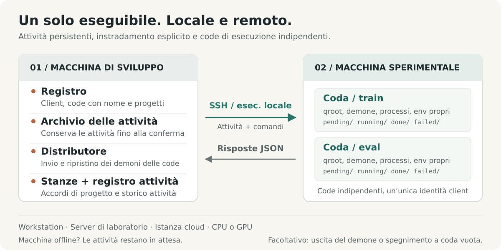
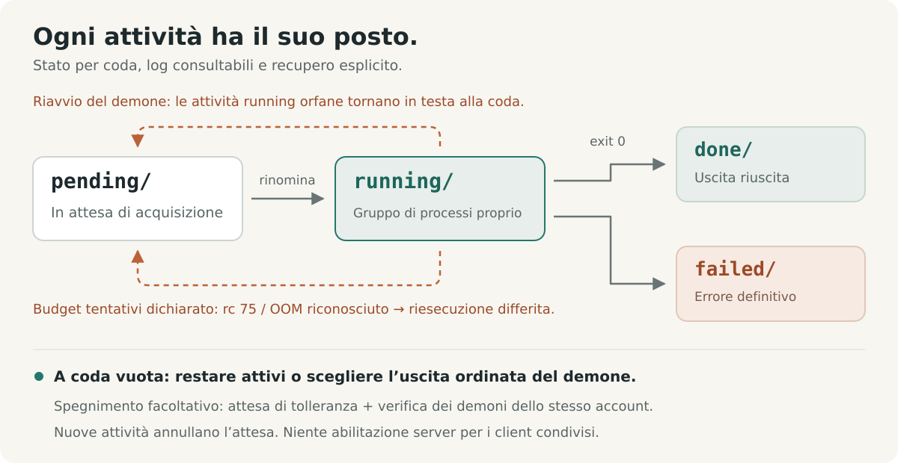

# shunt

[English](../../../README.md) · [Français](../fr/README.fr.md) · [Deutsch](../de/README.de.md) · **Italiano** · [日本語](../ja/README.ja.md) · [Español](../es/README.es.md) · [한국어](../ko/README.ko.md) · [简体中文](../zh-CN/README.zh-CN.md) · [繁體中文](../zh-TW/README.zh-TW.md) · [Русский](../ru/README.ru.md) · [Bahasa Indonesia](../id/README.id.md) · [Português (BR)](../pt-BR/README.pt-BR.md)


<p align="center">
  <strong>Esegui esperimenti. Coordina il calcolo.</strong><br>
  Un livello operativo per gli esperimenti, per persone e agenti AI, dalle workstation locali ai server remoti.
</p>

<p align="center">
  <a href="../../../Cargo.toml"></a>
  
  <a href="../../design.md#5-wire-protocol"></a>
  <a href="../../../LICENSE"></a>
</p>

<p align="center">
  <a href="#avvio-rapido">Avvio rapido</a> ·
  <a href="#come-funziona">Architettura</a> ·
  <a href="#coordinare-il-calcolo-condiviso">Coordinamento</a> ·
  <a href="#progettato-per-gli-agent">Guida per gli agent</a> ·
  <a href="../../design.md">Specifica di progetto</a> ·
  <a href="#contribuire">Contribuire</a>
</p>

Gli esperimenti attraversano progetti, macchine, ambienti e sessioni di lunga durata. shunt riunisce questo lavoro in un'unica CLI: registra le macchine, collega i progetti alle code, prepara ed esegue i task, ispeziona risultati e consumo di risorse, e coordina le persone e gli agent che condividono il calcolo.

Usa lo stesso flusso di lavoro su una workstation locale, un server di laboratorio o un'istanza cloud CPU o GPU. Un unico binario Rust gira su entrambi i lati, con SSH per le macchine remote ed esecuzione diretta dei processi in locale. Task, log e stato delle code vivono su disco. I metadati di fatturazione e lo shutdown per inattività sono strumenti opzionali per le macchine che ne hanno bisogno.

## Perché shunt

| Quando devi…                                         | shunt ti offre…                                                                                                                                                                 |
| ---------------------------------------------------- | ------------------------------------------------------------------------------------------------------------------------------------------------------------------------------- |
| **Lavorare su più macchine e progetti**              | Un registry TOML, binding di progetto molti-a-molti, directory di lavoro e ambienti per binding, e trasporto SSH o locale.                                                      |
| **Separare i flussi di lavoro su una macchina**      | Code con nome, ciascuna con directory, daemon, pool di worker, shell e configurazione dell'ambiente indipendenti sotto un'unica identità client.                                |
| **Inviare prima che una macchina sia raggiungibile** | Uno spool persistente sul lato dev. Il dispatcher consegna quando la macchina torna disponibile e riavvia il daemon di coda fermo prima del push.                               |
| **Mantenere gli esperimenti in movimento**           | Worker concorrenti, ordine di presa FIFO, priorità manuale, ridimensionamento del pool a caldo, timeout dei task e rischedulazione limitata e opzionale per contesa di risorse. |
| **Sapere cosa ha usato davvero un run**              | Disponibilità di macchina e GPU, picchi di RAM e VRAM per task, tempo CPU, e stime di risorse dichiarate accanto all'uso misurato.                                              |
| **Coordinare il calcolo condiviso**                  | Stanze di coordinamento di progetto con tracciamento dei non letti, accordi registrati, riassunti delle conversazioni e archiviazione.                                          |
| **Recuperare e ispezionare**                         | Esecuzione at-least-once, recupero degli orfani, guard degli artefatti, deduplicazione delle consegne, log dei task, un registro delle sottomissioni e stream di eventi.        |
| **Operare tramite un agent**                         | La stessa CLI con stato in JSON, elenchi di task in JSONL, una skill operativa inclusa e un canale di feedback persistente.                                                     |

I controlli delle macchine includono esecuzione SSH gestita, bootstrap e upgrade, un proxy SOCKS5 inverso opzionale, uscita del daemon dopo il drenaggio e shutdown per inattività opzionale. Le macchine condivise possono rifiutare esplicitamente l'attivazione del poweroff dal lato server.

## Avvio rapido

### 1. Installazione

Serve Linux con una toolchain Rust stable, un linker di sistema e Bash. L'operatività remota richiede anche gli strumenti OpenSSH (`ssh`, `scp` e `ssh-keygen`) sulla macchina dev.

```bash
curl -fsSL https://raw.githubusercontent.com/ShinoharaHaruna/shunt/main/install.sh | sh
shunt --help
```

Lo script installa il binario dell'ultima release (build musl statica, dashboard inclusa) in `~/.local/bin`; passa `--gnu` per la build a link dinamico, `--dir` per un percorso diverso, oppure `uninstall` per rimuovere il binario. Per una build dai sorgenti con la toolchain Rust:

```bash
git clone https://github.com/ShinoharaHaruna/shunt.git
cd shunt
cargo install --path . --locked
shunt --help
```

### 2. Prova la coda in locale

Il client `localhost` integrato usa lo stesso protocollo CLI tramite esecuzione locale dei processi. Puoi provare l'intero percorso spool → dispatcher → coda senza SSH né GPU:

```bash
# Il task crea un marcatore di completamento nella directory della coda locale.
shunt submit -c localhost --slug hello --guard hello.done -- touch hello.done
shunt dispatch --once
shunt status -c localhost --json
shunt logs -c localhost hello

# Al termine delle prove, drena il daemon locale ed esci.
shunt stop --root ~/.config/shunt/queue
```

L'esecuzione è asincrona: ripeti `status` o `logs` dopo qualche istante per vedere il risultato. La coda locale predefinita è `~/.config/shunt/queue/`; questa demo vi lascia `hello.done`, quindi ripeterla salta il task già completato. `stop` drena i task in esecuzione del daemon; lo shutdown per inattività è un'operazione separata e opzionale.

### 3. Collega una macchina per gli esperimenti

Esegui questi comandi sulla tua macchina dev per un server Linux già raggiungibile. Sostituisci i percorsi di esempio con directory di tua proprietà su quella macchina. Questa configurazione riusa una chiave SSH autorizzata e tratta il server come condiviso:

```bash
shunt client add lab --template generic \
    --key ~/.ssh/id_ed25519 --deploy-root /path/you/own \
    --qroot /path/you/own/shunt-queue \
    --shared --exit-on-idle --expire unlimited

# Compila ssh.host, ssh.port e ssh.user per il tuo server.
${EDITOR:-vi} ~/.config/shunt/clients/lab.toml

shunt client bootstrap lab

shunt project add experiments
shunt project bind experiments --client lab \
    --workdir /path/to/experiments --env OMP_NUM_THREADS=4 --env MKL_NUM_THREADS=4
```

`--shared` blocca l'attivazione dello shutdown per inattività dal lato server; `--exit-on-idle` permette al daemon di coda di uscire dopo il drenaggio e di essere riavviato dal dispatch successivo. Ometti questi flag se vuoi una macchina dedicata con un daemon residente. `expire = "unlimited"` descrive una macchina di proprietà o di laboratorio; le macchine cloud possono invece usare `"metered"` o una scadenza di abbonamento, con tariffe di fatturazione opzionali.

Il bootstrap installa il binario sotto la radice della coda, verifica la compatibilità del runtime, inizializza la coda, avvia il daemon e rileva le caratteristiche della macchina. Può scaricare una release statica corrispondente quando la build locale richiede una glibc più recente; altre architetture o build non rilasciate possono richiedere un `--bin-path` esplicito. Vedi [compatibilità del binario](../../design.md#15-binary-compatibility-at-bootstrap).

Per un'istanza cloud dedicata, template dei fornitori come `--template autodl` precaricano i valori predefiniti di deployment. Senza `--key`, shunt genera una coppia di chiavi dedicata: installa tu stesso la chiave pubblica, oppure configura `ssh.password` e installa `sshpass` per un deployment assistito da password su una macchina dedicata. I client condivisi saltano il deployment automatico delle chiavi.

La `workdir` del binding deve già contenere il tuo codice, i dati e l'ambiente di esecuzione. Il bootstrap distribuisce shunt; il binding di progetto registra dove girano i tuoi esperimenti.

### 4. Sottometti e ispeziona un esperimento

Supponendo che il tuo `train.py` scriva `runs/exp1/metrics.json` al completamento con successo:

```bash
shunt submit -p experiments -c lab --slug exp1 \
    --guard runs/exp1/metrics.json --timeout 14400 -- \
    uv run python train.py --out runs/exp1

shunt dispatch --once               # consegna lo spool corrente
shunt status -c lab --json           # ispeziona lo stato della coda e l'uso di risorse
shunt logs -c lab exp1               # ispeziona il log del task
```

Tieni `shunt dispatch` in esecuzione in un terminale separato della macchina dev per la consegna continua, inclusi i task sottomessi mentre una macchina è offline. Dopo la consegna, il daemon di coda della macchina esegue il task indipendentemente dal dispatcher o dal terminale che lo ha sottomesso.

`--timeout 14400` imposta un limite wall-clock di quattro ore per questo task. `--guard` controlla un percorso relativo alla `workdir` del binding e salta l'esecuzione se esiste già. `uv` e `train.py` sono dipendenze del carico di lavoro di esempio; usa il comando che serve al tuo progetto.

## Come funziona



Il nome viene dallo shunting ferroviario. La tua macchina dev è lo scalo di smistamento; ogni macchina di esperimento è un binario di destinazione. Un **client** è una macchina registrata; una **queue** è una corsia di esecuzione su di essa; un **project binding** fornisce la directory di lavoro e l'ambiente per una coppia `(client, queue)`.

| Sulla tua macchina dev                                                                                            | Su ogni macchina di esperimento                                                                                      |
| ----------------------------------------------------------------------------------------------------------------- | -------------------------------------------------------------------------------------------------------------------- |
| **Registry** — TOML modificabile per client, code, progetti, binding e fatturazione opzionale.                    | **Queue** — directory dei task sotto `pending/`, `running/`, `done/` e `failed/`.                                    |
| **Spool e dispatcher** — preparano i task fino all'ack, li consegnano e riavviano i daemon fermi.                 | **Daemon** — uno per coda, con worker concorrenti, log, campionamento dell'uso e recupero degli orfani.              |
| **Registro dei task e stanze** — tracciano le sottomissioni e conservano la storia del coordinamento di progetto. | **Ambienti dei task** — configurazione e shell della coda, impostazioni del binding di progetto e override per task. |

### Progetti e code con nome

Separa training, valutazione o progetti diversi su una macchina senza registrare identità SSH duplicate:

```bash
shunt queue add eval -c lab --qroot /path/you/own/shunt-eval \
    --workers 2 --exit-on-idle
shunt queue bootstrap eval -c lab
shunt project bind experiments --client lab --queue eval \
    --workdir /path/to/experiments --env OMP_NUM_THREADS=2 --env MKL_NUM_THREADS=2
shunt submit -p experiments -c lab --queue eval --slug eval1 \
    --guard runs/eval1.json -- python evaluate.py --out runs/eval1.json
shunt status -c lab --queue eval --json
```

Ogni coda possiede il proprio qroot, spazio di sequenze, pool di worker, daemon, binario, shell e configurazione dell'ambiente. La selezione della coda è `--queue` → `default_queue` configurata → unica coda; una scelta non risolta fallisce con un errore di ambiguità. I task preparati fissano la loro coda e il loro qroot, quindi cambiare il default non reindirizza mai il lavoro già sottomesso.

Configura `env_setup` e `shell` su una coda per l'attivazione dell'ambiente o export condivisi, poi distribuiscili con `shunt queue env <name> -c lab`; `shunt client env lab` aggiorna tutte le code. Gli overlay di ambiente di progetto e per task permettono a una coda di servire diversi carichi di lavoro.

Il canale è `ssh <machine> 'shunt <cmd> --json'`. Non serve alcun servizio HTTP né una connessione inversa verso la macchina dev. Lo stesso binario supporta il trasporto locale diretto per `localhost` e per altri client aggiunti con `client add --local`.

### Una coda che puoi ispezionare



Ogni task è una directory chiamata `NNNN_<slug>`. Contiene `task.sh` e accumula un `log`, un record `pid` in tempo reale, l'`usage` misurato e un codice `exit` finale. Le transizioni di coda usano rename del filesystem. Il numero di worker viene riletto a ogni poll, quindi il ridimensionamento non richiede riavvio; ridurlo lascia terminare i task in corso. I task girano in process group separati, con controlli di identità registrati prima dell'invio dei segnali.

**L'esecuzione è at-least-once.** Gli ID dei task generati dal server deduplicano la riconsegna sulle tracce attive della coda, ma il recupero del daemon o una consegna fuori da quella finestra di deduplicazione può comunque causare una riesecuzione. Un guard è un controllo di esistenza prima dell'esecuzione, quindi pubblica l'artefatto protetto solo quando rappresenta lavoro completato, e rendi le riesecuzioni sicure. Non fornisce esecuzione exactly-once né un lock contro tentativi sovrapposti. Vedi il [contratto del guard](../../design.md#313-task-file-format-and-the-guard-contract) e il [template dei task](../../../task_template.sh).

## Esperimenti consapevoli delle risorse

Dichiara le stime, imposta un budget wall-clock e consenti un retry limitato quando le risorse sono temporaneamente non disponibili:

```bash
shunt submit -p experiments -c lab --slug exp2 \
    --guard runs/exp2/metrics.json --timeout 14400 \
    --retry 2 --retry-delay 60 --ram-mb 8192 --cpu-cores 4 --gpu-mem-mb 4096 \
    --env CUDA_VISIBLE_DEVICES=0 --env OMP_NUM_THREADS=4 --env MKL_NUM_THREADS=4 -- \
    uv run python train.py --out runs/exp2
shunt status -c lab --json
```

`--retry 2` consente due tentativi aggiuntivi per l'exit code 75 (`EX_TEMPFAIL`, un segnale di risorsa occupata) o una firma di out-of-memory riconosciuta nel log. Ognuno attende almeno `--retry-delay` secondi prima di tornare eleggibile. Gli altri fallimenti e i timeout restano fallimenti; i retry richiedono un budget esplicito.

Status affianca le stime dichiarate ai picchi campionati di RAM per task, VRAM per GPU e secondi CPU cumulativi. Riporta anche memoria e utilizzo GPU correnti, RAM dell'host e load; i probe della macchina forniscono dati di capacità consapevoli dei cgroup. La telemetria GPU usa `nvidia-smi` quando disponibile. Il campionamento può mancare processi di breve durata o picchi momentanei.

**Le stime sono annotazioni, non prenotazioni di risorse né controlli di ammissione.** Tu o il tuo agent scegliete il target, il numero di worker e l'assegnazione delle GPU. I task solo-CPU usano la stessa coda senza flag GPU. Vedi [telemetria delle risorse](../../design.md#316-resource-declarations-and-usage-telemetry).

## Coordinare il calcolo condiviso

Quando i progetti condividono una macchina, i loro agent hanno bisogno di un posto dove accordarsi su limiti di worker, budget di memoria o posizionamento GPU. Le stanze di coordinamento mantengono quella conversazione e il suo accordo corrente accanto al registry:

```bash
# Supponiamo che experiments e analysis siano progetti registrati.
shunt room ls --as experiments          # stanze, conteggi non letti, gruppi suggeriti
shunt room create shared-compute --members experiments,analysis --clients lab
shunt room say shared-compute --as experiments \
    --body "Training needs GPU 0 until 18:00; can evaluation use GPU 1?"
shunt room read shared-compute --as analysis
shunt room decide shared-compute --as analysis \
    --note "Training uses GPU 0; evaluation uses GPU 1 with two workers."
shunt status --all --json --as experiments
```

Le stanze hanno appartenenza per progetto, posizioni di non letto per identità e una decisione corrente. `room ls` suggerisce gruppi di progetti collegati alla stessa macchina. Le conversazioni lunghe possono essere compattate in riassunti nello stream mantenendo i messaggi archiviati per letture per intervallo; intere stanze possono essere archiviate e ripristinate.

Le stanze vivono su una macchina dev e possono coprire i suoi client registrati. Gli agent che condividono quel registry possono interrogarle prima di modificare il calcolo condiviso. Gli accordi hanno effetto quando i partecipanti li applicano con comandi come `workers` o `submit --env`; le stanze non impongono scheduling né allocazione delle risorse. Vedi [stanze di coordinamento](../../design.md#17-coordination-rooms-server-side).

## Controlli quotidiani

Esegui questi comandi sulla macchina dev. Gli esempi specifici per client usano il client registrato `lab`; aggiungi `--queue eval` per puntare alla coda con nome.

| Intento                                         | Comando                                               |
| ----------------------------------------------- | ----------------------------------------------------- |
| Vedi tutte le macchine, le code e le stanze     | `shunt status --all --json`                           |
| Vedi le sottomissioni in attesa di consegna     | `shunt spool ls`                                      |
| Ispeziona un task sottomesso tramite il suo ID  | `shunt task show <id> --json`                         |
| Leggi lo stream di eventi dei task del server   | `shunt task events`                                   |
| Ridimensiona il pool di worker                  | `shunt workers 4 -c lab`                              |
| Sposta un task pending in testa                 | `shunt prio exp1 0 -c lab`                            |
| Cancella un task pending                        | `shunt cancel exp1 -c lab`                            |
| Parcheggia un task pending fino al rilascio     | `shunt hold exp1 -c lab "waiting on lease"`           |
| Rilascia un task pending parcheggiato           | `shunt release exp1 -c lab`                           |
| Ferma il process group di un task in esecuzione | `shunt kill exp1 -c lab`                              |
| Drena e ferma il daemon di una coda             | `shunt queue stop eval -c lab`                        |
| Aggiorna i dati della macchina                  | `shunt client probe lab`                              |
| Elenca le code su una macchina                  | `shunt queue ls -c lab`                               |
| Esegui un comando ad hoc via SSH gestita        | `shunt client exec lab -- nvidia-smi`                 |
| Aggiorna un endpoint SSH spostato               | `shunt client update lab --host <host> --port <port>` |
| Ripulisci una host key e una connessione stale  | `shunt client hostkey lab`                            |
| Apri il proxy SOCKS5 inverso opzionale          | `shunt tunnel up -c lab`                              |
| Genera i completamenti della shell              | `shunt completions zsh`                               |
| Ispeziona versione e build locali               | `shunt version --json`                                |
| Controlla se c'è una nuova release              | `shunt upgrade --check --json`                        |
| Aggiorna il binario locale                      | `shunt upgrade`                                       |
| Aggiorna il binario di una coda remota          | `shunt upgrade -c lab --queue eval`                   |

I pattern di controllo dei task come `exp1` devono identificare un solo task; usa il nome completo della entry del task quando un pattern è ambiguo. Il registro dei task mappa un ID di sottomissione a quel nome di entry. `task show` interroga la macchina in modo lazy per risolvere un esito; una entry fuori dalla finestra dello stato recente può apparire come `unknown`. Il lavoro si può anche parcheggiare prima che sia reclamabile: `--hold` trattiene una sottomissione nello spool lato dev fino a `spool release`, e `--hold-on-box` la consegna lasciando la entry lato box non reclamabile fino a `shunt release`.

Gli upgrade verificano checksum della release e versione del binario prima dell'installazione. Un daemon vivo — di una coda locale, di una box remota o della dashboard `serve` — viene riavviato in handoff sul binario installato: riesegue sul posto, mantiene lo stesso pid e il lavoro in corso continua; un daemon fermo viene semplicemente avviato. Quando l'immagine in esecuzione precede l'handler di handoff, l'upgrade la nomina invece di segnalarla, e fermare poi avviare quel daemon (`serve down` + `serve up` per la dashboard) lo porta sul nuovo binario. Un dispatcher non ha pidfile, quindi un upgrade locale si limita a nominare i pid dei dispatcher vivi — invia `SIGUSR2` a ciascuno, o riavvialo. Gli upgrade a release precompilate attualmente puntano a Linux x86_64.

Usa `shunt <command> --help` per i flag e il [riferimento CLI](../../design.md#10-cli-surface) per la superficie completa. I comandi di coda come `status` e `logs` funzionano anche direttamente su una macchina con `--root <qroot>`.

### Shutdown per inattività opzionale

Per una macchina dedicata che vuoi spegnere dopo un batch, attiva esplicitamente con `shunt shutdown -c <client> on`; usa `off` per disattivare e `status` per ispezionare il comando risolto. La coda conta alla rovescia solo dopo il drenaggio, e nuovo lavoro annulla il conto alla rovescia. Il server fa una preflight delle code sorelle registrate all'attivazione; il gate runtime della macchina controlla i daemon attivi sotto lo stesso account Unix. Un client `shared` rifiuta l'attivazione dal lato server.

Per una workstation o un server condiviso che deve restare acceso, usa `exit_on_idle` per terminare solo il daemon, oppure tienilo residente per il batch successivo. La demo locale e l'avvio rapido del server condiviso non richiedono alcuna configurazione di gestione dell'alimentazione.

## Progettato per gli agent

La CLI è anche l'interfaccia per gli agent. Lo stato delle code e le query sul registro dei task espongono JSON o JSONL strutturati; i log dei task e dei daemon forniscono il dettaglio dietro quegli stati. Dati della macchina, risorse in tempo reale, uso dichiarato rispetto a misurato e conteggi di non letto delle stanze danno agli agent il contesto per scegliere un target, dimensionare un batch e negoziare il calcolo condiviso. Tariffe di fatturazione configurate e metadati di scadenza aggiungono contesto quando una macchina ha un costo o una scadenza.

La [skill shunt](../../../skills/shunt/SKILL.md) inclusa insegna la configurazione, le sottomissioni con guard, l'interpretazione delle code, il coordinamento, la gestione dei fallimenti e l'operatività opzionale consapevole dei costi. Indicala al tuo agent prima di gestire le macchine di esperimento.

Installa la skill collegando `skills/shunt/` nella directory da cui il tuo agent carica le skill:

```bash
ln -s "$PWD/skills/shunt" ~/.agents/skills/shunt   # directory condivisa delle skill per agent
# oppure: cp -r skills/shunt ~/.claude/skills/shunt   # skill utente di Claude Code
# oppure: cp -r skills/shunt .claude/skills/          # a livello di progetto
```

```bash
shunt task ls --json
shunt status --all --json --as experiments
shunt task show <id> --json
```

shunt espone fatti ed esegue comandi espliciti. Scegliere una macchina, applicare gli accordi sulle risorse, decidere se un run rientra nel budget e provisionare o accendere le macchine restano all'umano o al flusso di lavoro dell'agent circostante.

Quando un agent incontra un difetto o una spigolosità di shunt, `shunt feedback "title" --body "…"` lo registra come issue GitHub. Il canale di feedback ripulisce le credenziali note del registry e i nomi di client, progetti e code registrati, salva un report locale prima della consegna, deduplica le ripetizioni e applica un limite orario. Anteprima con `--dry-run`; ispeziona i report in sospeso con `feedback ls --json` e riconsegna con `feedback retry`. I report sono pubblici per default, e il ripulitore non può riconoscere ogni segreto arbitrario. Vedi [feedback](../../design.md#14-feedback-channel).

## Limiti operativi

- **Task indipendenti e posizionamento esplicito.** Nessun grafo di dipendenze, selezione automatica della macchina o bilanciamento del carico multi-macchina; ogni sottomissione punta a un client e a una coda. Le dichiarazioni di risorse e le decisioni delle stanze non prenotano hardware né isolano i tenant.
- **Recupero limitato.** I fallimenti per risorsa occupata o out-of-memory riconosciuto possono essere rischedulati solo con un budget di retry dichiarato. I fallimenti fuori da quei criteri, i timeout e i retry esauriti finiscono in `failed/`; ispeziona i log e risottometti quando opportuno. Il recupero degli orfani dopo il riavvio di un daemon è separato.
- **Coordinamento locale.** Le stanze servono gli agent che condividono un registry lato dev. Forniscono un record di coordinamento interrogato via poll, senza messaggistica tra registry, notifiche push né controllo degli accessi imposto tra i partecipanti.
- **Poweroff opzionale.** Lo shutdown per inattività usa un comando configurabile e un periodo di grazia, 60 secondi per default. Code gestite vuote non dimostrano che altri utenti o carichi di lavoro non gestiti siano inattivi. Verifica il comando di shutdown per la tua macchina; shunt non controlla le regole di fatturazione del fornitore. Un enqueue in corsa con il controllo finale di poweroff può comunque perdere contro lo shutdown.
- **Deployment esplicito.** Il binding di progetto registra percorsi e ambiente; non sincronizza il codice sorgente, non provisiona dipendenze né crea la workdir remota.

L'implementazione Rust copre registry, code con nome, spool, dispatcher, trasporti SSH e locali, telemetria dei task, stanze di coordinamento, tunnel, upgrade, feedback e daemon di coda del client. È in sviluppo attivo; [docs/design.md](../../design.md) definisce il contratto comportamentale e i suoi casi limite.

## Contribuire

Inizia con la [specifica di progetto](../../design.md) e la [guida del repository](../../../AGENTS.md). Per una modifica al comportamento delle code, aggiorna il contratto e copri la transizione o il caso di fallimento rilevante.

```bash
just setup       # abilita gli hook Git versionati
just fmt         # formatta Rust, Markdown, TOML e JSON
just check       # controllo formato + clippy (-D warnings) + test
```

Installa `just` e `dprint` per queste recipe; la formattazione Rust e Clippy vengono dalla toolchain configurata. Gli hook controllano la formattazione prima del commit ed eseguono Clippy prima del push. Non riscrivono mai i file; la suite di test completa gira tramite `just check` o `just test`.

### Rilasci

Fai push di un tag SemVer come `v0.1.0` (o `0.1.0`) sul commit da rilasciare. La versione, escluso il prefisso opzionale `v`, deve corrispondere a `package.version` in `Cargo.toml`; aggiorna anche `Cargo.lock` con il cambio di versione. Il commit taggato deve includere [il workflow di rilascio](../../../.github/workflows/release.yml).

```bash
git tag -a v0.1.0 -m "Release v0.1.0"
git push origin v0.1.0
```

Il workflow controlla la formattazione, esegue Clippy e testa entrambi i target, poi pubblica una GitHub Release con note generate, archivi binari Linux x86_64 musl (statico) e GNU, e file `SHA256SUMS-<target>` per target. I tag con suffisso prerelease, come `v0.2.0-rc.1`, creano prerelease. Usa il `GITHUB_TOKEN` integrato; non serve alcun secret aggiuntivo. Le release pubblicate non vengono sovrascritte ai rerun.

| Da dove iniziare                                  | Per…                                                                          |
| ------------------------------------------------- | ----------------------------------------------------------------------------- |
| [Specifica di progetto](../../design.md)          | Semantica delle code, protocollo wire, telemetria, stanze e strategia di test |
| [Skill per agent](../../../skills/shunt/SKILL.md) | Manuale operativo per un agent AI                                             |
| [Template dei fornitori](../../../etc/vendors/)   | Valori predefiniti dei client AutoDL e generic                                |
| [Template dei task](../../../task_template.sh)    | Scrivere uno script di task con guard                                         |
| [Test di integrazione](../../../tests/)           | Comportamento di code, processi, shutdown e dispatch                          |

## Licenza

[MIT](../../../LICENSE).
