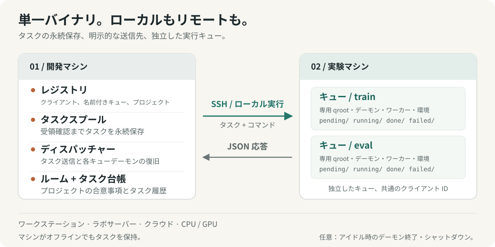
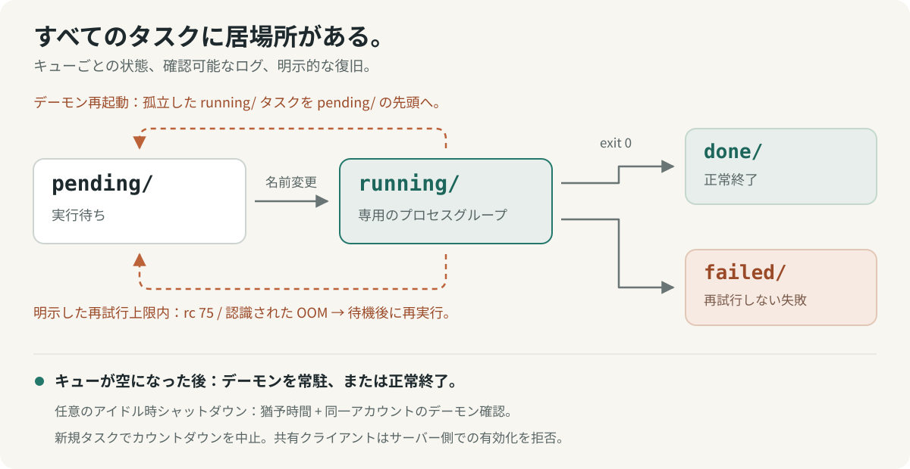

# shunt

[English](../../../README.md) · [Français](../fr/README.fr.md) · [Deutsch](../de/README.de.md) · [Italiano](../it/README.it.md) · **日本語** · [Español](../es/README.es.md) · [한국어](../ko/README.ko.md) · [简体中文](../zh-CN/README.zh-CN.md) · [繁體中文](../zh-TW/README.zh-TW.md) · [Русский](../ru/README.ru.md) · [Bahasa Indonesia](../id/README.id.md) · [Português (BR)](../pt-BR/README.pt-BR.md)


<p align="center">
  <strong>実験を実行し、計算資源を調整する。</strong><br>
  ローカルワークステーションからリモートサーバーまで、人間と AI エージェントのための実験運用レイヤー。
</p>

<p align="center">
  <a href="../../../Cargo.toml"></a>
  
  <a href="../../design.md#5-wire-protocol"></a>
  <a href="../../../LICENSE"></a>
</p>

<p align="center">
  <a href="#クイックスタート">クイックスタート</a> ·
  <a href="#仕組み">アーキテクチャ</a> ·
  <a href="#共有計算資源の調整">コーディネーション</a> ·
  <a href="#エージェント向け">エージェントガイド</a> ·
  <a href="../../design.md">設計仕様</a> ·
  <a href="#コントリビュート">コントリビュート</a>
</p>

実験はプロジェクト、マシン、環境、長時間稼働のセッションにまたがる。shunt はその作業を1つの CLI にまとめる：マシンを登録し、プロジェクトをキューにバインドし、タスクをステージして実行し、結果とリソース使用量を調べ、計算資源を共有する人とエージェントを調整する。

ローカルワークステーションでも、研究室のサーバーでも、クラウドの CPU/GPU インスタンスでも同じワークフローを使える。1つの Rust バイナリが両側で動き、リモートマシンには SSH、ローカルには直接プロセス実行を使う。タスク、ログ、キュー状態はディスク上にある。課金メタデータとアイドルシャットダウンは、必要なマシン向けのオプションのツール。

## shunt を選ぶ理由

| 必要なこと                                 | shunt が提供するもの                                                                                                                        |
| ------------------------------------------ | ------------------------------------------------------------------------------------------------------------------------------------------- |
| **マシンやプロジェクトをまたいで作業する** | TOML レジストリ、多対多のプロジェクトバインド、バインドごとの作業ディレクトリと環境、SSH またはローカルトランスポート。                     |
| **1台のマシンでワークフローを分離する**    | 1つのクライアント ID の下で、独立したディレクトリ、デーモン、ワーカープール、シェル、環境セットアップを持つ名前付きキュー。                 |
| **マシンに届かないうちに投入する**         | 開発側の永続スプール。マシンが戻るとディスパッチャーが配送し、プッシュ前に停止したキューデーモンを復帰させる。                              |
| **実験を前に進め続ける**                   | 並行ワーカー、FIFO クレーム順、手動優先度、実行中のプールリサイズ、タスクタイムアウト、オプトインの回数制限付きリソース競合リスケジュール。 |
| **実行が実際に使ったものを知る**           | マシンと GPU の可用性、タスクごとの RAM/VRAM ピーク、CPU 時間、宣言したリソース推定値と実測使用量の対比。                                   |
| **共有の計算資源を調整する**               | 未読追跡、合意の記録、会話ダイジェスト、アーカイブを備えたプロジェクトコーディネーションルーム。                                            |
| **復旧と検査**                             | at-least-once 実行、オーファン復旧、アーティファクトガード、配送デデュープ、タスクログ、投入台帳、イベントストリーム。                      |
| **エージェント経由で操作する**             | 同じ CLI に JSON ステータス、JSONL タスクリスト、同梱の運用スキル、永続フィードバックチャネル。                                             |

マシン管理には、管理された SSH 実行、bootstrap とアップグレード、オプションのリバース SOCKS5 プロキシ、ドレイン時のデーモン終了、オプトインのアイドルシャットダウンが含まれる。共有マシンはサーバー側からの poweroff アーミングを明示的に拒否できる。

## クイックスタート

### 1. インストール

Linux、stable な Rust ツールチェイン、システムリンカー、Bash を使う。リモート操作には開発マシン側の OpenSSH ツール（`ssh`、`scp`、`ssh-keygen`）も必要。

```bash
curl -fsSL https://raw.githubusercontent.com/ShinoharaHaruna/shunt/main/install.sh | sh
shunt --help
```

このスクリプトは最新リリースのバイナリ（静的 musl ビルド、ダッシュボード同梱）を `~/.local/bin` にインストールする。動的リンクビルドには `--gnu`、別の場所にインストールするには `--dir`、バイナリを削除するには `uninstall` を渡す。代わりに Rust ツールチェインでソースからビルドする場合:

```bash
git clone https://github.com/ShinoharaHaruna/shunt.git
cd shunt
cargo install --path . --locked
shunt --help
```

### 2. ローカルでキューを試す

組み込みの `localhost` クライアントは、ローカルプロセス実行を通じて同じ CLI プロトコルを使う。SSH や GPU なしで、スプール → ディスパッチャー → キューの全経路を試せる:

```bash
# このタスクはローカルキューディレクトリに完了マーカーを作成する。
shunt submit -c localhost --slug hello --guard hello.done -- touch hello.done
shunt dispatch --once
shunt status -c localhost --json
shunt logs -c localhost hello

# 試し終わったら、ローカルデーモンをドレインして終了する。
shunt stop --root ~/.config/shunt/queue
```

実行は非同期。少し待ってから `status` や `logs` を繰り返すと結果が見える。デフォルトのローカルキューは `~/.config/shunt/queue/` で、このデモはそこに `hello.done` を残すので、再実行すると完了済みタスクがスキップされる。`stop` はデーモンの実行中タスクをドレインする。アイドルシャットダウンは別の、オプトインの操作。

### 3. 実験マシンを接続する

すでに接続可能な Linux サーバーに対して、開発マシンで以下のコマンドを実行する。例のパスは、そのマシン上で自分が所有するディレクトリに置き換えること。このセットアップは承認済み SSH キーを再利用し、サーバーを共有扱いにする:

```bash
shunt client add lab --template generic \
    --key ~/.ssh/id_ed25519 --deploy-root /path/you/own \
    --qroot /path/you/own/shunt-queue \
    --shared --exit-on-idle --expire unlimited

# サーバーの ssh.host、ssh.port、ssh.user を記入する。
${EDITOR:-vi} ~/.config/shunt/clients/lab.toml

shunt client bootstrap lab

shunt project add experiments
shunt project bind experiments --client lab \
    --workdir /path/to/experiments --env OMP_NUM_THREADS=4 --env MKL_NUM_THREADS=4
```

`--shared` はサーバー側からのアイドルシャットダウンのアーミングをブロックする。`--exit-on-idle` はキューデーモンがドレイン後に終了し、次のディスパッチで復帰するようにする。専有マシンでデーモンを常駐させたい場合はこれらのフラグを省略する。`expire = "unlimited"` は所有マシンや研究室マシンを表す。クラウドマシンは代わりに `"metered"` やサブスクリプション期限を使え、課金レートも任意で設定できる。

Bootstrap はキュールート配下にバイナリをインストールし、ランタイム互換性を確認し、キューを初期化し、デーモンを起動し、マシン情報をプローブする。ローカルビルドが新しい glibc を要求する場合、一致する静的リリースを取得できる。他のアーキテクチャや未リリースのビルドでは、明示的な `--bin-path` が必要なことがある。[バイナリ互換性](../../design.md#15-binary-compatibility-at-bootstrap)を参照。

専有のクラウドインスタンスでは、`--template autodl` のようなベンダーテンプレートがデプロイの既定値をシードする。`--key` なしでは、shunt が専用キーペアを生成する：公開鍵を自分でインストールするか、専有マシンで `ssh.password` を設定して `sshpass` をインストールし、パスワード補助デプロイを使う。共有クライアントは自動キーデプロイをスキップする。

バインドの `workdir` には、コード、データ、ランタイム環境がすでに置かれている必要がある。Bootstrap は shunt をデプロイする。プロジェクトバインドは実験がどこで走るかを記録する。

### 4. 実験を投入して確認する

`train.py` が成功時に `runs/exp1/metrics.json` を書き出すと仮定する:

```bash
shunt submit -p experiments -c lab --slug exp1 \
    --guard runs/exp1/metrics.json --timeout 14400 -- \
    uv run python train.py --out runs/exp1

shunt dispatch --once               # 現在のスプールを配送する
shunt status -c lab --json           # キュー状態とリソース使用を確認する
shunt logs -c lab exp1               # タスクログを確認する
```

開発マシンの別ターミナルで `shunt dispatch` を動かし続けると、マシンがオフラインの間に投入されたタスクも含めて継続的に配送できる。配送後は、そのマシン自身のキューデーモンがディスパッチャーや投入端末から独立してタスクを実行する。

`--timeout 14400` はこのタスクに4時間の wall-clock 上限を設定する。`--guard` はバインドの `workdir` からの相対パスを確認し、すでに存在すれば実行をスキップする。`uv` と `train.py` は例のワークロード依存であり、プロジェクトに必要なコマンドを使うこと。

## 仕組み



名前は鉄道の入れ替え（shunting）に由来する。開発マシンは操車場で、各実験マシンは行き先の側線だ。**クライアント**は登録済みマシン、**キュー**はその上の1本の実行レーン、**プロジェクトバインド**は `(client, queue)` ペアに作業ディレクトリと環境を与える。

| 開発マシン上                                                                                              | 各実験マシン上                                                                                  |
| --------------------------------------------------------------------------------------------------------- | ----------------------------------------------------------------------------------------------- |
| **レジストリ** — クライアント、キュー、プロジェクト、バインド、任意の課金情報を記録する編集可能な TOML。  | **キュー** — `pending/`、`running/`、`done/`、`failed/` 配下のタスクディレクトリ。              |
| **スプールとディスパッチャー** — 確認されるまでタスクをステージし、配送し、停止したデーモンを復帰させる。 | **デーモン** — キューごとに1つ。並行ワーカー、ログ、使用量サンプリング、オーファン復旧を持つ。  |
| **タスク台帳とルーム** — 投入を追跡し、プロジェクトのコーディネーション履歴を保持する。                   | **タスク環境** — キューのセットアップとシェル、プロジェクトバインドの設定、タスクごとの上書き。 |

### プロジェクトと名前付きキュー

重複した SSH ID を登録せずに、1台のマシンで学習、評価、別プロジェクトを分けられる:

```bash
shunt queue add eval -c lab --qroot /path/you/own/shunt-eval \
    --workers 2 --exit-on-idle
shunt queue bootstrap eval -c lab
shunt project bind experiments --client lab --queue eval \
    --workdir /path/to/experiments --env OMP_NUM_THREADS=2 --env MKL_NUM_THREADS=2
shunt submit -p experiments -c lab --queue eval --slug eval1 \
    --guard runs/eval1.json -- python evaluate.py --out runs/eval1.json
shunt status -c lab --queue eval --json
```

各キューは自分の qroot、シーケンス空間、ワーカープール、デーモン、バイナリ、シェル、環境セットアップを持つ。キュー選択は `--queue` → 設定済み `default_queue` → 唯一のキューの順で、解決できなければ曖昧さエラーで失敗する。ステージ済みタスクはキューと qroot を固定するので、あとでデフォルトを変えても投入済みの仕事は振り替わらない。

環境のアクティベーションや共有エクスポートにはキューに `env_setup` と `shell` を設定し、`shunt queue env <name> -c lab` でプッシュする。`shunt client env lab` はすべてのキューを更新する。プロジェクトおよびタスク単位の環境オーバーレイで、1つのキューが複数のワークロードに対応できる。

ワイヤは `ssh <machine> 'shunt <cmd> --json'`。HTTP サービスも開発マシンへのリバース接続も不要。同じバイナリが `localhost` と追加の `client add --local` クライアント向けに直接ローカルトランスポートをサポートする。

### 中身を確認できるキュー



各タスクは `NNNN_<slug>` という名前のディレクトリで、`task.sh` を含み、`log`、ライブ `pid` レコード、実測 `usage`、最終の `exit` コードを蓄積する。キュー遷移はファイルシステムの rename を使う。ワーカー数はポーリングごとに再読みされるので、リサイズに再起動は不要で、下げた場合は現在のタスクが終わるまで待つ。タスクは独立したプロセスグループで実行され、シグナルの前に記録済みの ID チェックを行う。

**実行は少なくとも1回（at-least-once）。** サーバー生成のタスク ID は、稼働中のキューの各トラックへの再配送をデデュープするが、デーモン復旧やそのデデュープ窓の外での配送は再実行を招きうる。ガードは実行前の存在チェックなので、ガード対象のアーティファクトは完了した仕事を表すときだけ公開し、再実行を安全にすること。exactly-once 実行も、重複する試行へのロックも提供しない。[ガード契約](../../design.md#313-task-file-format-and-the-guard-contract)と[タスクテンプレート](../../../task_template.sh)を参照。

## リソースを意識した実験

推定値を宣言し、wall-clock 予算を設定し、リソースが一時的に使えないときに回数制限付きのリトライを許可する:

```bash
shunt submit -p experiments -c lab --slug exp2 \
    --guard runs/exp2/metrics.json --timeout 14400 \
    --retry 2 --retry-delay 60 --ram-mb 8192 --cpu-cores 4 --gpu-mem-mb 4096 \
    --env CUDA_VISIBLE_DEVICES=0 --env OMP_NUM_THREADS=4 --env MKL_NUM_THREADS=4 -- \
    uv run python train.py --out runs/exp2
shunt status -c lab --json
```

`--retry 2` は、終了コード 75（`EX_TEMPFAIL`、リソースビジーのシグナル）または認識されたメモリ不足のログシグネチャに対し、追加で2回の試行を許可する。各試行は再びクレーム可能になるまで最低 `--retry-delay` 秒待つ。その他の失敗とタイムアウトは失敗のまま残る。リトライには明示的な予算が必要。

Status は宣言した推定値と、サンプルされたタスクごとの RAM ピーク、GPU ごとの VRAM ピーク、累積 CPU 秒を並べて表示する。現在の GPU メモリと利用率、ホスト RAM、負荷も報告し、マシンプローブが cgroup を考慮した容量情報を提供する。GPU テレメトリは利用可能なら `nvidia-smi` を使う。サンプリングは短命プロセスや瞬間的なピークを取りこぼすことがある。

**推定値は注釈であり、リソース予約でもアドミッションチェックでもない。** ターゲット、ワーカー数、GPU 割り当てはあなたかエージェントが選ぶ。CPU 専用タスクは GPU フラグなしで同じキューを使う。[リソーステレメトリ](../../design.md#316-resource-declarations-and-usage-telemetry)を参照。

## 共有計算資源の調整

プロジェクトがマシンを共有するとき、各エージェントにはワーカー上限、メモリ予算、GPU 配置について合意する場所が必要になる。コーディネーションルームは、その会話と現在の合意をレジストリのそばに保持する:

```bash
# experiments と analysis が登録済みプロジェクトだと仮定する。
shunt room ls --as experiments          # ルーム、未読数、推奨グループ
shunt room create shared-compute --members experiments,analysis --clients lab
shunt room say shared-compute --as experiments \
    --body "Training needs GPU 0 until 18:00; can evaluation use GPU 1?"
shunt room read shared-compute --as analysis
shunt room decide shared-compute --as analysis \
    --note "Training uses GPU 0; evaluation uses GPU 1 with two workers."
shunt status --all --json --as experiments
```

ルームはプロジェクトのメンバーシップ、ID ごとの未読位置、現在の決定を持つ。`room ls` は同じマシンにバインドされたプロジェクトのグループを提案する。長い会話はインストリームのダイジェストに圧縮でき、アーカイブ済みメッセージは範囲読みのために保持される。ルーム全体をアーカイブして復元することもできる。

ルームは1台の開発マシンに置かれ、その登録済みクライアントをまたげる。そのレジストリを共有するエージェントは、共有の計算資源を変える前にルームをポーリングできる。合意は参加者が `workers` や `submit --env` のようなコマンドで適用したときに効力を持つ。ルームはスケジューリングやリソース割り当てを強制しない。[コーディネーションルーム](../../design.md#17-coordination-rooms-server-side)を参照。

## 日常操作

これらのコマンドは開発マシンで実行する。クライアント固有の例は登録済みクライアント `lab` を使う。`--queue eval` を付けると名前付きキューを対象にできる。

| 意図                                            | コマンド                                              |
| ----------------------------------------------- | ----------------------------------------------------- |
| すべてのマシン、キュー、ルームを見る            | `shunt status --all --json`                           |
| 配送待ちの投入を見る                            | `shunt spool ls`                                      |
| ID で投入済みタスクを調べる                     | `shunt task show <id> --json`                         |
| サーバーのタスクイベントストリームを読む        | `shunt task events`                                   |
| ワーカープールをリサイズする                    | `shunt workers 4 -c lab`                              |
| pending タスクを先頭に移す                      | `shunt prio exp1 0 -c lab`                            |
| pending タスクをキャンセルする                  | `shunt cancel exp1 -c lab`                            |
| pending タスクをリリースまで保留する            | `shunt hold exp1 -c lab "waiting on lease"`           |
| 保留中の pending タスクをリリースする           | `shunt release exp1 -c lab`                           |
| 実行中タスクのプロセスグループを停止する        | `shunt kill exp1 -c lab`                              |
| 1つのキューデーモンをドレインして停止する       | `shunt queue stop eval -c lab`                        |
| マシン情報を更新する                            | `shunt client probe lab`                              |
| マシン上のキューを一覧する                      | `shunt queue ls -c lab`                               |
| 管理された SSH でアドホックコマンドを実行する   | `shunt client exec lab -- nvidia-smi`                 |
| 移動した SSH エンドポイントを更新する           | `shunt client update lab --host <host> --port <port>` |
| 古いホストキーと接続をクリアする                | `shunt client hostkey lab`                            |
| オプションのリバース SOCKS5 プロキシを開く      | `shunt tunnel up -c lab`                              |
| シェル補完を生成する                            | `shunt completions zsh`                               |
| ローカルのバージョンとビルドを調べる            | `shunt version --json`                                |
| 新しいリリースを確認する                        | `shunt upgrade --check --json`                        |
| ローカルバイナリをアップグレードする            | `shunt upgrade`                                       |
| リモートキュー1つのバイナリをアップグレードする | `shunt upgrade -c lab --queue eval`                   |

`exp1` のようなタスク制御パターンは1つのタスクを特定しなければならない。パターンが曖昧なら完全なタスクエントリ名を使う。タスク台帳は投入 ID をそのエントリ名にマップする。`task show` は結果を解決するためマシンに遅延問い合わせをする。最近のステータス窓の外にあるエントリは `unknown` と表示されうる。作業はクレーム可能になる前にも保留できる。`--hold` は `spool release` まで dev 側スプールに投入を留め、`--hold-on-box` は配送したうえで box 側のエントリを `shunt release` までクレーム不可にする。

アップグレードはインストール前にリリースチェックサムとバイナリバージョンを検証する。稼働中のデーモン — ローカルキューのもの、リモート box のもの、`serve` ダッシュボード — は handoff でインストール済みバイナリに再起動される。同じ pid のままその場で再 exec し、実行中の仕事は走り続ける。停止中のデーモンは単に起動される。稼働中のイメージが handoff ハンドラより前のものなら、アップグレードはシグナルを送らずにその旨を報告する。そのデーモンを停止して起動し直せば（ダッシュボードは `serve down` + `serve up`）新しいバイナリに切り替わる。dispatcher は pidfile を持たないため、ローカルのアップグレードは稼働中の dispatcher の pid を報告するだけだ — 各 pid に `SIGUSR2` を送るか、再起動する。プレビルドリリースのアップグレードは現在 Linux x86_64 が対象。

フラグは `shunt <command> --help` を、コマンド体系全体は [CLI リファレンス](../../design.md#10-cli-surface) を参照。`status` や `logs` のようなキューコマンドは、`--root <qroot>` でマシン上で直接も動く。

### オプションのアイドルシャットダウン

バッチ後に電源を落としたい専有マシンには、`shunt shutdown -c <client> on` で明示的にオプトインする。`off` で解除し、`status` で解決されたコマンドを確認する。キューはドレインしてからのみカウントダウンし、新しい仕事はカウントダウンをキャンセルする。アーミング時、サーバーは登録済みの兄弟キューをプリフライトし、マシンのランタイムゲートは同じ Unix アカウントの下にある稼働デーモンをチェックする。`shared` クライアントはサーバー側アーミングを拒否する。

入れっぱなしにすべきワークステーションや共有サーバーには、`exit_on_idle` でデーモンだけを終了させるか、次のバッチまで常駐させる。ローカルデモと共有サーバーのクイックスタートには電源管理のセットアップは不要。

## エージェント向け

この CLI はそのままエージェントインターフェースでもある。キューステータスとタスク台帳クエリは構造化 JSON/JSONL を公開し、タスクとデーモンのログがその状態の背後にある詳細を提供する。マシン情報、ライブリソース、宣言対実測の使用量、ルーム未読数が、ターゲット選択、バッチのサイジング、共有計算資源の交渉のためのコンテキストをエージェントに与える。設定済みの課金レートと期限メタデータは、マシンにコストや期限があるときのコンテキストを追加する。

同梱の [shunt スキル](../../../skills/shunt/SKILL.md) は、セットアップ、ガード付き投入、キューの解釈、コーディネーション、失敗処理、オプションのコスト意識運用を教える。実験マシンを管理させる前に、エージェントへこのスキルを渡すこと。

`skills/shunt/` をエージェントがスキルを読み込む場所へリンクすればスキルをインストールできる:

```bash
ln -s "$PWD/skills/shunt" ~/.agents/skills/shunt   # 共有 agentskills ディレクトリ
# または: cp -r skills/shunt ~/.claude/skills/shunt   # Claude Code ユーザースキル
# または: cp -r skills/shunt .claude/skills/          # プロジェクトローカル
```

```bash
shunt task ls --json
shunt status --all --json --as experiments
shunt task show <id> --json
```

shunt は事実を公開し、明示的なコマンドを実行する。マシンの選択、リソース合意の適用、実行が予算に合うかの判断、マシンのプロビジョニングや電源投入は、人間か周囲のエージェントワークフローに残る。

エージェントが shunt の欠陥や使いにくい点に当たったら、`shunt feedback "title" --body "…"` がそれを GitHub issue として登録する。フィードバックチャネルは既知のレジストリ認証情報と登録済みクライアント・プロジェクト・キュー名をスクラブし、配送前にローカルレポートを保存し、繰り返しをデデュープし、毎時キャップを適用する。`--dry-run` でプレビューし、`feedback ls --json` で保留レポートを確認し、`feedback retry` で再配送できる。レポートはデフォルトで公開であり、スクラバーはあらゆる形式のシークレットを認識できるわけではない。[フィードバック](../../design.md#14-feedback-channel)を参照。

## 運用の境界

- **独立タスクと明示的な配置。** 依存グラフ、自動マシン選択、複数マシンの負荷分散はない。各投入はクライアントとキューを対象にする。リソース宣言とルームの決定は、ハードウェアを予約せずテナントも分離しない。
- **限定的な復旧。** リソースビジーや認識されたメモリ不足の失敗は、宣言済みリトライ予算があるときだけ再スケジュールできる。その条件外の失敗、タイムアウト、リトライ枯渇は `failed/` に入る。ログを調べて適切に再投入すること。デーモン再起動後のオーファン復旧は別の話。
- **ローカルなコーディネーション。** ルームは1つの開発側レジストリを共有するエージェントに仕える。ポーリング式のコーディネーション記録を提供し、レジストリ間メッセージング、プッシュ通知、参加者間のアクセス制御の強制はない。
- **オプトインの poweroff。** アイドルシャットダウンは設定可能なコマンドと猶予期間（デフォルト60秒）を使う。管理キューが空であることは、他のユーザーや非管理ワークロードがアイドルであることを立証しない。シャットダウンコマンドが自分のマシンで正しいか確認すること。shunt はベンダーの課金ルールを制御しない。最終の poweroff チェックと競合するエンキューは、シャットダウンに負けうる。
- **明示的なデプロイ。** プロジェクトバインドはパスと環境を記録する。ソースコードの同期、依存のプロビジョン、リモート workdir の作成はしない。

Rust 実装は、レジストリ、名前付きキュー、スプール、ディスパッチャー、SSH とローカルトランスポート、タスクテレメトリ、コーディネーションルーム、トンネル、アップグレード、フィードバック、クライアントキューデーモンをカバーする。活発に開発中であり、[docs/design.md](../../design.md) が行動契約とそのエッジケースを定義する。

## コントリビュート

[設計仕様](../../design.md)と[リポジトリガイド](../../../AGENTS.md)から始める。キュー挙動を変える場合は、契約を更新し、関連する遷移や失敗ケースをカバーすること。

```bash
just setup       # バージョン管理された Git フックを有効化する
just fmt         # Rust、Markdown、TOML、JSON をフォーマットする
just check       # フォーマットチェック + clippy (-D warnings) + テスト
```

これらのレシピには `just` と `dprint` をインストールする。Rust のフォーマットと Clippy は設定済みツールチェインから来る。フックはコミット前にフォーマットをチェックし、プッシュ前に Clippy を走らせる。ファイルを書き換えることはない。全テストスイートは `just check` または `just test` で走る。

### リリース

リリースしたいコミットに `v0.1.0`（または `0.1.0`）のような SemVer タグをプッシュする。任意の `v` プレフィックスを除いたバージョンは `Cargo.toml` の `package.version` と一致しなければならない。バージョン変更では `Cargo.lock` も更新する。タグ付きコミットには[リリースワークフロー](../../../.github/workflows/release.yml)が含まれている必要がある。

```bash
git tag -a v0.1.0 -m "Release v0.1.0"
git push origin v0.1.0
```

ワークフローはフォーマットをチェックし、両ターゲットで Clippy とテストを走らせ、生成されたノート、Linux x86_64 musl（静的）と GNU のバイナリアーカイブ、ターゲットごとの `SHA256SUMS-<target>` ファイルを添えた GitHub Release を公開する。`v0.2.0-rc.1` のようなプレリリース接尾辞のタグはプレリリースを作る。組み込みの `GITHUB_TOKEN` を使い、追加シークレットは不要。公開済みリリースは再実行で上書きされない。

| 最初に見るもの                                       | 用途                                                                   |
| ---------------------------------------------------- | ---------------------------------------------------------------------- |
| [設計仕様](../../design.md)                          | キューセマンティクス、ワイヤプロトコル、テレメトリ、ルーム、テスト戦略 |
| [エージェントスキル](../../../skills/shunt/SKILL.md) | AI エージェントの運用プレイブック                                      |
| [ベンダーテンプレート](../../../etc/vendors/)        | AutoDL と generic のクライアント既定値                                 |
| [タスクテンプレート](../../../task_template.sh)      | ガード付きタスクスクリプトの書き方                                     |
| [統合テスト](../../../tests/)                        | キュー、プロセス、シャットダウン、ディスパッチの挙動                   |

## ライセンス

[MIT](../../../LICENSE)。
