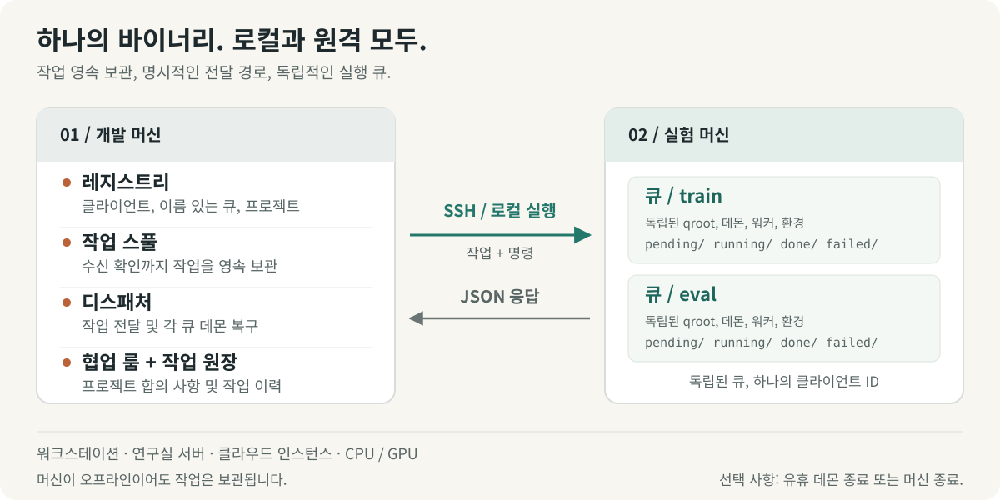
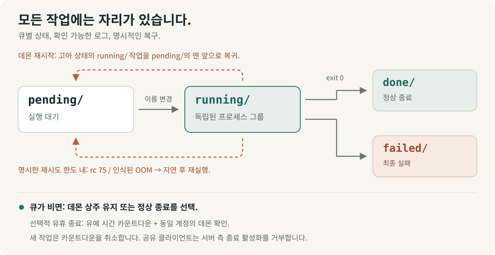

# shunt

[English](../../../README.md) · [Français](../fr/README.fr.md) · [Deutsch](../de/README.de.md) · [Italiano](../it/README.it.md) · [日本語](../ja/README.ja.md) · [Español](../es/README.es.md) · **한국어** · [简体中文](../zh-CN/README.zh-CN.md) · [繁體中文](../zh-TW/README.zh-TW.md) · [Русский](../ru/README.ru.md) · [Bahasa Indonesia](../id/README.id.md) · [Português (BR)](../pt-BR/README.pt-BR.md)


<p align="center">
  <strong>실험을 실행하고, 컴퓨팅 자원을 조율한다.</strong><br>
  로컬 워크스테이션부터 원격 서버까지, 사람과 AI agent를 위한 실험 운영 레이어.
</p>

<p align="center">
  <a href="../../../Cargo.toml"></a>
  
  <a href="../../design.md#5-wire-protocol"></a>
  <a href="../../../LICENSE"></a>
</p>

<p align="center">
  <a href="#빠른-시작">빠른 시작</a> ·
  <a href="#작동-방식">아키텍처</a> ·
  <a href="#공유-컴퓨팅-자원-조율">조율</a> ·
  <a href="#agent를-위한-설계">Agent 가이드</a> ·
  <a href="../../design.md">설계 명세</a> ·
  <a href="#기여하기">기여하기</a>
</p>

실험은 여러 프로젝트, 머신, 환경, 그리고 장시간 실행되는 세션에 걸쳐 있다. shunt는 이 작업을 하나의 CLI로 모은다. 머신을 등록하고, 프로젝트를 queue에 바인딩하고, task를 스테이징해 실행하고, 결과와 리소스 사용량을 확인하고, 컴퓨팅 자원을 공유하는 사람과 agent를 조율한다.

로컬 워크스테이션, 연구실 서버, 클라우드 CPU 또는 GPU 인스턴스 어디에서나 같은 워크플로를 사용한다. 하나의 Rust 바이너리가 양쪽에서 실행되며, 원격 머신은 SSH로, 로컬은 직접 프로세스 실행으로 동작한다. Task, 로그, queue 상태는 디스크에 저장된다. 과금 메타데이터와 idle shutdown은 필요한 머신에만 선택적으로 켜는 기능이다.

## shunt를 선택하는 이유

| 이런 상황에서…                       | shunt가 제공하는 것…                                                                                                              |
| ------------------------------------ | --------------------------------------------------------------------------------------------------------------------------------- |
| **여러 머신과 프로젝트에 걸쳐 작업** | TOML registry, 다대다 프로젝트 binding, binding별 작업 디렉터리와 환경, 그리고 SSH 또는 로컬 transport.                           |
| **한 머신에서 워크플로 분리**        | 하나의 client 신원 아래에서 독립된 디렉터리, daemon, worker 풀, shell, 환경 설정을 갖는 named queue.                              |
| **머신에 닿기 전에 먼저 제출**       | 개발 머신에 상주하는 spool. 머신이 돌아오면 dispatcher가 전달하고, 멈춘 queue daemon을 깨운 뒤 push한다.                          |
| **실험을 계속 진행**                 | 동시 worker, FIFO claim 순서, 수동 우선순위, 실행 중 풀 크기 조정, task 타임아웃, 그리고 opt-in 횟수 제한 리소스 경합 재스케줄링. |
| **실행이 실제로 사용한 리소스 파악** | 머신과 GPU 가용 상태, task별 RAM 및 VRAM 피크, CPU 시간, 그리고 측정된 사용량과 나란히 보여주는 선언 리소스 추정치.               |
| **공유 컴퓨팅 자원 조율**            | 미열람 추적, 합의 기록, 대화 다이제스트, 아카이빙을 지원하는 프로젝트 coordination room.                                          |
| **복구와 조사**                      | 최소 한 번 실행, orphan 복구, 산출물 guard, 전달 중복 제거, task 로그, 제출 ledger, 이벤트 스트림.                                |
| **agent를 통해 운영**                | 같은 CLI에 JSON 상태, JSONL task 목록, 함께 제공되는 운영 skill, 그리고 지속적인 피드백 채널.                                     |

머신 제어 기능에는 관리형 SSH 실행, bootstrap 및 업그레이드, 선택적 역방향 SOCKS5 프록시, 드레인 시 daemon 종료, 그리고 opt-in idle shutdown이 포함된다. 공유 머신은 server 측 poweroff arming을 명시적으로 거부할 수 있다.

## 빠른 시작

### 1. 소스에서 설치

Linux와 stable Rust 툴체인, 시스템 링커, Bash가 필요하다. 원격 작업에는 개발 머신에 OpenSSH 도구(`ssh`, `scp`, `ssh-keygen`)도 필요하다.

```bash
git clone https://github.com/ShinoharaHaruna/shunt.git
cd shunt
cargo install --path . --locked
shunt --help
```

### 2. 로컬에서 queue 사용해 보기

내장 `localhost` client는 로컬 프로세스 실행으로 같은 CLI 프로토콜을 사용한다. SSH나 GPU 없이 spool → dispatcher → queue 전체 경로를 시험할 수 있다.

```bash
# 이 task는 로컬 queue 디렉터리에 완료 마커를 만든다.
shunt submit -c localhost --slug hello --guard hello.done -- touch hello.done
shunt dispatch --once
shunt status -c localhost --json
shunt logs -c localhost hello

# 실험이 끝나면 로컬 daemon을 드레인하고 종료한다.
shunt stop --root ~/.config/shunt/queue
```

실행은 비동기다. 잠시 후 `status`나 `logs`를 다시 실행해 결과를 확인한다. 기본 로컬 queue는 `~/.config/shunt/queue/`이며, 이 데모는 그곳에 `hello.done`을 남기므로 반복 실행하면 완료된 task를 건너뛴다. `stop`은 daemon의 실행 중인 task를 드레인한다. idle shutdown은 별도의 opt-in 작업이다.

### 3. 실험 머신 연결

이미 접근 가능한 Linux 서버에 대해 개발 머신에서 다음 명령을 실행한다. 예시 경로는 해당 머신에서 본인이 소유한 디렉터리로 바꾼다. 이 설정은 이미 승인된 SSH 키를 재사용하고 서버를 공유 머신으로 취급한다.

```bash
shunt client add lab --template generic \
    --key ~/.ssh/id_ed25519 --deploy-root /path/you/own \
    --qroot /path/you/own/shunt-queue \
    --shared --exit-on-idle --expire unlimited

# 서버의 ssh.host, ssh.port, ssh.user를 채운다.
${EDITOR:-vi} ~/.config/shunt/clients/lab.toml

shunt client bootstrap lab

shunt project add experiments
shunt project bind experiments --client lab \
    --workdir /path/to/experiments --env OMP_NUM_THREADS=4 --env MKL_NUM_THREADS=4
```

`--shared`는 server 측 idle-shutdown arming을 차단한다. `--exit-on-idle`은 queue daemon이 드레인 후 종료하고 다음 dispatch에서 다시 깨어나도록 한다. 상주 daemon을 원하는 전용 머신이라면 이 플래그들을 생략한다. `expire = "unlimited"`는 소유 또는 연구실 머신을 나타낸다. 클라우드 머신은 `"metered"` 또는 구독 만료 시각을 쓸 수 있으며, 선택적으로 과금 요율을 설정할 수 있다.

Bootstrap은 바이너리를 queue 루트 아래에 설치하고, 런타임 호환성을 확인하고, queue를 초기화하고, daemon을 시작하고, 머신 정보를 probe한다. 로컬 빌드가 더 새로운 glibc를 요구하면 맞는 static release를 가져올 수 있다. 다른 아키텍처나 미릴리스 빌드는 명시적 `--bin-path`가 필요할 수 있다. [바이너리 호환성](../../design.md#15-binary-compatibility-at-bootstrap)을 참고한다.

전용 클라우드 인스턴스에는 `--template autodl` 같은 벤더 템플릿이 배포 기본값을 채워 준다. `--key` 없이 실행하면 shunt가 전용 키 쌍을 생성한다. 공개 키를 직접 설치하거나, 전용 머신에서 `ssh.password`를 설정하고 `sshpass`를 설치해 비밀번호 기반 배포를 쓸 수 있다. 공유 client는 자동 키 배포를 건너뛴다.

Binding의 `workdir`에는 코드, 데이터, 런타임 환경이 이미 있어야 한다. Bootstrap은 shunt를 배포하고, project binding은 실험이 실행될 위치를 기록한다.

### 4. 실험 제출 및 확인

`train.py`가 성공적으로 끝나면 `runs/exp1/metrics.json`을 쓴다고 가정한다.

```bash
shunt submit -p experiments -c lab --slug exp1 \
    --guard runs/exp1/metrics.json --timeout 14400 -- \
    uv run python train.py --out runs/exp1

shunt dispatch --once               # 현재 spool을 전달
shunt status -c lab --json           # queue 상태와 리소스 사용량 확인
shunt logs -c lab exp1               # task 로그 확인
```

개발 머신의 별도 터미널에서 `shunt dispatch`를 계속 실행해 두면 머신이 오프라인인 동안 제출된 task를 포함해 지속적으로 전달한다. 전달 후에는 머신 자체의 queue daemon이 dispatcher나 제출 터미널과 무관하게 task를 실행한다.

`--timeout 14400`은 이 task에 4시간의 벽시계 제한을 설정한다. `--guard`는 binding의 `workdir` 기준 상대 경로를 확인하고 이미 존재하면 실행을 건너뛴다. `uv`와 `train.py`는 예시 워크로드 의존성이며, 프로젝트에 필요한 명령을 사용하면 된다.

## 작동 방식



이름은 철도 조차(shunting)에서 따왔다. 개발 머신이 조차장이고, 각 실험 머신은 목적지 측선이다. **Client**는 등록된 머신, **queue**는 그 위의 실행 레인 하나, **project binding**은 `(client, queue)` 쌍에 작업 디렉터리와 환경을 제공한다.

| 개발 머신에서                                                                               | 각 실험 머신에서                                                                       |
| ------------------------------------------------------------------------------------------- | -------------------------------------------------------------------------------------- |
| **Registry** — client, queue, project, binding, 선택적 과금 정보를 담은 편집 가능한 TOML.   | **Queue** — `pending/`, `running/`, `done/`, `failed/` 아래의 task 디렉터리.           |
| **Spool과 dispatcher** — 확인될 때까지 task를 스테이징하고, 전달하고, 멈춘 daemon을 깨운다. | **Daemon** — queue당 하나로, 동시 worker, 로그, 사용량 샘플링, orphan 복구를 담당한다. |
| **Task ledger와 room** — 제출을 추적하고 프로젝트 조율 기록을 보관한다.                     | **Task 환경** — queue 설정과 shell, project binding 설정, task별 오버라이드.           |

### 프로젝트와 named queue

한 머신에서 학습, 평가, 서로 다른 프로젝트를 분리하면서 SSH 신원을 중복 등록하지 않는다.

```bash
shunt queue add eval -c lab --qroot /path/you/own/shunt-eval \
    --workers 2 --exit-on-idle
shunt queue bootstrap eval -c lab
shunt project bind experiments --client lab --queue eval \
    --workdir /path/to/experiments --env OMP_NUM_THREADS=2 --env MKL_NUM_THREADS=2
shunt submit -p experiments -c lab --queue eval --slug eval1 \
    --guard runs/eval1.json -- python evaluate.py --out runs/eval1.json
shunt status -c lab --queue eval --json
```

각 queue는 자체 qroot, 시퀀스 공간, worker 풀, daemon, 바이너리, shell, 환경 설정을 소유한다. Queue 선택 순서는 `--queue` → 설정된 `default_queue` → 단일 queue이며, 결정되지 않으면 모호성 오류로 실패한다. 스테이징된 task는 자신의 queue와 qroot를 고정하므로, 기본값을 바꿔도 이미 제출된 작업이 이동하지 않는다.

Queue에 `env_setup`과 `shell`을 설정해 환경 활성화나 공유 export를 구성한 뒤 `shunt queue env <name> -c lab`으로 push한다. `shunt client env lab`은 모든 queue를 갱신한다. 프로젝트 및 task별 환경 오버레이로 하나의 queue가 여러 워크로드를 처리할 수 있다.

통신은 `ssh <machine> 'shunt <cmd> --json'`이다. HTTP 서비스나 개발 머신으로의 역방향 연결은 필요 없다. 같은 바이너리가 `localhost`와 추가 `client add --local` client에 대한 직접 로컬 transport도 지원한다.

### 직접 확인할 수 있는 queue



각 task는 `NNNN_<slug>`라는 이름의 디렉터리다. `task.sh`를 담고 있으며 `log`, 실시간 `pid` 기록, 측정된 `usage`, 종료 `exit` 코드가 쌓인다. Queue 상태 전이는 파일시스템 rename을 사용한다. Worker 수는 매 폴링마다 다시 읽히므로 크기 조정에 재시작이 필요 없고, 줄이면 현재 task가 끝날 때까지 기다린다. Task는 별도 프로세스 그룹에서 실행되며, 시그널 전에 기록된 신원을 확인한다.

**실행은 최소 한 번(at least once)이다.** Server가 생성한 task ID는 queue의 활성 상태 디렉터리 내 재전달을 중복 제거하지만, daemon 복구나 중복 제거 창 밖의 전달은 여전히 재실행을 일으킬 수 있다. Guard는 실행 전 존재 여부 검사이므로, 보호 대상 산출물은 완료된 작업을 나타낼 때만 게시하고 재실행이 안전하도록 만든다. 정확히 한 번 실행이나 중첩 실행 방지 락을 제공하지 않는다. [guard 계약](../../design.md#313-task-file-format-and-the-guard-contract)과 [task 템플릿](../../../task_template.sh)을 참고한다.

## 리소스를 고려한 실험

추정치를 선언하고, 벽시계 예산을 설정하고, 리소스가 일시적으로 부족할 때 횟수 제한 재시도를 허용한다.

```bash
shunt submit -p experiments -c lab --slug exp2 \
    --guard runs/exp2/metrics.json --timeout 14400 \
    --retry 2 --retry-delay 60 --ram-mb 8192 --cpu-cores 4 --gpu-mem-mb 4096 \
    --env CUDA_VISIBLE_DEVICES=0 --env OMP_NUM_THREADS=4 --env MKL_NUM_THREADS=4 -- \
    uv run python train.py --out runs/exp2
shunt status -c lab --json
```

`--retry 2`는 종료 코드 75(`EX_TEMPFAIL`, 리소스 사용 중 신호)나 인식된 메모리 부족 로그 시그니처에 대해 두 번의 추가 시도를 허용한다. 각 시도는 다시 claim 가능해지기 전에 최소 `--retry-delay`초를 기다린다. 다른 실패와 타임아웃은 그대로 실패로 남으며, 재시도에는 명시적 예산이 필요하다.

Status는 선언된 추정치와 함께 샘플링된 task별 RAM 피크, GPU별 VRAM 피크, 누적 CPU 초를 나란히 보여 준다. 현재 GPU 메모리와 사용률, 호스트 RAM, 부하도 보고하며, 머신 probe는 cgroup을 고려한 용량 정보를 제공한다. GPU 텔레메트리는 가능하면 `nvidia-smi`를 사용한다. 샘플링은 수명이 짧은 프로세스나 순간 피크를 놓칠 수 있다.

**추정치는 주석이지 리소스 예약이나 admission check가 아니다.** 대상 머신, worker 수, GPU 할당은 사용자나 agent가 정한다. CPU 전용 task는 GPU 플래그 없이 같은 queue를 사용한다. [리소스 텔레메트리](../../design.md#316-resource-declarations-and-usage-telemetry)를 참고한다.

## 공유 컴퓨팅 자원 조율

여러 프로젝트가 한 머신을 공유하면, 각 agent가 worker 한도, 메모리 예산, GPU 배치를 합의할 장소가 필요하다. Coordination room은 그 대화와 현재 합의를 registry 옆에 둔다.

```bash
# experiments와 analysis가 등록된 프로젝트라고 가정한다.
shunt room ls --as experiments          # room, 미열람 수, 추천 그룹
shunt room create shared-compute --members experiments,analysis --clients lab
shunt room say shared-compute --as experiments \
    --body "Training needs GPU 0 until 18:00; can evaluation use GPU 1?"
shunt room read shared-compute --as analysis
shunt room decide shared-compute --as analysis \
    --note "Training uses GPU 0; evaluation uses GPU 1 with two workers."
shunt status --all --json --as experiments
```

Room은 프로젝트 멤버십, 신원별 미열람 위치, 현재 결정을 갖는다. `room ls`는 같은 머신에 바인딩된 프로젝트 그룹을 제안한다. 긴 대화는 아카이브된 메시지를 범위 읽기용으로 보존하면서 스트림 내 다이제스트로 압축할 수 있고, room 전체를 아카이브하고 복원할 수도 있다.

Room은 한 개발 머신에 있으며 그곳에 등록된 client들에 걸칠 수 있다. 그 registry를 공유하는 agent는 공유 컴퓨팅 자원을 변경하기 전에 room을 폴링할 수 있다. 합의는 참가자가 `workers`나 `submit --env` 같은 명령으로 적용할 때 효력을 갖는다. Room은 스케줄링이나 리소스 할당을 강제하지 않는다. [coordination room](../../design.md#17-coordination-rooms-server-side)을 참고한다.

## 일상적인 제어

다음 명령은 개발 머신에서 실행한다. Client별 예시는 등록된 `lab` client를 사용하며, `--queue eval`을 추가하면 named queue를 대상으로 한다.

| 의도                                  | 명령                                                  |
| ------------------------------------- | ----------------------------------------------------- |
| 모든 머신, queue, room 보기           | `shunt status --all --json`                           |
| 전달 대기 중인 제출 보기              | `shunt spool ls`                                      |
| ID로 제출된 task 조회                 | `shunt task show <id> --json`                         |
| Server의 task 이벤트 스트림 읽기      | `shunt task events`                                   |
| Worker 풀 크기 조정                   | `shunt workers 4 -c lab`                              |
| Pending task를 맨 앞으로 이동         | `shunt prio exp1 0 -c lab`                            |
| Pending task 취소                     | `shunt cancel exp1 -c lab`                            |
| 실행 중인 task의 프로세스 그룹 중지   | `shunt kill exp1 -c lab`                              |
| 한 queue의 daemon 드레인 및 중지      | `shunt queue stop eval -c lab`                        |
| 머신 정보 갱신                        | `shunt client probe lab`                              |
| 머신의 queue 목록                     | `shunt queue ls -c lab`                               |
| 관리형 SSH로 임시 명령 실행           | `shunt client exec lab -- nvidia-smi`                 |
| 변경된 SSH 엔드포인트 갱신            | `shunt client update lab --host <host> --port <port>` |
| 오래된 호스트 키와 연결 정리          | `shunt client hostkey lab`                            |
| 선택적 역방향 SOCKS5 프록시 열기      | `shunt tunnel up -c lab`                              |
| Shell 자동완성 생성                   | `shunt completions zsh`                               |
| 로컬 버전과 빌드 정보 확인            | `shunt version --json`                                |
| 새 릴리스 확인                        | `shunt upgrade --check --json`                        |
| 로컬 바이너리 업그레이드              | `shunt upgrade`                                       |
| 원격 queue 하나의 바이너리 업그레이드 | `shunt upgrade -c lab --queue eval`                   |

`exp1` 같은 task 제어 패턴은 하나의 task를 가리켜야 한다. 패턴이 모호하면 전체 task 항목 이름을 사용한다. Task ledger는 제출 ID를 그 항목 이름에 매핑한다. `task show`는 머신을 지연 조회해 결과를 확인하며, 최근 상태 창 밖의 항목은 `unknown`으로 표시될 수 있다.

업그레이드는 설치 전에 릴리스 체크섬과 바이너리 버전을 검증한다. 실행 중인 원격 daemon은 `queue stop` / `queue start`로 드레인하고 재시작할 때까지 로드된 버전을 유지하며, 바이너리를 교체해도 현재 작업은 계속 실행된다. 사전 빌드된 릴리스 업그레이드는 현재 Linux x86_64를 대상으로 한다.

플래그는 `shunt <command> --help`로, 전체 명령 표면은 [CLI 레퍼런스](../../design.md#10-cli-surface)에서 확인한다. `status`, `logs` 같은 queue 명령은 `--root <qroot>`를 붙여 머신에서 직접 실행할 수도 있다.

### 선택적 idle shutdown

배치가 끝난 뒤 꺼지길 원하는 전용 머신에는 `shunt shutdown -c <client> on`으로 명시적으로 켠다. `off`로 해제하고 `status`로 해석된 명령을 확인한다. Queue는 드레인된 후에만 카운트다운하고, 새 작업이 들어오면 카운트다운을 취소한다. Server는 arming할 때 등록된 형제 queue를 사전 점검하고, 머신의 런타임 게이트는 같은 Unix 계정 아래의 살아 있는 daemon을 확인한다. `shared` client는 server 측 arming을 거부한다.

계속 켜 두어야 할 워크스테이션이나 공유 서버에는 `exit_on_idle`로 daemon만 종료하거나, 다음 배치를 위해 상주시켜 둔다. 로컬 데모와 공유 서버 빠른 시작은 전원 관리 설정이 필요 없다.

## Agent를 위한 설계

CLI가 곧 agent 인터페이스다. Queue 상태와 task ledger 쿼리는 구조화된 JSON 또는 JSONL을 제공하고, task 및 daemon 로그는 그 상태 뒤의 상세 정보를 제공한다. 머신 정보, 실시간 리소스, 선언 대비 측정 사용량, room 미열람 수는 agent가 대상을 선택하고 배치 크기를 정하고 공유 컴퓨팅 자원을 협상하는 데 필요한 컨텍스트를 준다. 머신에 비용이나 기한이 있으면 설정된 과금 요율과 만료 메타데이터가 컨텍스트를 더한다.

함께 제공되는 [shunt skill](../../../skills/shunt/SKILL.md)은 설정, guard를 적용한 제출, queue 해석, 조율, 실패 처리, 선택적 비용 인지 운영을 가르친다. Agent가 실험 머신을 관리하기 전에 이 skill을 가리켜라.

`skills/shunt/`를 agent가 skill을 로드하는 위치에 링크하면 설치된다.

```bash
ln -s "$PWD/skills/shunt" ~/.agents/skills/shunt   # 공유 agent skill 디렉터리
# 또는: cp -r skills/shunt ~/.claude/skills/shunt   # Claude Code 사용자 skill
# 또는: cp -r skills/shunt .claude/skills/          # 프로젝트 로컬
```

```bash
shunt task ls --json
shunt status --all --json --as experiments
shunt task show <id> --json
```

shunt는 사실을 노출하고 명시적 명령을 실행한다. 머신 선택, 리소스 합의 적용, 실행이 예산에 맞는지 판단, 머신 프로비저닝과 전원 켜기는 사람이나 그 주변의 agent 워크플로에 남는다.

Agent가 shunt의 결함이나 거친 부분을 만나면 `shunt feedback "title" --body "…"`이 GitHub issue로 등록한다. 피드백 채널은 알려진 registry 자격 증명과 등록된 client, project, queue 이름을 지우고, 전달 전에 로컬 보고서를 저장하고, 반복 제출을 중복 제거하고, 시간당 상한을 적용한다. `--dry-run`으로 미리 보고, `feedback ls --json`으로 대기 중인 보고서를 확인하고, `feedback retry`로 재전달한다. 보고서는 기본적으로 공개되며, 스크러버는 임의의 모든 시크릿을 인식하지 못한다. [피드백 채널](../../design.md#14-feedback-channel)을 참고한다.

## 운영 경계

- **독립 task와 명시적 배치.** 의존성 그래프, 자동 머신 선택, 다중 머신 로드 밸런싱은 없다. 각 제출은 client와 queue를 지정한다. 리소스 선언과 room 결정은 하드웨어를 예약하거나 테넌트를 격리하지 않는다.
- **제한된 복구.** 리소스 사용 중이거나 인식된 메모리 부족 실패는 선언된 재시도 예산이 있을 때만 재스케줄된다. 그 기준 밖의 실패, 타임아웃, 재시도 소진은 `failed/`로 간다. 로그를 확인하고 적절히 재제출한다. Daemon 재시작 후의 orphan 복구는 별개다.
- **로컬 조율.** Room은 하나의 개발 측 registry를 공유하는 agent를 위한 것이다. 폴링되는 조율 기록을 제공할 뿐, registry 간 메시징, 푸시 알림, 참가자 간 접근 제어 강제는 없다.
- **Opt-in 전원 차단.** Idle shutdown은 설정 가능한 명령과 유예 시간(기본 60초)을 사용한다. 관리되는 queue가 비어 있다고 해서 다른 사용자나 비관리 워크로드가 유휴임을 보장하지 않는다. 머신에 맞는 종료 명령인지 확인하라. shunt는 벤더의 과금 규칙을 제어하지 않는다. 마지막 poweroff 확인과 경합하는 enqueue는 shutdown에 질 수 있다.
- **명시적 배포.** Project binding은 경로와 환경을 기록할 뿐, 소스 코드를 동기화하거나 의존성을 프로비저닝하거나 원격 workdir을 만들지 않는다.

Rust 구현은 registry, named queue, spool, dispatcher, SSH 및 로컬 transport, task 텔레메트리, coordination room, tunnel, 업그레이드, 피드백, client queue daemon을 포함한다. 활발히 개발 중이며, [docs/design.md](../../design.md)이 동작 계약과 경계 사례를 정의한다.

## 기여하기

[설계 명세](../../design.md)와 [저장소 가이드](../../../AGENTS.md)부터 시작한다. Queue 동작을 변경한다면 계약을 갱신하고 관련 상태 전이나 실패 사례를 커버한다.

```bash
just setup       # 버전 관리되는 Git hook 활성화
just fmt         # Rust, Markdown, TOML, JSON 포맷
just check       # 포맷 검사 + clippy (-D warnings) + 테스트
```

이 레시피에는 `just`와 `dprint` 설치가 필요하며, Rust 포맷팅과 Clippy는 설정된 툴체인에서 온다. Hook은 커밋 전에 포맷을 검사하고 push 전에 Clippy를 실행한다. 파일을 다시 쓰지 않으며, 전체 테스트 스위트는 `just check`나 `just test`로 실행한다.

### 릴리스

릴리스할 커밋에 `v0.1.0`(또는 `0.1.0`) 같은 SemVer 태그를 push한다. 선택적 `v` 접두사를 제외한 버전이 `Cargo.toml`의 `package.version`과 일치해야 하며, 버전 변경 시 `Cargo.lock`도 갱신한다. 태그된 커밋에는 [릴리스 워크플로](../../../.github/workflows/release.yml)가 포함되어 있어야 한다.

```bash
git tag -a v0.1.0 -m "Release v0.1.0"
git push origin v0.1.0
```

워크플로는 포맷을 검사하고, 두 타겟에 대해 Clippy와 테스트를 실행한 뒤, 생성된 노트, Linux x86_64 musl(정적) 및 GNU 바이너리 아카이브, 타겟별 `SHA256SUMS-<target>` 파일이 포함된 GitHub Release를 게시한다. `v0.2.0-rc.1`처럼 프리릴리스 접미사가 있는 태그는 프리릴리스를 만든다. 내장 `GITHUB_TOKEN`을 사용하며 추가 시크릿이 필요 없다. 게시된 릴리스는 재실행해도 덮어쓰지 않는다.

| 시작점                                        | 용도                                                       |
| --------------------------------------------- | ---------------------------------------------------------- |
| [설계 명세](../../design.md)                  | Queue 시맨틱, 통신 프로토콜, 텔레메트리, room, 테스트 전략 |
| [Agent skill](../../../skills/shunt/SKILL.md) | AI agent를 위한 운영 플레이북                              |
| [벤더 템플릿](../../../etc/vendors/)          | AutoDL 및 generic client 기본값                            |
| [Task 템플릿](../../../task_template.sh)      | Guard를 적용한 task 스크립트 작성                          |
| [통합 테스트](../../../tests/)                | Queue, 프로세스, shutdown, dispatch 동작                   |

## 라이선스

[MIT](../../../LICENSE).
