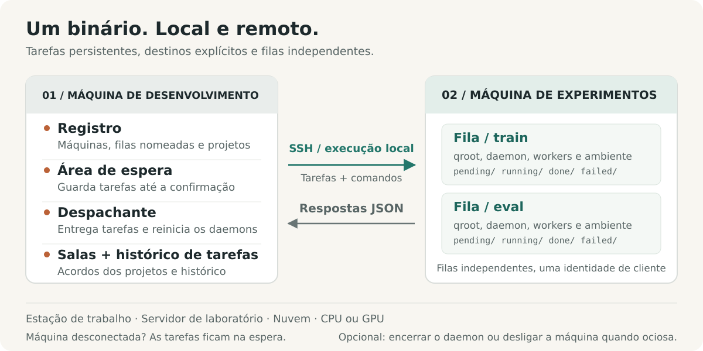

# shunt

[English](../../../README.md) · [Français](../fr/README.fr.md) · [Deutsch](../de/README.de.md) · [Italiano](../it/README.it.md) · [日本語](../ja/README.ja.md) · [Español](../es/README.es.md) · [한국어](../ko/README.ko.md) · [简体中文](../zh-CN/README.zh-CN.md) · [繁體中文](../zh-TW/README.zh-TW.md) · [Русский](../ru/README.ru.md) · [Bahasa Indonesia](../id/README.id.md) · **Português (BR)**


<p align="center">
  <strong>Execute experimentos. Coordene a computação.</strong><br>
  Uma camada de operações de experimentos para humanos e agentes de IA, de estações de trabalho locais a servidores remotos.
</p>

<p align="center">
  <a href="../../../Cargo.toml"></a>
  
  <a href="../../design.md#5-wire-protocol"></a>
  <a href="../../../LICENSE"></a>
</p>

<p align="center">
  <a href="#início-rápido">Início rápido</a> ·
  <a href="#como-funciona">Arquitetura</a> ·
  <a href="#coordene-computação-compartilhada">Coordenação</a> ·
  <a href="#feito-para-agents">Guia do agent</a> ·
  <a href="../../design.md">Especificação de design</a> ·
  <a href="#contribuindo">Contribuindo</a>
</p>

Experimentos abrangem projetos, máquinas, ambientes e sessões de longa duração. O shunt traz esse trabalho para uma única CLI: registre máquinas, vincule projetos a queues, prepare e execute tarefas, inspecione seus resultados e uso de recursos, e coordene as pessoas e os agents que compartilham a computação.

Use o mesmo fluxo numa estação de trabalho local, num servidor de laboratório ou numa instância de nuvem com CPU ou GPU. Um único binário Rust roda nos dois lados, com SSH para máquinas remotas e execução direta de processos localmente. Tarefas, logs e estado da queue vivem em disco. Metadados de billing e desligamento por inatividade são ferramentas opcionais para máquinas que precisam deles.

## Por que shunt

| Quando você precisa…                          | o shunt oferece…                                                                                                                                                                                |
| --------------------------------------------- | ----------------------------------------------------------------------------------------------------------------------------------------------------------------------------------------------- |
| **Trabalhar em várias máquinas e projetos**   | Um registry TOML, bindings de projeto muitos-para-muitos, diretórios de trabalho e ambientes por binding, e transporte SSH ou local.                                                            |
| **Separar fluxos de trabalho numa máquina**   | Queues nomeadas com diretórios, daemons, pools de workers, shells e configuração de ambiente independentes sob uma única identidade de client.                                                  |
| **Enviar antes de a máquina estar acessível** | Um spool persistente na máquina dev. O dispatcher entrega quando a máquina volta e reativa um daemon de queue parado antes de enviar.                                                           |
| **Manter os experimentos avançando**          | Workers concorrentes, ordem de reivindicação FIFO, prioridade manual, redimensionamento do pool em tempo real, timeouts de tarefa e reagendamento limitado opcional para contenção de recursos. |
| **Saber o que uma execução realmente usou**   | Disponibilidade de máquina e GPU, picos de RAM e VRAM por tarefa, tempo de CPU e estimativas de recursos declaradas lado a lado com o uso medido.                                               |
| **Coordenar computação compartilhada**        | Salas de coordenação de projeto com rastreamento de não lidas, acordos registrados, resumos de conversa e arquivamento.                                                                         |
| **Recuperar e inspecionar**                   | Execução pelo menos uma vez, recuperação de órfãos, guards de artefato, desduplicação de entrega, logs de tarefa, um ledger de submissões e streams de eventos.                                 |
| **Operar por meio de um agent**               | A mesma CLI com status em JSON, listagens de tarefas em JSONL, um skill de operação incluído e um canal de feedback persistente.                                                                |

Os controles de máquina incluem execução SSH gerenciada, bootstrap e upgrade, um proxy reverso SOCKS5 opcional, saída do daemon ao drenar e desligamento por inatividade opcional. Máquinas compartilhadas podem recusar explicitamente o armamento de poweroff pelo lado do servidor.

## Início rápido

### 1. Instalação

Use Linux com uma toolchain Rust estável, um linker de sistema e Bash. A operação remota também precisa das ferramentas OpenSSH (`ssh`, `scp` e `ssh-keygen`) na máquina dev.

```bash
curl -fsSL https://raw.githubusercontent.com/ShinoharaHaruna/shunt/main/install.sh | sh
shunt --help
```

O script instala o binário da release mais recente (build estático musl, dashboard incluído) em `~/.local/bin`; passe `--gnu` para o build com vinculação dinâmica, `--dir` para um local diferente, ou `uninstall` para remover o binário. Para um build a partir do código-fonte com a toolchain Rust:

```bash
git clone https://github.com/ShinoharaHaruna/shunt.git
cd shunt
cargo install --path . --locked
shunt --help
```

### 2. Experimente a queue localmente

O client `localhost` embutido usa o mesmo protocolo da CLI por meio de execução local de processos. Você pode percorrer todo o caminho spool → dispatcher → queue sem SSH nem GPU:

```bash
# A tarefa cria um marcador de conclusão no diretório da queue local.
shunt submit -c localhost --slug hello --guard hello.done -- touch hello.done
shunt dispatch --once
shunt status -c localhost --json
shunt logs -c localhost hello

# Ao terminar os testes, drene o daemon local e encerre-o.
shunt stop --root ~/.config/shunt/queue
```

A execução é assíncrona: repita `status` ou `logs` após um momento para ver o resultado. A queue local padrão é `~/.config/shunt/queue/`; esta demo deixa `hello.done` lá, então repeti-la pula a tarefa já concluída. `stop` drena as tarefas em execução do daemon; o desligamento por inatividade é uma operação separada, ativada só por opção.

### 3. Conecte uma máquina de experimentos

Execute estes comandos na sua máquina dev para um servidor Linux já acessível. Substitua os caminhos de exemplo por diretórios que você possui nessa máquina. Esta configuração reutiliza uma chave SSH autorizada e trata o servidor como compartilhado:

```bash
shunt client add lab --template generic \
    --key ~/.ssh/id_ed25519 --deploy-root /path/you/own \
    --qroot /path/you/own/shunt-queue \
    --shared --exit-on-idle --expire unlimited

# Preencha ssh.host, ssh.port e ssh.user do seu servidor.
${EDITOR:-vi} ~/.config/shunt/clients/lab.toml

shunt client bootstrap lab

shunt project add experiments
shunt project bind experiments --client lab \
    --workdir /path/to/experiments --env OMP_NUM_THREADS=4 --env MKL_NUM_THREADS=4
```

`--shared` bloqueia o armamento do desligamento por inatividade pelo lado do servidor; `--exit-on-idle` permite que o daemon da queue saia após drenar e seja reativado pelo próximo dispatch. Omita essas flags quando quiser uma máquina dedicada com daemon residente. `expire = "unlimited"` descreve uma máquina própria ou de laboratório; máquinas de nuvem podem usar `"metered"` ou um prazo de assinatura, com taxas de billing opcionais.

O bootstrap instala o binário sob a raiz da queue, verifica a compatibilidade de runtime, inicializa a queue, inicia o daemon e sonda os fatos da máquina. Ele pode baixar um release estático correspondente quando o build local exige uma glibc mais nova; outras arquiteturas ou builds ainda não publicados podem precisar de um `--bin-path` explícito. Veja [compatibilidade de binários](../../design.md#15-binary-compatibility-at-bootstrap).

Para uma instância de nuvem dedicada, templates de fornecedor como `--template autodl` preenchem padrões de implantação. Sem `--key`, o shunt gera um par de chaves dedicado: instale você mesmo a chave pública, ou configure `ssh.password` e instale `sshpass` para implantação assistida por senha numa máquina dedicada. Clients compartilhados pulam a implantação automática de chaves.

O `workdir` do binding já deve conter seu código, dados e ambiente de execução. O bootstrap implanta o shunt; o binding de projeto registra onde seus experimentos rodam.

### 4. Envie e inspecione um experimento

Supondo que seu `train.py` grava `runs/exp1/metrics.json` ao concluir com sucesso:

```bash
shunt submit -p experiments -c lab --slug exp1 \
    --guard runs/exp1/metrics.json --timeout 14400 -- \
    uv run python train.py --out runs/exp1

shunt dispatch --once               # entregue o spool atual
shunt status -c lab --json           # inspecione o estado da queue e o uso de recursos
shunt logs -c lab exp1               # inspecione o log da tarefa
```

Mantenha `shunt dispatch` rodando em outro terminal da máquina dev para entrega contínua, incluindo tarefas enviadas enquanto a máquina está offline. Após a entrega, o daemon de queue da própria máquina executa a tarefa independentemente do dispatcher ou do terminal que a enviou.

`--timeout 14400` define um limite de quatro horas de tempo decorrido (wall-clock) para esta tarefa. `--guard` verifica um caminho relativo ao `workdir` do binding e pula a execução se ele já existir. `uv` e `train.py` são dependências do workload de exemplo; use o comando que seu projeto precisar.

## Como funciona



O nome vem das manobras ferroviárias (shunting). Sua máquina dev é o pátio de manobras; cada máquina de experimento é um desvio de destino. Um **client** é uma máquina registrada; uma **queue** é uma pista de execução nela; um **project binding** fornece o diretório de trabalho e o ambiente para um par `(client, queue)`.

| Na sua máquina dev                                                                                    | Em cada máquina de experimento                                                                                    |
| ----------------------------------------------------------------------------------------------------- | ----------------------------------------------------------------------------------------------------------------- |
| **Registry** — TOML editável para clients, queues, projetos, bindings e billing opcional.             | **Queues** — diretórios de tarefa sob `pending/`, `running/`, `done/` e `failed/`.                                |
| **Spool e dispatcher** — preparam tarefas até a confirmação, entregam-nas e reativam daemons parados. | **Daemons** — um por queue, com workers concorrentes, logs, amostragem de uso e recuperação de órfãos.            |
| **Ledger de tarefas e salas** — rastreiam submissões e mantêm o histórico de coordenação do projeto.  | **Ambientes de tarefa** — configuração e shell da queue, definições do binding de projeto e overrides por tarefa. |

### Projetos e queues nomeadas

Separe treinamento, avaliação ou projetos diferentes numa máquina sem registrar identidades SSH duplicadas:

```bash
shunt queue add eval -c lab --qroot /path/you/own/shunt-eval \
    --workers 2 --exit-on-idle
shunt queue bootstrap eval -c lab
shunt project bind experiments --client lab --queue eval \
    --workdir /path/to/experiments --env OMP_NUM_THREADS=2 --env MKL_NUM_THREADS=2
shunt submit -p experiments -c lab --queue eval --slug eval1 \
    --guard runs/eval1.json -- python evaluate.py --out runs/eval1.json
shunt status -c lab --queue eval --json
```

Cada queue possui seu próprio qroot, espaço de sequência, pool de workers, daemon, binário, shell e configuração de ambiente. A seleção de queue é `--queue` → `default_queue` configurada → única queue; uma escolha não resolvida falha com erro de ambiguidade. Tarefas preparadas fixam sua queue e qroot, então mudar o padrão nunca redireciona trabalho já enviado.

Configure `env_setup` e `shell` numa queue para ativação de ambiente ou exports compartilhados, depois envie-os com `shunt queue env <name> -c lab`; `shunt client env lab` atualiza todas as queues. Overlays de ambiente de projeto e por tarefa permitem que uma queue atenda a vários workloads.

O transporte é `ssh <machine> 'shunt <cmd> --json'`. Não é preciso serviço HTTP nem conexão reversa à máquina dev. O mesmo binário oferece transporte local direto para `localhost` e clients adicionais de `client add --local`.

### Uma queue que você pode inspecionar


Cada tarefa é um diretório chamado `NNNN_<slug>`. Ele contém `task.sh` e acumula um `log`, um registro `pid` ao vivo, o `usage` medido e um código `exit` final. As transições de queue usam renames no sistema de arquivos. O número de workers é relido a cada poll, então redimensionar não exige reinício; reduzi-lo deixa as tarefas atuais terminarem. As tarefas rodam em grupos de processo separados, com verificações de identidade registradas antes do envio de sinais.

**A execução é pelo menos uma vez.** IDs de tarefa gerados pelo servidor desduplicam reenvios entre as faixas ativas da queue, mas a recuperação do daemon ou uma entrega fora dessa janela de desduplicação ainda pode causar uma reexecução. Um guard é uma verificação de existência antes da execução, então publique o artefato protegido somente quando ele representar trabalho concluído e torne reexecuções seguras. Ele não fornece execução exatamente-uma-vez nem trava contra tentativas sobrepostas. Veja o [contrato do guard](../../design.md#313-task-file-format-and-the-guard-contract) e o [template de tarefa](../../../task_template.sh).

## Experimentos com estimativa de recursos

Declare estimativas, defina um orçamento de tempo decorrido e permita uma retentativa limitada quando os recursos estiverem temporariamente indisponíveis:

```bash
shunt submit -p experiments -c lab --slug exp2 \
    --guard runs/exp2/metrics.json --timeout 14400 \
    --retry 2 --retry-delay 60 --ram-mb 8192 --cpu-cores 4 --gpu-mem-mb 4096 \
    --env CUDA_VISIBLE_DEVICES=0 --env OMP_NUM_THREADS=4 --env MKL_NUM_THREADS=4 -- \
    uv run python train.py --out runs/exp2
shunt status -c lab --json
```

`--retry 2` permite duas tentativas extras para o código de saída 75 (`EX_TEMPFAIL`, um sinal de recurso ocupado) ou uma assinatura reconhecida de falta de memória no log. Cada uma espera pelo menos `--retry-delay` segundos antes de voltar a ser reivindicável. Outras falhas e timeouts continuam falhas; retentativas exigem um orçamento explícito.

O status emparelha estimativas declaradas com o pico amostrado de RAM por tarefa, o pico de VRAM por GPU e os segundos cumulativos de CPU. Ele também reporta memória e utilização atuais de GPU, RAM do host e load; sondagens da máquina fornecem fatos de capacidade cientes de cgroup. A telemetria de GPU usa `nvidia-smi` quando disponível. A amostragem pode perder processos de vida curta ou picos breves.

**Estimativas são anotações, não reservas de recurso nem verificações de admissão.** Você ou seu agent escolhem o destino, o número de workers e a atribuição de GPU. Tarefas só de CPU usam a mesma queue sem flags de GPU. Veja [telemetria de recursos](../../design.md#316-resource-declarations-and-usage-telemetry).

## Coordene computação compartilhada

Quando projetos compartilham uma máquina, seus agents precisam de um lugar para combinar limites de workers, orçamentos de memória ou alocação de GPU. As salas de coordenação mantêm essa conversa e o acordo vigente ao lado do registry:

```bash
# Suponha que experiments e analysis são projetos registrados.
shunt room ls --as experiments          # salas, contagens de não lidas, grupos sugeridos
shunt room create shared-compute --members experiments,analysis --clients lab
shunt room say shared-compute --as experiments \
    --body "Training needs GPU 0 until 18:00; can evaluation use GPU 1?"
shunt room read shared-compute --as analysis
shunt room decide shared-compute --as analysis \
    --note "Training uses GPU 0; evaluation uses GPU 1 with two workers."
shunt status --all --json --as experiments
```

As salas têm membership de projetos, posições de não lidas por identidade e uma decisão vigente. `room ls` sugere grupos de projetos vinculados à mesma máquina. Conversas longas podem ser compactadas em resumos dentro do fluxo, mantendo as mensagens arquivadas para leitura por intervalo; salas inteiras podem ser arquivadas e restauradas.

As salas vivem numa máquina dev e podem abranger seus clients registrados. Agents que compartilham esse registry podem consultá-las antes de alterar a computação compartilhada. Os acordos passam a valer quando os participantes os aplicam com comandos como `workers` ou `submit --env`; as salas não impõem agendamento nem alocação de recursos. Veja [salas de coordenação](../../design.md#17-coordination-rooms-server-side).

## Controles do dia a dia

Execute estes comandos na máquina dev. Exemplos específicos de client usam o client registrado `lab`; adicione `--queue eval` para mirar a queue nomeada.

| Intenção                                             | Comando                                               |
| ---------------------------------------------------- | ----------------------------------------------------- |
| Ver todas as máquinas, queues e salas                | `shunt status --all --json`                           |
| Ver submissões aguardando entrega                    | `shunt spool ls`                                      |
| Inspecionar uma tarefa enviada pelo ID               | `shunt task show <id> --json`                         |
| Ler o stream de eventos de tarefa do servidor        | `shunt task events`                                   |
| Redimensionar o pool de workers                      | `shunt workers 4 -c lab`                              |
| Mover uma tarefa pending para o início               | `shunt prio exp1 0 -c lab`                            |
| Cancelar uma tarefa pending                          | `shunt cancel exp1 -c lab`                            |
| Parar o grupo de processos de uma tarefa em execução | `shunt kill exp1 -c lab`                              |
| Drenar e parar o daemon de uma queue                 | `shunt queue stop eval -c lab`                        |
| Atualizar os fatos da máquina                        | `shunt client probe lab`                              |
| Listar as queues de uma máquina                      | `shunt queue ls -c lab`                               |
| Executar um comando ad hoc via SSH gerenciado        | `shunt client exec lab -- nvidia-smi`                 |
| Atualizar um endpoint SSH que mudou                  | `shunt client update lab --host <host> --port <port>` |
| Limpar uma chave de host e conexão obsoletas         | `shunt client hostkey lab`                            |
| Abrir o proxy reverso SOCKS5 opcional                | `shunt tunnel up -c lab`                              |
| Gerar completions de shell                           | `shunt completions zsh`                               |
| Inspecionar versão e build locais                    | `shunt version --json`                                |
| Verificar se há um novo release                      | `shunt upgrade --check --json`                        |
| Atualizar o binário local                            | `shunt upgrade`                                       |
| Atualizar o binário de uma queue remota              | `shunt upgrade -c lab --queue eval`                   |

Patterns de controle de tarefa como `exp1` devem identificar uma única tarefa; use o nome completo da entrada de tarefa quando um pattern for ambíguo. O ledger de tarefas mapeia um ID de submissão para esse nome de entrada. `task show` consulta a máquina sob demanda para resolver um resultado; uma entrada fora da janela de status recente pode aparecer como `unknown`.

Upgrades verificam checksums de release e a versão do binário antes da instalação. Um daemon remoto em execução mantém sua versão carregada até você drenar e reiniciá-lo com `queue stop` / `queue start`; substituir o binário deixa o trabalho atual rodando. Upgrades de releases pré-compilados atualmente visam Linux x86_64.

Use `shunt <command> --help` para as flags e a [referência da CLI](../../design.md#10-cli-surface) para a superfície completa. Comandos de queue como `status` e `logs` também funcionam diretamente numa máquina com `--root <qroot>`.

### Desligamento opcional por inatividade

Para uma máquina dedicada que você quer desligada após um lote, ative explicitamente com `shunt shutdown -c <client> on`; use `off` para desarmar e `status` para inspecionar o comando resolvido. A queue só inicia a contagem regressiva depois de drenar, e trabalho novo cancela a contagem. O servidor faz pré-verificação das queues irmãs registradas ao armar; o gate de runtime da máquina verifica daemons ativos sob a mesma conta Unix. Um client `shared` recusa o armamento pelo lado do servidor.

Para uma estação de trabalho ou servidor compartilhado que deve permanecer ligado, use `exit_on_idle` para encerrar apenas o daemon, ou mantenha-o residente para o próximo lote. A demo local e o início rápido de servidor compartilhado não precisam de configuração de gerenciamento de energia.

## Feito para agents

A CLI também é a interface do agent. O status da queue e as consultas ao ledger de tarefas expõem JSON ou JSONL estruturados; logs de tarefa e de daemon fornecem o detalhe por trás desses estados. Fatos da máquina, recursos ao vivo, uso declarado versus medido e contagens de não lidas das salas dão aos agents contexto para escolher um destino, dimensionar um lote e negociar computação compartilhada. Taxas de billing e metadados de expiração configurados acrescentam contexto quando a máquina tem custo ou prazo.

O [skill shunt](../../../skills/shunt/SKILL.md) incluído ensina configuração, submissões com guard, interpretação de queues, coordenação, tratamento de falhas e operação opcional ciente de custo. Aponte seu agent para ele antes de gerenciar máquinas de experimento.

Instale o skill ligando `skills/shunt/` ao diretório onde seu agent carrega skills:

```bash
ln -s "$PWD/skills/shunt" ~/.agents/skills/shunt   # diretório agentskills compartilhado
# ou: cp -r skills/shunt ~/.claude/skills/shunt   # skills de usuário do Claude Code
# ou: cp -r skills/shunt .claude/skills/          # local ao projeto
```

```bash
shunt task ls --json
shunt status --all --json --as experiments
shunt task show <id> --json
```

O shunt expõe fatos e executa comandos explícitos. Escolher uma máquina, aplicar acordos de recursos, decidir se uma execução cabe no orçamento e provisionar ou ligar máquinas permanecem com o humano ou o fluxo de agente ao redor.

Quando um agent encontra um defeito ou aresta do shunt, `shunt feedback "title" --body "…"` registra isso como issue no GitHub. O canal de feedback remove credenciais conhecidas do registry e nomes registrados de clients, projetos e queues, salva um relatório local antes da entrega, desduplica repetições e aplica um limite por hora. Pré-visualize com `--dry-run`; inspecione relatórios pendentes com `feedback ls --json` e reenvie com `feedback retry`. Os relatórios são públicos por padrão, e o limpador não reconhece todo segredo arbitrário. Veja [feedback](../../design.md#14-feedback-channel).

## Limites de operação

- **Tarefas independentes e posicionamento explícito.** Não há grafo de dependências, seleção automática de máquina nem balanceamento de carga entre máquinas; cada submissão mira um client e uma queue. Declarações de recursos e decisões de sala não reservam hardware nem isolam tenants.
- **Recuperação limitada.** Falhas de recurso ocupado ou falta de memória reconhecida só podem reagendar com um orçamento de retentativa declarado. Falhas fora desses critérios, timeouts e retentativas esgotadas caem em `failed/`; inspecione os logs e reenvie quando apropriado. A recuperação de órfãos após reinício do daemon é separada.
- **Coordenação local.** As salas servem agents que compartilham um registry na máquina dev. Elas fornecem um registro de coordenação consultado por polling, sem mensagens entre registries, notificações push nem controle de acesso imposto entre participantes.
- **Poweroff opcional.** O desligamento por inatividade usa um comando configurável e um período de tolerância, 60 segundos por padrão. Queues gerenciadas vazias não comprovam que outros usuários ou workloads não gerenciados estejam ociosos. Verifique o comando de desligamento da sua máquina; o shunt não controla as regras de billing do fornecedor. Um enqueue que dispute com a verificação final de poweroff ainda pode perder para o desligamento.
- **Implantação explícita.** O binding de projeto registra caminhos e ambiente; não sincroniza código-fonte, não provisiona dependências nem cria o workdir remoto.

A implementação em Rust cobre o registry, queues nomeadas, spool, dispatcher, transportes SSH e local, telemetria de tarefas, salas de coordenação, tunnel, upgrade, feedback e o daemon de queue do client. Está em desenvolvimento ativo; [docs/design.md](../../design.md) define o contrato comportamental e seus casos de borda.

## Contribuindo

Comece pela [especificação de design](../../design.md) e o [guia do repositório](../../../AGENTS.md). Para uma mudança de comportamento da queue, atualize o contrato e cubra a transição ou o caso de falha relevante.

```bash
just setup       # habilite os hooks Git versionados
just fmt         # formate Rust, Markdown, TOML e JSON
just check       # verificação de formato + clippy (-D warnings) + testes
```

Instale `just` e `dprint` para essas receitas; a formatação Rust e o Clippy vêm da toolchain configurada. Os hooks verificam formatação antes do commit e rodam Clippy antes do push. Eles nunca reescrevem arquivos; a suíte de testes completa roda via `just check` ou `just test`.

### Lançamentos

Envie uma tag SemVer como `v0.1.0` (ou `0.1.0`) no commit a lançar. A versão, sem o prefixo `v` opcional, deve corresponder a `package.version` no `Cargo.toml`; atualize também o `Cargo.lock` com a mudança de versão. O commit tagueado deve incluir [o workflow de release](../../../.github/workflows/release.yml).

```bash
git tag -a v0.1.0 -m "Release v0.1.0"
git push origin v0.1.0
```

O workflow verifica formatação, roda Clippy e testes para ambos os targets, e então publica um GitHub Release com notas geradas, arquivos de binários Linux x86_64 musl (estático) e GNU, e arquivos `SHA256SUMS-<target>` por target. Tags com sufixo de pré-release, como `v0.2.0-rc.1`, criam pré-releases. Usa o `GITHUB_TOKEN` embutido; nenhum secret adicional é necessário. Releases publicados não são sobrescritos em reexecuções.

| Comece por aqui                                  | Para…                                                                                 |
| ------------------------------------------------ | ------------------------------------------------------------------------------------- |
| [Especificação de design](../../design.md)       | Semântica da queue, protocolo de transporte, telemetria, salas e estratégia de testes |
| [Skill do agent](../../../skills/shunt/SKILL.md) | Manual de operação para um agent de IA                                                |
| [Templates de fornecedor](../../../etc/vendors/) | Padrões de client AutoDL e genérico                                                   |
| [Template de tarefa](../../../task_template.sh)  | Escrever um script de tarefa com guard                                                |
| [Testes de integração](../../../tests/)          | Comportamento de queue, processo, desligamento e dispatch                             |

## Licença

[MIT](../../../LICENSE).
