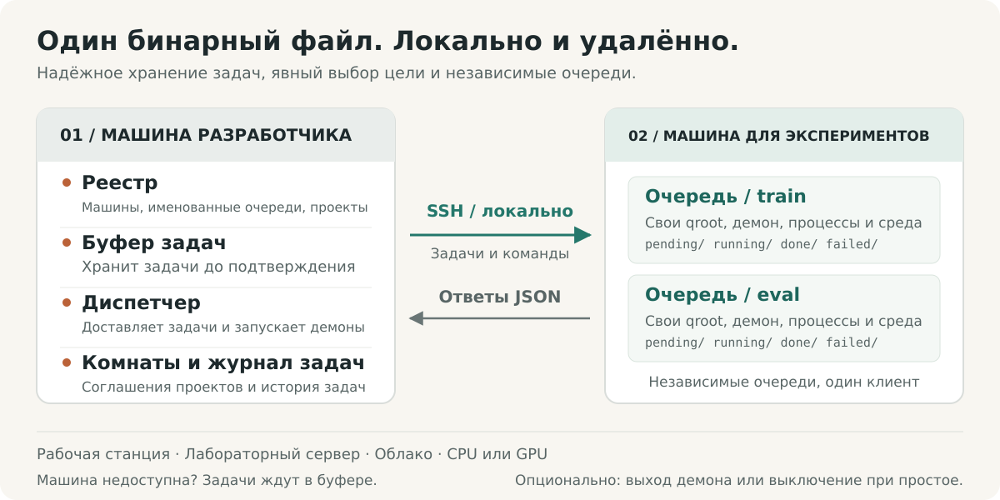
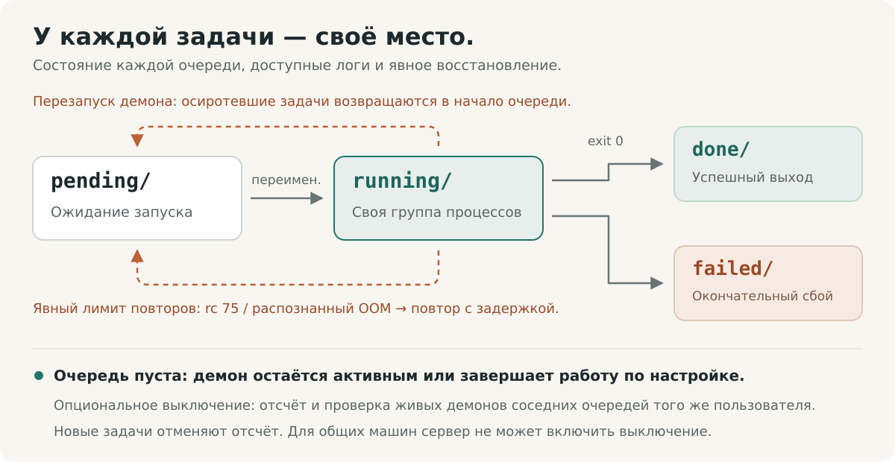

# shunt

[English](../../../README.md) · [Français](../fr/README.fr.md) · [Deutsch](../de/README.de.md) · [Italiano](../it/README.it.md) · [日本語](../ja/README.ja.md) · [Español](../es/README.es.md) · [한국어](../ko/README.ko.md) · [简体中文](../zh-CN/README.zh-CN.md) · [繁體中文](../zh-TW/README.zh-TW.md) · **Русский** · [Bahasa Indonesia](../id/README.id.md) · [Português (BR)](../pt-BR/README.pt-BR.md)


<p align="center">
  <strong>Запускайте эксперименты. Координируйте вычисления.</strong><br>
  Слой управления экспериментами для людей и AI-агентов — от локальных рабочих станций до удалённых серверов.
</p>

<p align="center">
  <a href="../../../Cargo.toml"></a>
  
  <a href="../../design.md#5-wire-protocol"></a>
  <a href="../../../LICENSE"></a>
</p>

<p align="center">
  <a href="#быстрый-старт">Быстрый старт</a> ·
  <a href="#как-это-работает">Архитектура</a> ·
  <a href="#координация-общих-вычислений">Координация</a> ·
  <a href="#создано-для-агентов">Руководство для агентов</a> ·
  <a href="../../design.md">Спецификация</a> ·
  <a href="#как-внести-вклад">Как внести вклад</a>
</p>

Эксперименты охватывают множество проектов, машин, окружений и длительных сеансов. shunt собирает всю эту работу в один CLI: регистрация машин, привязка проектов к очередям, подготовка и запуск задач, просмотр результатов и использования ресурсов, а также координация людей и агентов, совместно использующих вычислительные ресурсы.

Один и тот же рабочий процесс применим к локальной рабочей станции, лабораторному серверу или облачному инстансу с CPU или GPU. Один бинарный файл Rust работает на обеих сторонах: удалённые машины обслуживаются через SSH, локально используется прямой запуск процессов. Задачи, логи и состояние очередей хранятся на диске. Метаданные биллинга и выключение при простое — опциональные возможности для машин, которым они нужны.

## Зачем shunt

| Когда вам нужно…                               | shunt предоставляет…                                                                                                                                                                    |
| ---------------------------------------------- | --------------------------------------------------------------------------------------------------------------------------------------------------------------------------------------- |
| **Работать на нескольких машинах и проектах**  | TOML-registry, привязки проектов «многие-ко-многим», отдельные рабочие каталоги и окружения для каждой привязки, а также SSH- или локальный транспорт.                                  |
| **Разделить рабочие процессы на одной машине** | Именованные очереди с независимыми каталогами, демонами, пулами воркеров, shell и настройкой окружения в рамках одной клиентской идентичности.                                          |
| **Отправлять задачи до доступности машины**    | Постоянный spool на стороне dev-машины. Dispatcher доставляет задачи, когда машина возвращается, и перед отправкой перезапускает остановленный демон очереди.                           |
| **Непрерывно продвигать эксперименты**         | Параллельные воркеры, порядок захвата FIFO, ручные приоритеты, изменение размера пула на лету, тайм-ауты задач и опциональное ограниченное перепланирование при конкуренции за ресурсы. |
| **Узнать, сколько реально использовал запуск** | Доступность машины и GPU, пиковые значения RAM и VRAM по каждой задаче, время CPU, а также заявленные оценки ресурсов рядом с измеренным потреблением.                                  |
| **Координировать общие вычисления**            | Координационные комнаты проектов с отслеживанием непрочитанного, записанными договорённостями, дайджестами диалогов и архивацией.                                                       |
| **Восстанавливать и инспектировать**           | Выполнение не менее одного раза, восстановление осиротевших задач, guard'ы артефактов, дедупликация доставки, логи задач, журнал отправок и потоки событий.                             |
| **Управлять через агента**                     | Тот же CLI со статусом в JSON, списками задач в JSONL, прилагаемым skill для эксплуатации и постоянным каналом обратной связи.                                                          |

Управление машинами включает выполнение команд через управляемый SSH, bootstrap и обновление, опциональный обратный SOCKS5-прокси, выход демона после опустошения и включаемое явно выключение при простое. Общие машины могут явно отклонять взведение выключения со стороны server.

## Быстрый старт

### 1. Установка

Требуются Linux со стабильным toolchain Rust, системный компоновщик и Bash. Для удалённой работы на dev-машине также нужны инструменты OpenSSH (`ssh`, `scp` и `ssh-keygen`).

```bash
curl -fsSL https://raw.githubusercontent.com/ShinoharaHaruna/shunt/main/install.sh | sh
shunt --help
```

Скрипт устанавливает бинарный файл последнего релиза (статическая сборка musl, dashboard включён) в `~/.local/bin`; передайте `--gnu` для динамически слинкованной сборки, `--dir` для другого расположения или `uninstall` для удаления бинарного файла. Для сборки из исходного кода с помощью toolchain Rust вместо этого:

```bash
git clone https://github.com/ShinoharaHaruna/shunt.git
cd shunt
cargo install --path . --locked
shunt --help
```

### 2. Локальное испытание очереди

Встроенный клиент `localhost` использует тот же протокол CLI через локальный запуск процессов. Вы можете пройти весь путь spool → dispatcher → очередь без SSH и GPU:

```bash
# Задача создаёт маркер завершения в каталоге локальной очереди.
shunt submit -c localhost --slug hello --guard hello.done -- touch hello.done
shunt dispatch --once
shunt status -c localhost --json
shunt logs -c localhost hello

# По окончании экспериментов дождитесь опустошения локального демона и выхода.
shunt stop --root ~/.config/shunt/queue
```

Выполнение асинхронно: повторите `status` или `logs` через некоторое время, чтобы увидеть результат. Локальная очередь по умолчанию — `~/.config/shunt/queue/`; эта демонстрация оставляет в ней `hello.done`, поэтому при повторе выполненная задача пропускается. `stop` дожидается опустошения запущенных задач демона; выключение при простое — отдельная опциональная операция.

### 3. Подключение экспериментальной машины

Выполните эти команды на dev-машине для уже доступного Linux-сервера. Замените примеры путей каталогами, которыми вы владеете на этой машине. В этой настройке повторно используется авторизованный SSH-ключ, а сервер считается общим:

```bash
shunt client add lab --template generic \
    --key ~/.ssh/id_ed25519 --deploy-root /path/you/own \
    --qroot /path/you/own/shunt-queue \
    --shared --exit-on-idle --expire unlimited

# Укажите ssh.host, ssh.port и ssh.user вашего сервера.
${EDITOR:-vi} ~/.config/shunt/clients/lab.toml

shunt client bootstrap lab

shunt project add experiments
shunt project bind experiments --client lab \
    --workdir /path/to/experiments --env OMP_NUM_THREADS=4 --env MKL_NUM_THREADS=4
```

`--shared` запрещает взведение выключения при простое со стороны server; `--exit-on-idle` позволяет демону очереди завершаться после опустошения и перезапускаться при следующем dispatch. Опустите эти флаги, если хотите выделенную машину с постоянно работающим демоном. `expire = "unlimited"` описывает собственную или лабораторную машину; облачные машины могут вместо этого использовать `"metered"` или срок окончания подписки с опциональными тарифами.

Bootstrap устанавливает бинарный файл в корень очереди, проверяет совместимость среды выполнения, инициализирует очередь, запускает демон и опрашивает сведения о машине. Если локальная сборка требует более новой glibc, он может скачать подходящий статический релиз; для других архитектур или неопубликованных сборок может понадобиться явный `--bin-path`. См. [совместимость бинарных файлов](../../design.md#15-binary-compatibility-at-bootstrap).

Для выделенного облачного инстанса шаблоны вендоров, например `--template autodl`, задают параметры развёртывания по умолчанию. Без `--key` shunt генерирует выделенную пару ключей: установите её открытый ключ самостоятельно или настройте `ssh.password` и установите `sshpass` для развёртывания с помощью пароля на выделенной машине. Общие клиенты пропускают автоматическое развёртывание ключей.

`workdir` привязки уже должен содержать ваш код, данные и среду выполнения. Bootstrap развёртывает shunt; привязка проекта фиксирует, где выполняются ваши эксперименты.

### 4. Отправка и проверка эксперимента

Предположим, ваш `train.py` при успешном завершении записывает `runs/exp1/metrics.json`:

```bash
shunt submit -p experiments -c lab --slug exp1 \
    --guard runs/exp1/metrics.json --timeout 14400 -- \
    uv run python train.py --out runs/exp1

shunt dispatch --once               # доставить текущий spool
shunt status -c lab --json           # посмотреть состояние очереди и использование ресурсов
shunt logs -c lab exp1               # посмотреть лог задачи
```

Держите `shunt dispatch` запущенным в отдельном терминале dev-машины для непрерывной доставки, включая задачи, отправленные, пока машина была офлайн. После доставки собственный демон очереди машины выполняет задачу независимо от dispatcher и терминала отправки.

`--timeout 14400` задаёт для задачи предел в четыре часа астрономического времени. `--guard` проверяет путь относительно `workdir` привязки и пропускает выполнение, если он уже существует. `uv` и `train.py` — зависимости примера нагрузки; используйте команду, необходимую вашему проекту.

## Как это работает



Название происходит от железнодорожной сортировки (shunting). Ваша dev-машина — сортировочная станция; каждая экспериментальная машина — тупиковый путь назначения. **Клиент** — зарегистрированная машина; **очередь** — одна исполнительная колея на ней; **привязка проекта** задаёт рабочий каталог и окружение для пары `(client, queue)`.

| На вашей dev-машине                                                                                                  | На каждой экспериментальной машине                                                                                              |
| -------------------------------------------------------------------------------------------------------------------- | ------------------------------------------------------------------------------------------------------------------------------- |
| **Registry** — редактируемый TOML для клиентов, очередей, проектов, привязок и опционального биллинга.               | **Очереди** — каталоги задач в `pending/`, `running/`, `done/` и `failed/`.                                                     |
| **Spool и dispatcher** — готовят задачи до подтверждения приёма, доставляют их и перезапускают остановленные демоны. | **Демоны** — по одному на очередь, с параллельными воркерами, логами, выборкой потребления и восстановлением осиротевших задач. |
| **Журнал задач и комнаты** — отслеживают отправки и хранят историю координации проектов.                             | **Окружения задач** — настройка очереди и shell, параметры привязки проекта и переопределения на уровне задачи.                 |

### Проекты и именованные очереди

Разделяйте обучение, оценку или разные проекты на одной машине без регистрации дублирующих SSH-идентичностей:

```bash
shunt queue add eval -c lab --qroot /path/you/own/shunt-eval \
    --workers 2 --exit-on-idle
shunt queue bootstrap eval -c lab
shunt project bind experiments --client lab --queue eval \
    --workdir /path/to/experiments --env OMP_NUM_THREADS=2 --env MKL_NUM_THREADS=2
shunt submit -p experiments -c lab --queue eval --slug eval1 \
    --guard runs/eval1.json -- python evaluate.py --out runs/eval1.json
shunt status -c lab --queue eval --json
```

Каждая очередь владеет своими qroot, пространством нумерации, пулом воркеров, демоном, бинарным файлом, shell и настройкой окружения. Выбор очереди: `--queue` → настроенный `default_queue` → единственная очередь; неразрешимый выбор завершается ошибкой неоднозначности. Подготовленные задачи фиксируют свою очередь и qroot, поэтому смена умолчания никогда не перенаправляет уже отправленную работу.

Настройте `env_setup` и `shell` в очереди для активации окружения или общих переменных, затем отправьте их командой `shunt queue env <name> -c lab`; `shunt client env lab` обновляет все очереди. Оверлеи окружения на уровне проекта и задачи позволяют одной очереди обслуживать несколько нагрузок.

Протокол обмена — `ssh <machine> 'shunt <cmd> --json'`. HTTP-сервис и обратное подключение к dev-машине не требуются. Тот же бинарный файл поддерживает прямой локальный транспорт для `localhost` и дополнительных клиентов `client add --local`.

### Очередь, которую можно проверить



Каждая задача — каталог с именем `NNNN_<slug>`. Он содержит `task.sh` и накапливает `log`, актуальную запись `pid`, измеренное `usage` и итоговый код `exit`. Переходы очереди выполняются переименованиями в файловой системе. Число воркеров перечитывается при каждом опросе, поэтому изменение размера пула не требует перезапуска; при уменьшении текущие задачи завершаются. Задачи выполняются в отдельных группах процессов, перед отправкой сигнала проверяется записанная идентичность.

**Выполнение — не менее одного раза.** Сгенерированные server идентификаторы задач дедуплицируют повторную доставку в пределах активных каталогов очереди, но восстановление демона или доставка за пределами окна дедупликации всё ещё может вызвать повторный запуск. Guard — это проверка существования перед выполнением, поэтому публикуйте защищаемый артефакт только когда он представляет завершённую работу, и делайте повторные запуски безопасными. Он не обеспечивает выполнение ровно один раз и не является блокировкой от перекрывающихся попыток. См. [контракт guard](../../design.md#313-task-file-format-and-the-guard-contract) и [шаблон задачи](../../../task_template.sh).

## Эксперименты с учётом ресурсов

Заявляйте оценки, задавайте бюджет астрономического времени и разрешайте ограниченное число повторных попыток при временной недоступности ресурсов:

```bash
shunt submit -p experiments -c lab --slug exp2 \
    --guard runs/exp2/metrics.json --timeout 14400 \
    --retry 2 --retry-delay 60 --ram-mb 8192 --cpu-cores 4 --gpu-mem-mb 4096 \
    --env CUDA_VISIBLE_DEVICES=0 --env OMP_NUM_THREADS=4 --env MKL_NUM_THREADS=4 -- \
    uv run python train.py --out runs/exp2
shunt status -c lab --json
```

`--retry 2` разрешает две дополнительные попытки при коде выхода 75 (`EX_TEMPFAIL`, сигнал занятости ресурсов) или распознанной сигнатуре нехватки памяти в логе. Каждая ждёт не менее `--retry-delay` секунд, прежде чем стать доступной для захвата. Прочие сбои и тайм-ауты остаются сбоями; повторные попытки требуют явного бюджета.

`status` сопоставляет заявленные оценки с выборочными пиковыми значениями RAM по каждой задаче, пиковой VRAM по каждому GPU и накопленными секундами CPU. Он также сообщает текущую память и загрузку GPU, RAM хоста и нагрузку; опросы машины дают сведения о ёмкости с учётом cgroup. Телеметрия GPU при наличии использует `nvidia-smi`. Выборка может пропустить короткоживущие процессы или краткие пики.

**Оценки — это аннотации, а не резервирование ресурсов и не проверки допуска.** Цель, число воркеров и распределение GPU выбираете вы или ваш агент. Задачи только на CPU используют ту же очередь без флагов GPU. См. [телеметрию ресурсов](../../design.md#316-resource-declarations-and-usage-telemetry).

## Координация общих вычислений

Когда проекты делят одну машину, их агентам нужно место, чтобы договориться об ограничениях воркеров, бюджетах памяти или размещении на GPU. Координационные комнаты хранят этот диалог и текущую договорённость рядом с registry:

```bash
# Предположим, что experiments и analysis — зарегистрированные проекты.
shunt room ls --as experiments          # комнаты, счётчики непрочитанного, предложенные группы
shunt room create shared-compute --members experiments,analysis --clients lab
shunt room say shared-compute --as experiments \
    --body "Training needs GPU 0 until 18:00; can evaluation use GPU 1?"
shunt room read shared-compute --as analysis
shunt room decide shared-compute --as analysis \
    --note "Training uses GPU 0; evaluation uses GPU 1 with two workers."
shunt status --all --json --as experiments
```

У комнат есть членство проектов, позиции непрочитанного для каждой идентичности и текущее решение. `room ls` предлагает группы проектов, привязанных к одной машине. Длинные диалоги можно сжимать в дайджесты внутри потока, сохраняя архивированные сообщения для чтения по диапазонам; целые комнаты можно архивировать и восстанавливать.

Комнаты живут на одной dev-машине и могут охватывать её зарегистрированных клиентов. Агенты, разделяющие этот registry, могут опрашивать их перед изменением общих вычислений. Договорённости вступают в силу, когда участники применяют их командами вроде `workers` или `submit --env`; комнаты не принуждают к расписанию или распределению ресурсов. См. [координационные комнаты](../../design.md#17-coordination-rooms-server-side).

## Повседневные операции

Эти команды выполняются на dev-машине. В примерах для конкретного клиента используется зарегистрированный клиент `lab`; добавьте `--queue eval`, чтобы адресовать именованную очередь.

| Намерение                                            | Команда                                               |
| ---------------------------------------------------- | ----------------------------------------------------- |
| Показать все машины, очереди и комнаты               | `shunt status --all --json`                           |
| Показать отправки, ожидающие доставки                | `shunt spool ls`                                      |
| Проверить отправленную задачу по её ID               | `shunt task show <id> --json`                         |
| Читать поток событий задач на server                 | `shunt task events`                                   |
| Изменить размер пула воркеров                        | `shunt workers 4 -c lab`                              |
| Переместить задачу pending в начало                  | `shunt prio exp1 0 -c lab`                            |
| Отменить задачу pending                              | `shunt cancel exp1 -c lab`                            |
| Остановить группу процессов выполняемой задачи       | `shunt kill exp1 -c lab`                              |
| Опустошить и остановить один демон очереди           | `shunt queue stop eval -c lab`                        |
| Обновить сведения о машине                           | `shunt client probe lab`                              |
| Перечислить очереди на машине                        | `shunt queue ls -c lab`                               |
| Выполнить произвольную команду через управляемый SSH | `shunt client exec lab -- nvidia-smi`                 |
| Обновить перемещённую конечную точку SSH             | `shunt client update lab --host <host> --port <port>` |
| Очистить устаревший ключ хоста и соединение          | `shunt client hostkey lab`                            |
| Открыть опциональный обратный SOCKS5-прокси          | `shunt tunnel up -c lab`                              |
| Сгенерировать автодополнения shell                   | `shunt completions zsh`                               |
| Показать локальную версию и сборку                   | `shunt version --json`                                |
| Проверить наличие нового релиза                      | `shunt upgrade --check --json`                        |
| Обновить локальный бинарный файл                     | `shunt upgrade`                                       |
| Обновить бинарный файл одной удалённой очереди       | `shunt upgrade -c lab --queue eval`                   |

Шаблоны управления задачами вроде `exp1` должны идентифицировать одну задачу; при неоднозначности используйте полное имя записи задачи. Журнал задач сопоставляет ID отправки с этим именем записи. `task show` лениво опрашивает машину для определения исхода; запись за пределами окна недавнего статуса может отображаться как `unknown`.

Обновления проверяют контрольные суммы релиза и версию бинарного файла перед установкой. Работающий удалённый демон сохраняет загруженную версию, пока вы не опустошите и не перезапустите его через `queue stop` / `queue start`; замена бинарного файла не останавливает текущую работу. Обновления из готовых релизов в настоящее время предназначены для Linux x86_64.

Используйте `shunt <command> --help` для флагов и [справочник CLI](../../design.md#10-cli-surface) для полного списка. Команды очереди вроде `status` и `logs` также работают непосредственно на машине с `--root <qroot>`.

### Опциональное выключение при простое

Для выделенной машины, которую нужно выключить после пакета работ, явно включите режим командой `shunt shutdown -c <client> on`; используйте `off` для снятия с взвода и `status` для просмотра разрешённой команды. Очередь начинает обратный отсчёт только после опустошения, а новая работа отменяет его. При взведении server выполняет предварительную проверку зарегистрированных соседних очередей; проверка на машине во время выполнения проверяет живых демонов под той же учётной записью Unix. Клиент `shared` отклоняет взведение со стороны server.

Для рабочей станции или общего сервера, которые должны оставаться включёнными, используйте `exit_on_idle`, чтобы завершать только демон, или держите его постоянно запущенным для следующего пакета. Локальная демонстрация и быстрый старт с общим сервером не требуют настройки управления питанием.

## Создано для агентов

CLI — это также интерфейс для агентов. Статус очереди и запросы к журналу задач выдают структурированный JSON или JSONL; логи задач и демонов дают детали за этими состояниями. Сведения о машине, текущие ресурсы, сопоставление заявленного и измеренного потребления, а также счётчики непрочитанного в комнатах дают агентам контекст для выбора цели, определения размера пакета и согласования общих вычислений. Настроенные тарифы биллинга и метаданные о сроках добавляют контекст, когда у машины есть стоимость или дедлайн.

Прилагаемый [skill shunt](../../../skills/shunt/SKILL.md) обучает настройке, отправкам с guard, интерпретации очередей, координации, обработке сбоев и опциональной работе с учётом стоимости. Направьте на него своего агента перед управлением экспериментальными машинами.

Установите skill, связав `skills/shunt/` с каталогом, откуда ваш агент загружает skills:

```bash
ln -s "$PWD/skills/shunt" ~/.agents/skills/shunt   # общий каталог agentskills
# или: cp -r skills/shunt ~/.claude/skills/shunt   # skill уровня пользователя Claude Code
# или: cp -r skills/shunt .claude/skills/          # на уровне проекта
```

```bash
shunt task ls --json
shunt status --all --json --as experiments
shunt task show <id> --json
```

shunt предоставляет факты и выполняет явные команды. Выбор машины, применение договорённостей о ресурсах, решение о том, укладывается ли запуск в бюджет, а также выделение и включение машин остаются за человеком или окружающим рабочим процессом агента.

Когда агент сталкивается с дефектом shunt или шероховатостью, `shunt feedback "title" --body "…"` оформляет это как issue на GitHub. Канал обратной связи вычищает известные учётные данные registry и зарегистрированные имена клиентов, проектов и очередей, сохраняет локальный отчёт перед доставкой, дедуплицирует повторы и применяет часовой лимит. Предпросмотр — `--dry-run`; просмотр ожидающих отчётов — `feedback ls --json`, повторная доставка — `feedback retry`. Отчёты по умолчанию публичны, а скрабер не может распознать произвольный секрет. См. [канал обратной связи](../../design.md#14-feedback-channel).

## Границы эксплуатации

- **Независимые задачи и явное размещение.** Нет графа зависимостей, автоматического выбора машины или балансировки нагрузки между машинами; каждая отправка адресует клиента и очередь. Декларации ресурсов и решения комнат не резервируют оборудование и не изолируют арендаторов.
- **Ограниченное восстановление.** Сбои из-за занятости ресурсов или распознанной нехватки памяти могут перепланироваться только при заявленном бюджете повторов. Сбои вне этих критериев, тайм-ауты и исчерпанные повторы попадают в `failed/`; просмотрите логи и отправьте заново, когда уместно. Восстановление осиротевших задач после перезапуска демона — отдельный механизм.
- **Локальная координация.** Комнаты обслуживают агентов, разделяющих один registry на dev-стороне. Они предоставляют опрашиваемую запись координации без обмена сообщениями между registry, push-уведомлений или принудительного контроля доступа между участниками.
- **Выключение по явному согласию.** Выключение при простое использует настраиваемую команду и период отсрочки — по умолчанию 60 секунд. Пустые управляемые очереди не гарантируют, что другие пользователи или неуправляемые нагрузки простаивают. Проверьте, что команда выключения подходит вашей машине; shunt не контролирует правила биллинга вендоров. Постановка в очередь, конкурирующая с финальной проверкой перед выключением, всё ещё может проиграть выключению.
- **Явное развёртывание.** Привязка проекта фиксирует пути и окружение; она не синхронизирует исходный код, не устанавливает зависимости и не создаёт удалённый workdir.

Реализация на Rust охватывает registry, именованные очереди, spool, dispatcher, SSH- и локальный транспорты, телеметрию задач, координационные комнаты, tunnel, обновления, обратную связь и демон очереди клиента. Проект активно развивается; [docs/design.md](../../design.md) определяет поведенческий контракт и его граничные случаи.

## Как внести вклад

Начните со [спецификации](../../design.md) и [руководства по репозиторию](../../../AGENTS.md). При изменении поведения очереди обновите контракт и покройте соответствующий переход или случай сбоя.

```bash
just setup       # включить версионируемые хуки Git
just fmt         # форматировать Rust, Markdown, TOML и JSON
just check       # проверка формата + clippy (-D warnings) + тесты
```

Для этих рецептов установите `just` и `dprint`; форматирование Rust и Clippy берутся из настроенного toolchain. Хуки проверяют форматирование перед коммитом и запускают Clippy перед push. Они никогда не перезаписывают файлы; полный набор тестов запускается через `just check` или `just test`.

### Релизы

Поставьте SemVer-тег, например `v0.1.0` (или `0.1.0`), на коммит релиза и отправьте его. Версия без опционального префикса `v` должна совпадать с `package.version` в `Cargo.toml`; при изменении версии обновите также `Cargo.lock`. Коммит с тегом должен содержать [workflow релиза](../../../.github/workflows/release.yml).

```bash
git tag -a v0.1.0 -m "Release v0.1.0"
git push origin v0.1.0
```

Workflow проверяет форматирование, запускает Clippy и тесты для обеих целей, затем публикует GitHub Release со сгенерированными заметками, архивами бинарных файлов Linux x86_64 musl (статическими) и GNU, а также файлами `SHA256SUMS-<target>` для каждой цели. Теги с суффиксом предрелиза, например `v0.2.0-rc.1`, создают предрелизы. Используется встроенный `GITHUB_TOKEN`; дополнительные секреты не нужны. Опубликованные релизы при повторных запусках не перезаписываются.

| Начните здесь                                      | Для…                                                                              |
| -------------------------------------------------- | --------------------------------------------------------------------------------- |
| [Спецификация](../../design.md)                    | Семантика очередей, протокол обмена, телеметрия, комнаты и стратегия тестирования |
| [Skill для агента](../../../skills/shunt/SKILL.md) | Руководство по эксплуатации для AI-агента                                         |
| [Шаблоны вендоров](../../../etc/vendors/)          | Параметры клиентов по умолчанию для AutoDL и generic                              |
| [Шаблон задачи](../../../task_template.sh)         | Написание скрипта задачи с guard                                                  |
| [Интеграционные тесты](../../../tests/)            | Поведение очередей, процессов, выключения и доставки                              |

## Лицензия

[MIT](../../../LICENSE).
