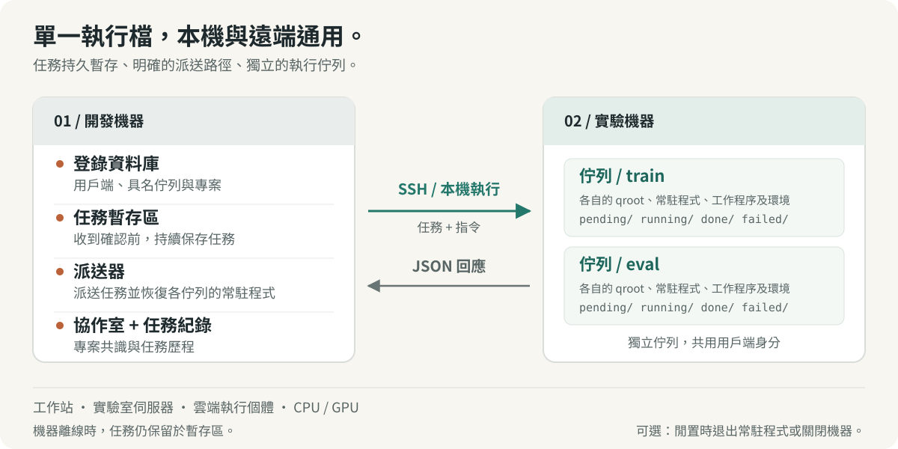
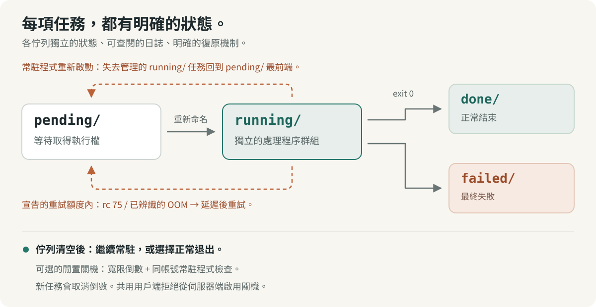

# shunt

[English](../../../README.md) · [Français](../fr/README.fr.md) · [Deutsch](../de/README.de.md) · [Italiano](../it/README.it.md) · [日本語](../ja/README.ja.md) · [Español](../es/README.es.md) · [한국어](../ko/README.ko.md) · [简体中文](../zh-CN/README.zh-CN.md) · **繁體中文** · [Русский](../ru/README.ru.md) · [Bahasa Indonesia](../id/README.id.md) · [Português (BR)](../pt-BR/README.pt-BR.md)


<p align="center">
  <strong>執行實驗，協調算力。</strong><br>
  面向人與 AI agent 的實驗運作管理層，從本機工作站到遠端伺服器。
</p>

<p align="center">
  <a href="../../../Cargo.toml"></a>
  
  <a href="../../design.md#5-wire-protocol"></a>
  <a href="../../../LICENSE"></a>
</p>

<p align="center">
  <a href="#快速上手">快速上手</a> ·
  <a href="#運作方式">架構</a> ·
  <a href="#協調共享算力">協作</a> ·
  <a href="#面向-agent">Agent 指南</a> ·
  <a href="../../design.md">設計規格</a> ·
  <a href="#參與貢獻">參與貢獻</a>
</p>

實驗往往橫跨多個專案、機器、環境與長時間執行的工作階段。shunt 將這些工作整合到一個 CLI：註冊機器、將專案綁定到佇列、暫存並執行任務、檢視結果與資源用量，以及協調共享算力的人與 agent。

無論本機工作站、實驗室伺服器，還是雲端 CPU 或 GPU 執行個體，都可以使用同一套工作流程。同一個 Rust 執行檔運作在兩端：遠端機器透過 SSH 操作，本機直接執行程序。任務、記錄與佇列狀態都保存在磁碟上。計費中繼資料與閒置關機是按需啟用的輔助功能。

## 為什麼選擇 shunt

| 當你需要……                         | shunt 提供……                                                                                                   |
| ---------------------------------- | -------------------------------------------------------------------------------------------------------------- |
| **跨機器、跨專案工作**             | TOML registry、多對多專案綁定、每條綁定獨立的工作目錄與環境，以及 SSH 或本機 transport。                       |
| **在同一台機器上區分不同工作流程** | 同一個 client 身分下的具名佇列，各自擁有獨立目錄、守護程式、worker 池、shell 與環境初始化設定。                |
| **機器尚未連線就先提交任務**       | 開發機上持久化的 spool；機器恢復可連線後 dispatcher 自動投遞，推送前會重新啟動已停止的佇列守護程式。           |
| **讓實驗持續推進**                 | 並行 worker、FIFO 領取順序、手動優先順序、執行中調整池大小、任務逾時，以及明確開啟且次數有限的資源爭用重排程。 |
| **了解一次執行實際用了多少資源**   | 機器與 GPU 的可用狀態、每個任務的 RAM 與 VRAM 峰值、CPU 時間，以及並列展示的資源宣告與實測用量。               |
| **協調共享算力**                   | 專案協作房間，支援未讀追蹤、協定記錄、對話摘要與封存。                                                         |
| **復原與排查**                     | 至少一次執行、孤兒任務復原、產物 guard、投遞去重、任務記錄、提交台帳與事件串流。                               |
| **透過 agent 操作**                | 同一套 CLI，提供 JSON 狀態、JSONL 任務清單、隨附的操作 skill，以及持久化回饋管道。                             |

機器管理還包括受管 SSH 指令執行、bootstrap 與升級、可選的反向 SOCKS5 代理、佇列排空後退出守護程式，以及明確開啟的閒置關機。共享機器可以明確拒絕從 server 端開啟關機。

## 快速上手

### 1. 安裝

需要 Linux、stable Rust 工具鏈、系統連結器與 Bash。遠端操作還需要開發機上裝有 OpenSSH 工具（`ssh`、`scp` 與 `ssh-keygen`）。

```bash
curl -fsSL https://raw.githubusercontent.com/ShinoharaHaruna/shunt/main/install.sh | sh
shunt --help
```

此腳本會將最新 release 執行檔（靜態 musl 建置，內含儀表板）安裝到 `~/.local/bin`；傳入 `--gnu` 改用動態連結建置、`--dir` 指定其他安裝位置，或 `uninstall` 移除執行檔。若要改用 Rust 工具鏈從原始碼建置：

```bash
git clone https://github.com/ShinoharaHaruna/shunt.git
cd shunt
cargo install --path . --locked
shunt --help
```

### 2. 在本機試用佇列

內建的 `localhost` client 透過本機程序執行同一套 CLI 協定。不需要 SSH 或 GPU，就能走完 spool → dispatcher → 佇列的完整路徑：

```bash
# 該任務會在本機佇列目錄中建立一個完成標記。
shunt submit -c localhost --slug hello --guard hello.done -- touch hello.done
shunt dispatch --once
shunt status -c localhost --json
shunt logs -c localhost hello

# 試用結束後，讓本機守護程式等待執行中的任務完成再退出。
shunt stop --root ~/.config/shunt/queue
```

執行是非同步的：稍等片刻再重複 `status` 或 `logs` 檢視結果。預設本機佇列是 `~/.config/shunt/queue/`；這個示範會在裡面留下 `hello.done`，所以重複執行會跳過已完成的任務。`stop` 會等待守護程式中正在執行的任務完成；閒置關機是另一項需要明確開啟的獨立操作。

### 3. 接入一台實驗機器

在開發機上執行以下指令，接入一台已可連線的 Linux 伺服器。將範例路徑換成你在該機器上有權限使用的目錄。本例重用已授權的 SSH 金鑰，並將伺服器標記為共享機器：

```bash
shunt client add lab --template generic \
    --key ~/.ssh/id_ed25519 --deploy-root /path/you/own \
    --qroot /path/you/own/shunt-queue \
    --shared --exit-on-idle --expire unlimited

# 填入伺服器的 ssh.host、ssh.port 與 ssh.user。
${EDITOR:-vi} ~/.config/shunt/clients/lab.toml

shunt client bootstrap lab

shunt project add experiments
shunt project bind experiments --client lab \
    --workdir /path/to/experiments --env OMP_NUM_THREADS=4 --env MKL_NUM_THREADS=4
```

`--shared` 阻止從 server 端開啟閒置關機；`--exit-on-idle` 讓佇列守護程式在排空後退出，並在下次投遞時重新啟動。如果你使用專用機器並希望守護程式常駐，可以省略這兩個參數。`expire = "unlimited"` 適用於自有或實驗室機器；雲端機器也可以使用 `"metered"` 或訂閱到期時間，並按需設定計費費率。

Bootstrap 將執行檔安裝到佇列根目錄下、檢查執行環境相容性、初始化佇列、啟動守護程式並探測機器資訊。如果本機建置需要較新的 glibc，它可以取得對應版本的靜態 release；其他架構或尚未發佈的建置可能需要明確指定 `--bin-path`。參見[二進位相容性](../../design.md#15-binary-compatibility-at-bootstrap)。

對於專用的雲端執行個體，`--template autodl` 等廠商範本可預填部署預設值。不指定 `--key` 時，shunt 會產生專用金鑰對：你可以自行安裝公開金鑰；也可以在專用機器上設定 `ssh.password` 並安裝 `sshpass`，用密碼輔助部署。共享 client 會跳過自動金鑰部署。

綁定的 `workdir` 必須已經包含你的程式碼、資料與執行環境。Bootstrap 部署 shunt 本體；專案綁定記錄實驗在哪裡執行。

### 4. 提交並檢視實驗

假設你的 `train.py` 成功結束後會寫出 `runs/exp1/metrics.json`：

```bash
shunt submit -p experiments -c lab --slug exp1 \
    --guard runs/exp1/metrics.json --timeout 14400 -- \
    uv run python train.py --out runs/exp1

shunt dispatch --once               # 投遞目前的 spool
shunt status -c lab --json           # 檢視佇列狀態與資源用量
shunt logs -c lab exp1               # 檢視任務記錄
```

在開發機的另一個終端機裡讓 `shunt dispatch` 持續執行，即可持續投遞，包括機器離線期間提交的任務。投遞成功後，機器自己的佇列守護程式獨立執行任務，不再依賴 dispatcher 或提交任務的終端機。

`--timeout 14400` 為任務設定四小時的實際經過時間上限。`--guard` 檢查相對於綁定 `workdir` 的路徑，已存在則跳過執行。`uv` 與 `train.py` 是範例工作負載的依賴，換成你專案需要的指令即可。

## 運作方式



名字來自鐵路調車（shunting）。開發機是調車場，每台實驗機器是一條目的地側線。**Client** 是註冊的機器；**queue** 是機器上的一條執行通道；**專案綁定**為 `(client, queue)` 對提供工作目錄與環境。

| 開發機上                                                                                | 每台實驗機器上                                                                |
| --------------------------------------------------------------------------------------- | ----------------------------------------------------------------------------- |
| **Registry** —— 可手動編輯的 TOML 檔案，記錄 client、佇列、專案、綁定與可選的計費資訊。 | **佇列** —— `pending/`、`running/`、`done/`、`failed/` 下的任務目錄。         |
| **Spool 與 dispatcher** —— 暫存任務直到確認收到、投遞任務，並重新啟動已停止的守護程式。 | **守護程式** —— 每條佇列一個，支援並行 worker、記錄、用量取樣與孤兒任務復原。 |
| **任務台帳與房間** —— 追蹤提交並保留專案協作歷史。                                      | **任務環境** —— 佇列的初始化設定與 shell、專案綁定設定，以及任務層級覆寫。    |

### 專案與具名佇列

在同一台機器上區分訓練、評估或不同專案，無需重複註冊 SSH 身分：

```bash
shunt queue add eval -c lab --qroot /path/you/own/shunt-eval \
    --workers 2 --exit-on-idle
shunt queue bootstrap eval -c lab
shunt project bind experiments --client lab --queue eval \
    --workdir /path/to/experiments --env OMP_NUM_THREADS=2 --env MKL_NUM_THREADS=2
shunt submit -p experiments -c lab --queue eval --slug eval1 \
    --guard runs/eval1.json -- python evaluate.py --out runs/eval1.json
shunt status -c lab --queue eval --json
```

每條佇列各自擁有 qroot、序號空間、worker 池、守護程式、執行檔、shell 與環境初始化設定。佇列選擇順序為 `--queue` → 設定的 `default_queue` → 唯一佇列；仍無法唯一確定時會回報歧義錯誤。已暫存的任務固定在提交時選定的佇列與 qroot，之後改變預設值不會讓它們改投。

在佇列上設定 `env_setup` 與 `shell`，用於啟用環境或設定共享環境變數，再用 `shunt queue env <name> -c lab` 推送；`shunt client env lab` 更新所有佇列。專案與任務層級的環境覆寫讓一條佇列也能服務多種工作負載。

通訊鏈路就是 `ssh <machine> 'shunt <cmd> --json'`。無需 HTTP 服務，也不需要機器反向連回開發機。同一個執行檔還為 `localhost` 與透過 `client add --local` 加入的其他 client 提供直接的本機 transport。

### 可以直接檢查的佇列



每個任務是一個名為 `NNNN_<slug>` 的目錄，包含 `task.sh`，並逐漸累積 `log`、即時 `pid` 記錄、實測 `usage` 與最終的 `exit` 碼。佇列透過檔案系統 rename 遷移狀態。每次輪詢都會重新讀取 worker 數量，調整池大小無需重新啟動；減少 worker 時，會讓目前的任務完成。任務執行在獨立程序群組中，傳送訊號前會核對記錄的程序身分。

**執行語意是至少一次。** Server 產生的任務 ID 可以對仍在佇列各狀態目錄中的重複投遞去重，但守護程式復原或超出去重窗口的投遞仍可能觸發重跑。Guard 是執行前的存在性檢查，因此只有當產物代表已完成的工作時才發佈它，並確保重跑安全。它不提供恰好一次執行，也不是防止重疊執行的鎖。參見 [guard 契約](../../design.md#313-task-file-format-and-the-guard-contract) 與[任務範本](../../../task_template.sh)。

## 感知資源的實驗執行

宣告資源估算值、設定執行時間預算，並允許資源暫時不可用時進行有限重試：

```bash
shunt submit -p experiments -c lab --slug exp2 \
    --guard runs/exp2/metrics.json --timeout 14400 \
    --retry 2 --retry-delay 60 --ram-mb 8192 --cpu-cores 4 --gpu-mem-mb 4096 \
    --env CUDA_VISIBLE_DEVICES=0 --env OMP_NUM_THREADS=4 --env MKL_NUM_THREADS=4 -- \
    uv run python train.py --out runs/exp2
shunt status -c lab --json
```

`--retry 2` 允許在結束碼為 75（`EX_TEMPFAIL`，表示資源忙碌）或記錄檔符合已辨識的記憶體不足特徵時，再嘗試兩次。每次至少等待 `--retry-delay` 秒，任務才可重新被領取。其他失敗與逾時仍按失敗處理；重試必須明確宣告次數預算。

Status 將資源宣告與取樣得到的每個任務 RAM 峰值、各 GPU 的 VRAM 峰值及累計 CPU 秒數並列展示，同時回報目前 GPU 顯示記憶體與使用率、主機 RAM 與負載；機器探測提供考慮 cgroup 限額的容量資訊。GPU 遙測在可用時使用 `nvidia-smi`。取樣可能漏掉短暫存活的程序或瞬間峰值。

**資源估算是註記，不會保留資源，也不執行准入檢查。** 目標機器、worker 數量與 GPU 分配由你或 agent 決定。純 CPU 任務使用同一套佇列，無需 GPU 參數。參見[資源遙測](../../design.md#316-resource-declarations-and-usage-telemetry)。

## 協調共享算力

多個專案共享機器時，各自的 agent 需要一個地方約定 worker 上限、記憶體預算或 GPU 分配。協作房間將對話及其目前協定保存在 registry 旁：

```bash
# 假設 experiments 與 analysis 已註冊為專案。
shunt room ls --as experiments          # 房間、未讀數與建議分組
shunt room create shared-compute --members experiments,analysis --clients lab
shunt room say shared-compute --as experiments \
    --body "Training needs GPU 0 until 18:00; can evaluation use GPU 1?"
shunt room read shared-compute --as analysis
shunt room decide shared-compute --as analysis \
    --note "Training uses GPU 0; evaluation uses GPU 1 with two workers."
shunt status --all --json --as experiments
```

房間記錄專案成員、各身分的未讀位置與目前決議。`room ls` 會建議將綁定到同一台機器的專案分組。長對話可以壓縮成訊息流中的摘要，同時保留已封存訊息，供依範圍讀取；整個房間也可以封存與還原。

房間保存在一台開發機上，可關聯其註冊的多個 client。共享該 registry 的 agent 可以在調整共享算力前輪詢房間。參與者透過 `workers` 或 `submit --env` 等指令落實約定後，協定才會生效；房間本身不強制執行排程或資源分配。參見[協作房間](../../design.md#17-coordination-rooms-server-side)。

## 日常操作

以下指令在開發機上執行。針對具體 client 的範例使用已註冊的 `lab`；加上 `--queue eval` 即可指定具名佇列。

| 意圖                         | 指令                                                  |
| ---------------------------- | ----------------------------------------------------- |
| 檢視所有機器、佇列與房間     | `shunt status --all --json`                           |
| 檢視等待投遞的提交           | `shunt spool ls`                                      |
| 按 ID 檢視已提交的任務       | `shunt task show <id> --json`                         |
| 讀取 server 端的任務事件串流 | `shunt task events`                                   |
| 調整 worker 池大小           | `shunt workers 4 -c lab`                              |
| 將 pending 任務移到佇列前端  | `shunt prio exp1 0 -c lab`                            |
| 取消 pending 任務            | `shunt cancel exp1 -c lab`                            |
| 暫停 pending 任務直到放行    | `shunt hold exp1 -c lab "waiting on lease"`           |
| 放行已暫停的 pending 任務    | `shunt release exp1 -c lab`                           |
| 停止執行中任務的程序群組     | `shunt kill exp1 -c lab`                              |
| 排空並停止一條佇列的守護程式 | `shunt queue stop eval -c lab`                        |
| 更新機器資訊                 | `shunt client probe lab`                              |
| 列出機器上的佇列             | `shunt queue ls -c lab`                               |
| 透過受管 SSH 執行臨時指令    | `shunt client exec lab -- nvidia-smi`                 |
| 更新發生變動的 SSH 端點      | `shunt client update lab --host <host> --port <port>` |
| 清除過期的主機金鑰與連線     | `shunt client hostkey lab`                            |
| 開啟可選的反向 SOCKS5 代理   | `shunt tunnel up -c lab`                              |
| 產生 shell 自動補全          | `shunt completions zsh`                               |
| 檢視本機版本與建置資訊       | `shunt version --json`                                |
| 檢查新版本                   | `shunt upgrade --check --json`                        |
| 升級本機執行檔               | `shunt upgrade`                                       |
| 升級一條遠端佇列的執行檔     | `shunt upgrade -c lab --queue eval`                   |

像 `exp1` 這樣的任務控制 pattern 必須能唯一對應一個任務；存在歧義時，使用完整的任務條目名。任務台帳將提交 ID 對應到該條目名。`task show` 按需查詢機器以確定結果；超出近期狀態窗口的條目可能顯示為 `unknown`。任務也可以在可領取之前先掛起：`--hold` 把提交留在 dev 側 spool，直到 `spool release`；`--hold-on-box` 照常投遞，但讓 box 側的條目在 `shunt release` 之前不可領取。

升級會在安裝前校驗 release 校驗碼與執行檔版本。執行中的守護程式——本機佇列的、遠端 box 的，或 `serve` 儀表板——會被 handoff 重新啟動到新安裝的執行檔上：原程序原地 re-exec，pid 不變，正在執行的任務繼續執行；已停止的守護程式則直接啟動。如果執行中的映像早於 handoff 處理器，升級只會指出這一點而不送出訊號；把該守護程式停止後再啟動（儀表板用 `serve down` + `serve up`）即可切換到新執行檔。dispatcher 沒有 pidfile，因此本機升級只會列出正在執行的 dispatcher pid——向每個 pid 送出 `SIGUSR2`，或重新啟動它。預建 release 升級目前面向 Linux x86_64。

用 `shunt <command> --help` 檢視參數，完整指令見 [CLI 參考](../../design.md#10-cli-surface)。`status`、`logs` 等佇列指令也可以加上 `--root <qroot>`，直接在機器上執行。

### 可選的閒置關機

如果希望專用機器在一批任務結束後關機，使用 `shunt shutdown -c <client> on` 明確開啟；`off` 關閉，`status` 檢視解析後的關機指令。佇列排空後才開始倒數計時，新任務會取消倒數。開啟時，server 會預檢已註冊的兄弟佇列；執行時的檢查僅涵蓋同一 Unix 帳號下仍在執行的佇列守護程式，無法證明其他使用者或未受管工作負載已閒置。標記為 `shared` 的 client 拒絕從 server 端開啟關機。

對於需要保持開機的工作站或共享伺服器，可以使用 `exit_on_idle` 僅退出守護程式，也可以讓它常駐、等待下一批任務。本機示範與共享伺服器快速上手均無需設定電源管理。

## 面向 agent

CLI 同時也是 agent 介面。佇列狀態與任務台帳查詢提供結構化 JSON 或 JSONL；任務與守護程式記錄提供這些狀態背後的細節。機器資訊、即時資源、資源宣告與實測用量對比，以及房間未讀數，為 agent 選擇目標、規劃批次任務與協商共享算力提供上下文。機器有成本或到期限制時，設定好的計費費率與到期中繼資料也會提供參考。

隨附的 [shunt skill](../../../skills/shunt/SKILL.md) 涵蓋初始化設定、帶 guard 的提交、佇列解讀、協作、失敗處理，以及可選的成本感知操作。讓 agent 管理實驗機器前，先將這個 skill 交給它。

把 `skills/shunt/` 連結到你的 agent 載入 skill 的目錄即可安裝：

```bash
ln -s "$PWD/skills/shunt" ~/.agents/skills/shunt   # 共享的 agentskills 目錄
# 或： cp -r skills/shunt ~/.claude/skills/shunt   # Claude Code 使用者層級 skill
# 或： cp -r skills/shunt .claude/skills/          # 專案層級
```

```bash
shunt task ls --json
shunt status --all --json --as experiments
shunt task show <id> --json
```

shunt 提供事實並執行明確的指令。選擇機器、落實資源協定、判斷一次執行是否符合預算，以及佈建或啟動機器，仍由人或外圍的 agent 工作流程負責。

當 agent 遇到 shunt 的缺陷或不順手之處，`shunt feedback "title" --body "…"` 會將回饋提交為 GitHub issue。回饋管道會清除 registry 中已知的憑證，以及已註冊的 client、專案與佇列名稱；先在本機儲存報告，再投遞，並透過重複去重與每小時上限限制提交。用 `--dry-run` 預覽、`feedback ls --json` 檢視待投遞報告、`feedback retry` 重新投遞。報告預設公開，清除器無法辨識任意形式的機密資訊。參見[回饋管道](../../design.md#14-feedback-channel)。

## 運作邊界

- **任務獨立，明確指定目標。** 沒有依賴圖、自動選機或多機負載平衡；每次提交都指定 client 與佇列。資源宣告與房間決議不會保留硬體或隔離租用戶。
- **復原次數有限。** 資源忙碌或已辨識的記憶體不足失敗，只有宣告了重試預算才會重新排程。不符合這些條件的失敗、逾時及重試用盡的任務進入 `failed/`；檢視記錄後視情況重新提交。守護程式重新啟動後的孤兒復原是另一回事。
- **協作限於本機 registry。** 房間服務於共享同一開發機 registry 的 agent，提供需要輪詢的協作記錄；沒有跨 registry 訊息、推播通知，也不強制執行參與者之間的存取控制。
- **關機需要明確開啟。** 閒置關機使用可設定的指令與寬限期，預設 60 秒。受管佇列為空，無法證明其他使用者或未受管工作負載已閒置。請確認關機指令適用於你的機器；shunt 不控制廠商的計費規則。與最後一次關機檢查同時發生的加入佇列請求，仍可能來不及阻止關機。
- **部署需要明確操作。** 專案綁定記錄路徑與環境；它不同步原始碼、不安裝依賴，也不建立遠端 workdir。

Rust 實作涵蓋 registry、具名佇列、spool、dispatcher、SSH 與本機 transport、任務遙測、協作房間、tunnel、升級、回饋與 client 佇列守護程式。專案仍在持續開發；[docs/design.md](../../design.md) 定義行為契約及其邊界情況。

## 參與貢獻

先讀[設計規格](../../design.md)與[儲存庫指南](../../../AGENTS.md)。改動佇列行為時，請同步更新契約，並涵蓋相關的狀態遷移或失敗情境。

```bash
just setup       # 啟用版本化的 Git hooks
just fmt         # 格式化 Rust、Markdown、TOML 與 JSON
just check       # 格式檢查 + clippy (-D warnings) + 測試
```

這些 recipe 需要安裝 `just` 與 `dprint`；Rust 格式化與 Clippy 來自設定好的工具鏈。Hooks 在提交前檢查格式、推送前執行 Clippy。它們從不改寫檔案；完整測試套件透過 `just check` 或 `just test` 執行。

### 發佈版本

在要發佈的 commit 上打一個 SemVer tag，例如 `v0.1.0`（也支援 `0.1.0`），然後推送。去掉可選的 `v` 前綴後，版本必須與 `Cargo.toml` 中的 `package.version` 一致；修改版本時也要同步更新 `Cargo.lock`。該 commit 必須包含 [release workflow](../../../.github/workflows/release.yml)。

```bash
git tag -a v0.1.0 -m "Release v0.1.0"
git push origin v0.1.0
```

Workflow 會檢查格式、執行 Clippy，並對兩個 target 執行測試；通過後發佈 GitHub Release，附帶自動產生的更新說明、Linux x86_64 musl（靜態）與 GNU 執行檔壓縮檔，以及各 target 的 `SHA256SUMS-<target>` 檔案。帶預發佈後綴的 tag（例如 `v0.2.0-rc.1`）會建立預發佈版。使用內建的 `GITHUB_TOKEN`，無需額外設定 secret。重跑不會覆寫已發佈的 release。

| 從這裡開始                                    | 用途                                     |
| --------------------------------------------- | ---------------------------------------- |
| [設計規格](../../design.md)                   | 佇列語意、通訊協定、遙測、房間與測試策略 |
| [Agent skill](../../../skills/shunt/SKILL.md) | AI agent 的操作手冊                      |
| [廠商範本](../../../etc/vendors/)             | AutoDL 與 generic 的 client 預設設定     |
| [任務範本](../../../task_template.sh)         | 撰寫帶 guard 的任務腳本                  |
| [整合測試](../../../tests/)                   | 佇列、程序、關機與投遞行為               |

## License

[MIT](../../../LICENSE)。
